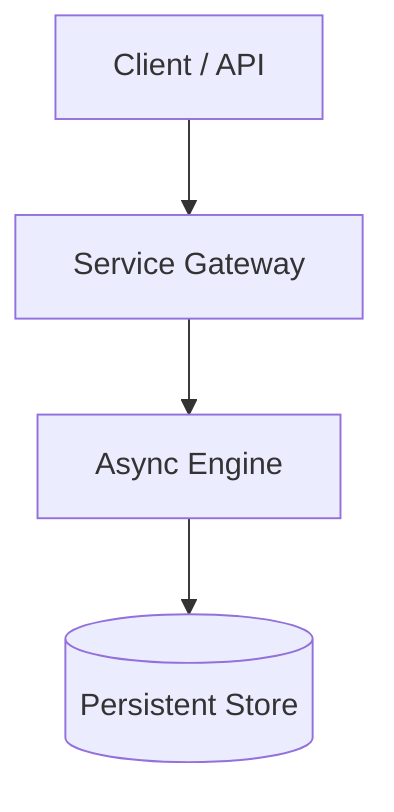

# Case Study Author Skill

Platform Engineering case studies must communicate **scale, architectural intent, developer ergonomics (DevEx), and quantifiable outcomes**. Avoid superficial tool listings.

## Standard Case Study Structure

Every case study in `docs/projects/<slug>.md` must follow this structure:

### 1. Frontmatter & Metadata Table
```markdown
---
title: "Case Study: <Project Name>"
description: "<Brief 1-sentence synopsis of architecture and impact>"
---

# <Project Name>: <Subtitle>

| Dimension | Details |
| :--- | :--- |
| **Role** | <Your Role: Sole Architect / Platform Owner / Lead Engineer> |
| **Organization / Scope** | <Company / Domain / Personal> |
| **Scale / Impact** | <e.g., 30k+ nodes, 40k ops/day, 90% MTTR reduction> |
| **Key Tech** | <Python, Celery, LangGraph, PostgreSQL, Kubernetes, etc.> |
```

### 2. The Engineering Challenge
- State the baseline operational bottleneck or business constraint.
- Explain why standard off-the-shelf tools were insufficient or why commercial licenses were rejected.

### 3. Architecture & Mermaid Diagram
Every case study must include a clear **Mermaid.js** diagram (flowchart, sequence, or class diagram):
```markdown

```

### 4. Key Architectural Trade-Offs & Decisions
- Detail 2-3 specific architectural decisions (e.g., synchronous vs asynchronous, relational vs document storage, deterministic guardrails vs unstructured output).
- Highlight how developer experience (DevEx) was improved.

### 5. Measurable Impact
- Quantify outcomes using concrete numbers (latency, cost reduction, MTTR, zero-downtime migrations).

## Checklist When Adding a New Case Study
1. Create `docs/projects/<slug>.md`.
2. Add the entry to `nav` in `mkdocs.yml` under `Projects`.
3. Add a Material grid card (`<div class="grid cards" markdown>`) to `docs/projects/index.md`, and to `docs/index.md` if it's a flagship project. Use Markdown links (`[text](file.md)`), never raw HTML `<a href="*.md">` — raw HTML links are not rewritten by MkDocs and break in production.
4. Include a "Python implementation highlights" section with a short, clearly labelled *illustrative* snippet (never proprietary code) and a trade-offs table.
5. Run `uv run mkdocs build --strict` to verify syntax and links.
