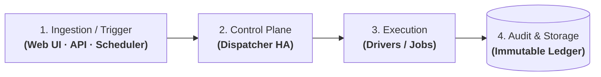

# Case Study Author Skill

Platform Engineering case studies must communicate **scale, architectural intent, developer ergonomics (DevEx), and quantifiable outcomes**. Avoid superficial tool listings or over-explanation.

All case studies must maintain **1:1 bilingual parity** between English (`docs/projects/`) and Spanish (`docs_es/projects/`).

---

## Portfolio Architectural & Editorial Standards

### 1. Naming & Organization Conventions
- **Banking Organization (Projects):** In project case studies, the target/client banking organization is always **`BBVA`** (Core Banking Infrastructure), as the systems were built for the banking entity.
- **Role Title:** Always use **`Arquitecto y Responsable de Plataforma`** (ES) or **`Architect & Platform Lead`** (EN). Never use "Arquitecto Único" or "Sole Architect".
- **Dates in Metadata:** Do **not** include project dates in the metadata tables of case studies. Keep metadata focused on Role, Organization, Scale/Outcome, and Stack.
- **Strategic Context (NextGen & Mainframe Offloading):** Orion was conceived under BBVA's **NextGen** cloud platform initiative to offload critical banking workloads from the legacy **mainframe**, evolving from on-premises datacenters (OpenStack, bare-metal) into a fully hybridized infrastructure (AWS, OpenShift, OpenStack).
- **Enterprise Confidentiality:** Enterprise case studies (BBVA / Oesia) must use **abstract architecture diagrams and high-level trade-offs only** — never publish proprietary employer code or invented/toy code snippets. Open-source case studies must link directly to real public GitHub repositories.

### 2. Regulatory Touches (DORA & Banking Compliance)
Integrate subtle, technical ("pinceladas") compliance touches regarding the **Digital Operational Resilience Act (DORA - Regulation EU 2022/2554)** and European Central Bank guidelines:
- **ICT Asset Inventory & Risk Management (Orion):** Continuous, auditable tracking of all machines, software versions, and ownership history.
- **ICT Third-Party / Vendor Concentration Risk (Blueprint):** Eliminating vendor lock-in on proprietary suites (e.g., Red Hat Ansible Automation Platform / Tower), avoiding recurring node-based licensing with cumulative cost avoidance exceeding €6M.
- **Business Continuity & Zero SPOF (Dispatcher Migration):** High availability with Django/Celery and ephemeral Kubernetes Jobs replacing fragile single points of failure.
- **ICT Incident Management & Rapid Triage (Orion AI):** Reducing MTTR from hours to seconds by correlating Orion execution logs in the Dispatcher with runbooks and GitLab diffs under deterministic guardrails.

### 3. Open-Source Projects Conventions
- **OmniLecture Studio:** Emphasize FFmpeg acoustic preprocessing for voice dictations (`afftdn`, vocal bandpass 100 Hz–4000 Hz, `silenceremove`), Whisper anti-hallucination speech filters (VAD, temperature fallback, `compression_ratio`), and **interconnected Markdown (`.md`) knowledge graphs (Obsidian-compatible with wikilinks `[[...]]`)**. **Never mention Word or `.docx`**.
- **WrenchBuddy:** Always explicitly identify as an **idea in early-stage construction / active prototype** (*idea en fase de construcción muy temprana*). Focus on unified relational + `pgvector` RAG and asynchronous Celery/Redis invoice OCR.

---

## Standard Case Study Structure

Every case study in `docs/projects/<slug>.md` and `docs_es/projects/<slug>.md` must follow this structure:

### 1. Frontmatter & Metadata Table
```markdown
---
title: "Case Study: <Project Name>"
description: "<Brief 1-sentence synopsis of architecture and impact>"
---

# <Project Name>: <Subtitle>

| Dimension | Details |
| :--- | :--- |
| **Role** | Architect & Platform Lead |
| **Organization** | BBVA (Core Banking Infrastructure) |
| **Scale / Impact** | <e.g., 30,000+ machines · 40,000+ daily operations · 500+ engineers> |
| **Stack** | <Python, Django, Celery, PostgreSQL, etc.> |

!!! abstract "Architectural summary"

    <Concise 1-paragraph summary highlighting core architecture, inputs, and engineering guarantees>
```

### 2. The Engineering Challenge / Context
- State the baseline operational bottleneck, architectural challenge, or regulatory constraint.
- Keep bullet points sharp, executive, and non-redundant.

### 3. Abstract System Topology: 1-Line Pipeline Flowchart & Table
To ensure optimal readability across mobile, tablet, and desktop, **always use a clean 1-line horizontal Mermaid flowchart (`flowchart LR`) followed by a structured step-by-step table**:

```markdown


### Step-by-Step Processing Pipeline

| Stage | Responsible Component | Exactly What Executes | Engineering Guarantee |
| :--- | :--- | :--- | :--- |
| **1. Ingestion** | ... | ... | ... |
| **2. Control Plane** | ... | ... | ... |
```
*(Avoid tall multi-column sequence diagrams or recargados multi-box subgraphs that degrade readability).*

### 4. Key Architectural Decisions
- Detail 3-4 specific architectural pillars (e.g., hybrid persistence, separation of layers, runtime variable injection, stateful graphs).
- Focus on engineering rationale rather than generic descriptions.

### 5. Architectural Trade-Offs Table
Every case study must include a clear trade-offs comparison table:
```markdown
## Architectural Trade-Offs

| Decision | Alternative Considered | Trade-Off Rationale |
| :--- | :--- | :--- |
| ... | ... | ... |
```

### 6. Measurable Operational & Business Impact
- Quantify outcomes with concrete metrics (scale, cost avoidance, MTTR reduction, zero downtime, DORA compliance readiness).

---

## Bilingual Checklist When Adding or Modifying a Case Study
1. Update/create English version: `docs/projects/<slug>.md`.
2. Update/create Spanish mirror: `docs_es/projects/<slug>.md` (translate prose and Mermaid labels; keep technical terms, commands and code unchanged).
3. Ensure 1:1 structural and anchor parity between both files.
4. Run strict dual build: `uv run zensical build -s && uv run zensical build -s -f mkdocs.es.yml`.
5. Run CV & i18n validations:
   ```bash
   python3 .agents/skills/cv-architect/scripts/validate_cv.py
   python3 .agents/skills/i18n-sync/scripts/sync_i18n.py
   ```
