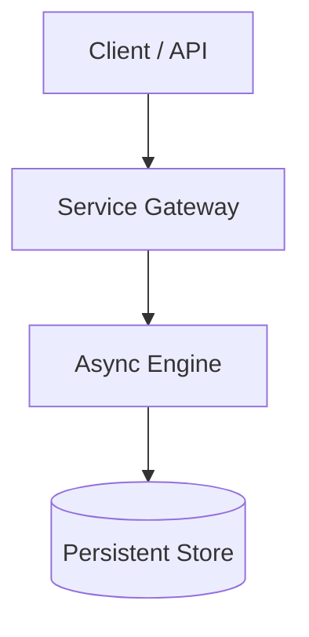

# Case Study Author Skill

Platform Engineering case studies must communicate **scale, architectural intent, developer ergonomics (DevEx), and quantifiable outcomes**. Avoid superficial tool listings.

All case studies must maintain **1:1 bilingual parity** between English (`docs/projects/`) and Spanish (`docs_es/projects/`).

---

## Standard Case Study Structure

Every case study in `docs/projects/<slug>.md` and `docs_es/projects/<slug>.md` must follow this structure:

### 1. Frontmatter & Metadata Table
```markdown
---
title: "Case Study: <Project Name>"
description: "<Brief 1-sentence synopsis of architecture and impact>"
---

# <Project Name>: <Subtitle>

| Dimension | Details |
| :--- | :--- |
| **Role** | <Your Role: Sole Architect / Platform Owner / Lead Engineer> |
| **Organization / Scope** | <Company / Domain / Personal> |
| **Scale / Impact** | <e.g., 30k+ nodes, 40k ops/day, 90% MTTR reduction> |
| **Key Tech** | <Python, Celery, LangGraph, PostgreSQL, Kubernetes, etc.> |
```

### 2. The Engineering Challenge
- State the baseline operational bottleneck or business constraint.
- Explain why standard off-the-shelf tools were insufficient or why commercial licenses were rejected.

### 3. Architecture & Mermaid Diagram
Every case study must include a clear **Mermaid.js** diagram (flowchart, sequence, or class diagram):
```markdown

```

### 4. Key Architectural Trade-Offs & Decisions
- Detail 2-3 specific architectural decisions (e.g., synchronous vs asynchronous, relational vs document storage, deterministic guardrails vs unstructured output).
- Include an explicit trade-offs comparison table.
- Highlight how developer experience (DevEx) was improved.

### 5. Python Implementation Highlights
- Include a short, clearly labelled *illustrative* Python code snippet demonstrating the key design pattern (e.g., driver factory, DAG topological sort, Pydantic guardrail).
- **Rule:** Never publish proprietary employer code; always use simplified illustrative abstractions.

### 6. Measurable Impact
- Quantify outcomes using concrete numbers (latency reduction, cost savings, MTTR drop, zero-downtime migrations).

---

## Bilingual Checklist When Adding a New Case Study
1. Create English version: `docs/projects/<slug>.md`.
2. Create Spanish mirror: `docs_es/projects/<slug>.md` (translate prose and Mermaid labels; keep technical terms, commands and code unchanged).
3. Add entries to `nav` in both `mkdocs.yml` (under `Projects`) and `mkdocs.es.yml` (under `Proyectos`).
4. Add Material grid cards (`<div class="grid cards" markdown>`) with relative Markdown links in `projects/index.md` (EN & ES), and in `index.md` if it is a flagship project. Never use raw HTML `<a href="*.md">`.
5. Check parity: `python3 .agents/skills/i18n-sync/scripts/sync_i18n.py`.
6. Preview both languages locally with `python3 serve.py` to inspect `/` and `/es/`.
7. Run strict dual build: `uv run zensical build -s && uv run zensical build -s -f mkdocs.es.yml`.
