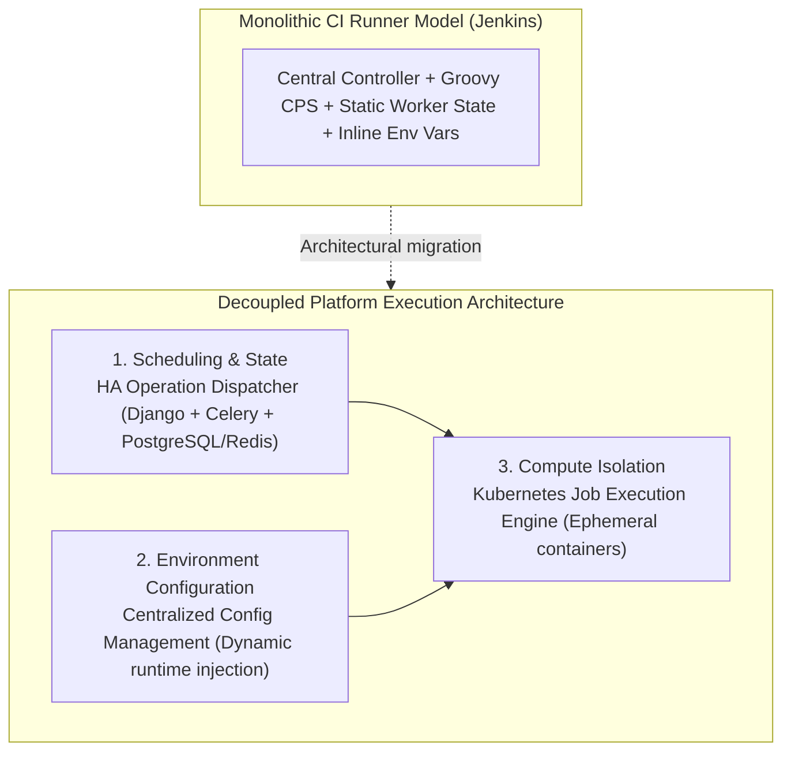

# When Shared Libraries Hit a Wall: Why We Replaced Jenkins with a Custom HA Dispatcher

Almost every growing infrastructure organization goes through the same two-act story with Jenkins.

In **Act I**, teams have dozens of copy-pasted pipelines scattered across repositories. You introduce **Jenkins Shared Libraries** in Groovy, standardize how deployments and infrastructure tasks are triggered, cut duplication, and accelerate onboarding. It feels like a decisive engineering win — and at that stage, it is.

In **Act II**, your standardization succeeds so well that hundreds of engineers and automated workflows start routing thousands of daily infrastructure operations through that shared framework. That is when you discover that **a CI server is not a distributed operation dispatcher**.

<!-- more -->

## Why Shared Libraries Were Necessary First

Before you can replace an execution engine without breaking an organization, you need a uniform contract. Building our Jenkins Shared Libraries framework forced every team onto a common interface for triggering infrastructure tasks.

More importantly, centralizing those workflows gave us the telemetry to see where the underlying runtime was failing us at banking scale:

1. **Controller state contention:** Jenkins' Groovy CPS (Continuation Passing Style) execution model serializes pipeline state back to the controller. Under heavy concurrent infrastructure workloads, the controller itself becomes a single point of contention and failure.
2. **UI-centric vs. API-first semantics:** When an internal platform (like our **Orion** control plane) needs to trigger, poll, retry, and audit tens of thousands of daily operations programmatically, scraping build numbers and console outputs is a fragile abstraction.
3. **Configuration drift on static workers:** Long-running agent VMs inevitably accumulate leftover state, credential caches, and conflicting package versions across executions.

## Separating What Jenkins Bundles Together

When we designed the migration away from Jenkins, the core architectural insight was that Jenkins bundles three concerns that should be strictly decoupled at scale:

### 1. A Purpose-Built HA Operation Dispatcher (Django + Celery)
Instead of treating an infrastructure operation as a "build job", we modeled it as a first-class state machine in **Django, PostgreSQL, Celery, and Redis**, exposed via a clean **Swagger/OpenAPI REST interface**:

- Callers submit a typed request and immediately receive a trackable operation identifier.
- We gained full ownership over queue routing, exponential backoff retry logic, dead-letter handling, and step-level audit trails — running in High Availability without a single JVM controller bottleneck.

### 2. Decoupling Variables from Playbook Logic
Replacing the runner only solves half the reliability problem if teams still hardcode environment variables inside their automation repositories. Alongside the dispatcher, we built a **Centralized Configuration Management System**:

- Playbooks and Ansible roles became **100% environment-agnostic**.
- At dispatch time, the configuration service resolves the target environment (`dev`, `staging`, `prod`) and injects the validated variable payload dynamically. Duplicated inventory branches disappeared overnight.

### 3. Ephemeral Compute via Kubernetes Jobs
Finally, to eliminate worker drift, we extended the execution pipeline to run operations as isolated **Kubernetes Jobs**. Each operation boots a fresh, ephemeral container, receives its runtime configuration, executes the workload, streams logs and exit telemetry back to the dispatcher, and vanishes.

## The Takeaway

Standardizing on Jenkins Shared Libraries was not wasted effort — it created the abstraction boundary that later allowed us to swap out Jenkins underneath with zero disruption to the engineering teams consuming it.

---

*Read the full system breakdown in the [HA Dispatcher & K8s Execution case study](../../projects/dispatcher-migration.md).*
