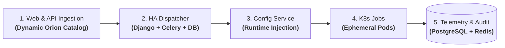

# When Shared Libraries Hit a Ceiling: Why We Replaced Jenkins with an In-House HA Dispatcher

Almost every growing infrastructure organization lives through the exact same two-act story with Jenkins.

In **Act I**, engineering teams maintain dozens of copy-pasted pipelines scattered across individual repositories. You introduce **Jenkins Shared Libraries** in Groovy, standardize deployment patterns, eradicate code duplication, and accelerate developer onboarding. It feels like an undeniable architectural victory — and at that early stage, it genuinely is.

In **Act II**, that standardization becomes a victim of its own success. Hundreds of developers and automated systems start funneling thousands of daily infrastructure operations through that shared framework. That is when you confront a harsh architectural reality: **a continuous integration build server was never designed to act as a self-service operational portal or a distributed infrastructure dispatcher**.

<!-- more -->

## 1. The Standardization Mirage: From Shared Libraries to the Job DSL Nightmare

Before you can replace a core execution engine at scale, you need a uniform interface contract. Building our corporate **Jenkins Shared Libraries** framework in Groovy was an indispensable stepping stone: it forced every team to consume a common syntax for dispatching infrastructure jobs.

However, as platform adoption accelerated, trying to parameterize hundreds of heterogeneous operations across diverse clouds triggered our first major wall: **the fragility of Job DSL**.

To avoid manually configuring hundreds of jobs in the web UI, we turned to **Jenkins Job DSL**: Groovy-based "seed jobs" designed to programmatically generate and update pipeline configurations in XML. The theory was appealing, but the operational reality was punishing:

- **Groovy execution fragility:** Jenkins executes pipeline code inside its own CPS (*Continuation Passing Style*) interpreter over the JVM, continuously serializing pipeline execution states to disk. Any unhandled non-serializable object or standard idiom of Groovy threw the infamous `NotSerializableException` right in the middle of mission-critical deployments.
- **Seed job regeneration overhead:** Whenever an infrastructure catalog changed or a new environment tier was provisioned, seed jobs had to be re-executed to rewrite hundreds of XML files on the Jenkins master, introducing severe I/O stalls and controller locks.
- **Blind debugging:** Testing DSL changes required deploying them onto a live Jenkins instance. Local feedback loops were non-existent, and subtle syntax errors surfaced only when an engineer attempted to execute an operation in production.

## 2. Rigid Forms and the Friction of Dynamic Catalog Integration with Orion

The most painful pain point for application developers was the substandard user experience. An internal infrastructure platform must provide **genuine self-service**, but Jenkins only offers its dated *"Build with Parameters"* screen:

### The poverty of Jenkins parameter forms
- **Rigid, error-prone inputs:** Jenkins lacks native reactive form validation. Engineers were forced to input complex infrastructure parameters into unformatted, plain text boxes (`TEXTAREA`), where a single typographical error or trailing whitespace caused a 20-minute provisioning run to crash in its final step.
- **No cascading dependencies:** If a user selected `production` as the environment and `aws-eu-west-1` as the region, native Jenkins forms could not dynamically filter which VPCs, subnets, load balancers, or machine flavors were actually available for that specific combination.

### The nightmare of querying live catalogs from Jenkins
Our central IaaS control plane (**Orion**) already maintained live, real-time inventory for 30,000+ machines, project quotas, networks, and compliance baselines in PostgreSQL and MongoDB. Attempting to bridge Jenkins with that source of truth proved to be an architectural impedance mismatch:

- **Master JVM saturation via Active Choices:** To populate dynamic dropdowns in Jenkins forms by querying Orion's REST API, we relied on plugins like *Active Choices Reactive Reference Parameter*. Every time a user loaded a job page, their browser triggered synchronous Groovy calls executed directly inside the Jenkins master JVM process.
- **Cascading freezes and network timeouts:** During morning peak hours, when dozens of engineers simultaneously opened job submission forms, the Jenkins master choked waiting on upstream REST responses, consuming JVM thread pools and freezing the UI for the entire engineering organization.
- **Semantic mismatch:** Orion operated on strongly-typed, idempotent, auditable operations identified by immutable Job IDs. Jenkins only understood sequential build numbers (`#1842`) and unstructured, ephemeral console text.

## 3. The Operational Bottleneck: A Monolithic Single Point of Failure (SPOF)

Beyond UI friction and DSL fragility lay a fundamental resilience barrier:

1. **The controller as a critical SPOF:** In a tier-1 banking organization subject to strict operational resilience and business continuity frameworks like **DORA**, running a single JVM master responsible for memory state, web interfaces, job scheduling, and disk persistence represents an unacceptable operational risk. A JVM memory leak or an unannounced master restart locked out the entire organization from deploying or modifying infrastructure.
2. **Static worker VM drift:** Long-lived execution VMs accumulated temp files, stale credentials, and colliding library versions, producing ghost failures that were impossible to reproduce locally.

## 4. The Decoupled Architecture: Web Portal, HA Dispatcher, and Kubernetes Jobs

Our architectural decision was not to "patch Jenkins", but to **completely decouple the three distinct responsibilities that Jenkins bundles into a single monolith**:

### 1. True Self-Service with Reactive Catalog Validation
We replaced *"Build with Parameters"* with a **modern web interface integrated directly into Orion** and backed by **OpenAPI/Swagger** REST endpoints:
- Web forms consume Orion's live inventory asynchronously, providing native cascading dropdowns, instant quota checks, and strict JSON schema validation before the request ever leaves the client.
- Zero malformed requests: developers receive immediate interactive feedback with zero blocking HTTP overhead on the server.

### 2. High-Availability Operations Dispatcher (Django + Celery)
Instead of treating an infrastructure lifecycle operation as a build job, we modeled it as a **transactional state machine** in **Django, Celery, PostgreSQL, and Redis**:
- **True High Availability (Zero SPOF):** Multiple stateless API nodes and Celery workers seamlessly process 40,000+ daily operations without JVM memory bottlenecks.
- **Full programmatic governance:** Prioritized task queues, exponential backoff retries, and granular status updates exposed in real-time via REST.

### 3. Centralized Configuration Management (Zero Drift)
We engineered a centralized service that injects environment variables and secrets into memory at runtime. Automation playbooks became **100% environment-agnostic**, eliminating redundant repositories and divergent branch inventories between `dev`, `staging`, and `prod`.

### 4. Ephemeral Compute via Kubernetes Jobs
We eliminated static worker agents by delegating workload execution to **Kubernetes Jobs**. Each task spins up an isolated pod with exact container dependencies, executes its payload in seconds, streams execution logs back to the dispatcher, and terminates cleanly with zero residual state.

---

## Architectural Comparison: Monolithic Jenkins vs. Decoupled HA Dispatcher

| Dimension | Monolithic Jenkins (Shared Libraries / DSL) | In-House HA Dispatcher on Orion |
| :--- | :--- | :--- |
| **User Experience (UI)** | Rigid forms (*Build with Parameters*), unvalidated text areas, zero real-time validation. | Modern web forms with cascading dropdowns, client-side schema checks, and quota verification. |
| **Catalog Integration** | Plugins (Active Choices) saturating the master JVM with synchronous REST polling. | Native API-first ingestion directly querying Orion's live inventory asynchronously. |
| **Job Definition** | Fragile Groovy Job DSL vulnerable to CPS serialization crashes and seed job latency. | Strongly typed OpenAPI contracts and declarative blueprints with zero procedural lock-in. |
| **Operational Resilience** | Monolithic JVM controller representing a critical Single Point of Failure (SPOF). | Fully stateless Django/Celery tier over Kubernetes (100% HA, DORA-compliant). |
| **Compute Isolation** | Static, long-lived worker VMs prone to state drift, dependency clashes, and stale files. | Ephemeral Kubernetes Job containers destroyed immediately after emitting telemetry. |

---

## The Engineering Takeaway

Standardizing first on Jenkins Shared Libraries was not a mistake: it was the indispensable stepping stone that taught us exactly what needed to be decoupled.

Jenkins remains a respected historical workhorse for compiling code and running unit test suites. But when your mission is to run a large-scale enterprise IaaS platform — governing thousands of engineers, satisfying stringent DORA audit mandates, and serving dynamic multi-cloud catalogs — attempting to stretch a CI server via plugins and Job DSLs is an uphill battle against the tool's core architecture. Decoupling the frontend, state dispatching, and ephemeral compute was the single best engineering decision we made.

---

*For deeper architectural details, explore the case studies on the [HA Dispatcher & K8s Execution](../../projects/dispatcher-migration.md) and the [Orion IaaS Platform](../../projects/orion-iaas.md).*
