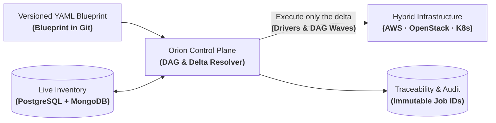

# Nine Years of Internal Cloud Platforms: Why Declarative YAML Replaced Our Commercial Orchestrator

"Never build your own orchestrator" is generally good advice — until you look closely at what your organization already owns and where commercial suites actually spend your engineering budget.

When we evaluated how 500+ engineers should orchestrate full infrastructure environments across our hybrid cloud, the default enterprise option on the table was a commercial suite like **Red Hat Automation Platform (Ansible Tower)**. Instead, we designed **Orion**: our in-house Python IaaS control plane, capable of directly parsing and executing **declarative YAML blueprints (Blueprint)** to govern the entire infrastructure lifecycle.

Here is why that trade-off made sense for us, what we chose *not* to build, why **teardown** — not creation — is the true test of any engine, and why **cultural evangelism across compute, networking, storage, and monitoring teams** was the defining factor for success.

<!-- more -->

## 1. Owning the Control Plane Changes the Build-vs-Buy Calculus

Most teams adopt heavy external orchestrators because they have no unified API over their underlying infrastructure.

We were in a different position. In 2017, we joined in the midst of **NextGen**, BBVA's strategic transformation to build its own internal cloud platform and offload mission-critical core banking workloads from the legacy **mainframe**. We started in on-premises datacenters (OpenStack and physical bare-metal nodes) and gradually evolved into a fully hybridized infrastructure bridging private and public clouds. Throughout that journey, we engineered **Orion**, our central IaaS control plane that today governs tens of thousands of nodes across AWS, OpenStack, OpenShift, and bare metal behind a single driver-based REST API. Orion already handled:

- Authentication, RBAC, and compliance policies.
- Provider-specific driver translation.
- Live multi-cloud inventory across PostgreSQL and MongoDB.
- Job tracking and immutable audit trails.

Buying a commercial orchestration suite to sit in front of Orion meant paying per-node licensing fees across tens of thousands of machines just to sequence HTTP calls against an API we already owned — while losing native visibility into Orion's job identifiers when a multi-step deployment failed halfway through.

## 2. Why We Avoided Local State Files

Tools inspired by Terraform often copy its most operationally painful design choice: a separate state file (`tfstate`) that must be stored, locked, and reconciled against reality whenever someone makes an out-of-band change.

Because **Orion** natively interprets declarative YAML blueprints (**Blueprint**) against its own live inventory, we made a deliberate architectural decision: **no separate state files**.

Orion's hybrid database *is* the live source of truth. When Orion processes a declarative YAML blueprint, it queries its live inventory directly for the current state of declared resources and acts only on the delta. There is no external state file to corrupt, no stale lock after a crashed runner, and no drift between "orchestrator state" and "real infrastructure".

## 3. Creation Is Easy; Idempotent Teardown Is the Real Test

Almost any script can provision a greenfield environment when every API returns `200 OK`. Where procedural automation falls apart is **partial failure during teardown**.

Imagine tearing down a 25-resource environment (compute pools, load balancer rules, storage volumes, networks). Step 14 times out because an upstream cloud API is momentarily degraded. What happens when the engineer re-runs the destroy job five minutes later?

- **In procedural playbooks:** Step 1 tries to delete a resource that was already deleted in the first run, fails with `404 Not Found`, and aborts the entire pipeline — forcing an engineer to manually comment out steps or clean up resources by hand.
- **In Orion's declarative execution:** Every step in a reverse-dependency teardown queries Orion first. Steps 1 through 13 see that their target resources are already gone, record a clean no-op, and the engine resumes immediately at Step 14.

Making teardown **safe to repeat** turned environment decommissioning from a high-stress manual ticket into a routine self-service operation.

## 4. The Human Factor: Evangelizing Platform Culture and Breaking Silos

The hardest challenge in building an internal platform is rarely code: it is cultural and organizational.

An infrastructure platform cannot succeed as an isolated ivory tower. Driving adoption across 500+ engineers requires continuous **evangelization of the platform philosophy** and **forging a unified front with specialized domain teams**:

- **Compute:** Partnering closely to standardize golden machine images, capacity sizing, and instance lifecycles across public clouds, private OpenStack clusters, and bare metal without developer friction.
- **Networking:** Co-designing automated IP allocation, dynamic routing, DNS, and load balancing policies (such as our custom zero-downtime F5 integration) so network provisioning ceases to be a multi-day ticketing bottleneck.
- **Storage:** Seamlessly incorporating block volumes, shared filesystems, and object storage tiers (Ceph, Swift, EBS) as first-class declarative primitives within the control plane.
- **Monitoring & Security:** Collaborating hand-in-hand to guarantee that observability agents, telemetry pipelines, and corporate CIS hardening baselines are enforced natively from the foundational Ground layer before handing over any compute asset.

When a platform is perceived as an external mandate, teams route around it. When you evangelize the vision — demonstrating that the platform relieves each specialized team of repetitive ticket queues while letting them govern their domain through clean APIs and guardrails — infrastructure evolves from disconnected operational silos into a synchronized engineering organization.

## 5. The Honest Cost of Building In-House

Owning Orion and its declarative capabilities eliminates commercial licensing and gives you a tight fit with internal compliance, but it is not free:

- **You own the edge cases:** Cycle detection in dependency graphs, partial failure reporting, and schema evolution are now your team's responsibility.
- **Documentation is a first-class engineering deliverable:** A commercial tool comes with public Stack Overflow answers; an internal YAML DSL only succeeds if its error messages, schema validation, and golden-path templates are self-explanatory.

After nine years of evolving this stack, the lesson is straightforward: don't reinvent commodity cloud SDKs — encapsulate them behind drivers. But when the central control plane (Orion) natively parses and executes declarative infrastructure blueprints (Blueprint), a purpose-built Python platform can outperform a heavyweight commercial suite in both reliability and cost.

---

*See how Orion and Blueprint fit together in the [Orion IaaS](../../projects/orion-iaas.md) and [Blueprint](../../projects/blueprint.md) case studies.*
