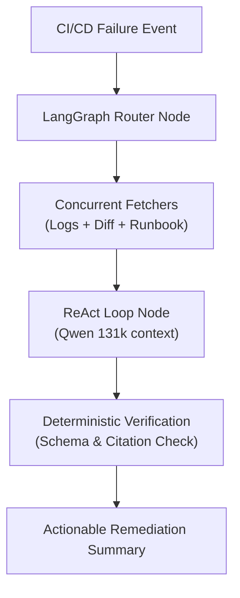

# Automating CI/CD Root-Cause Triage with LangGraph & ReAct Agents

When a CI/CD build breaks, the slowest part of the recovery loop is rarely the fix itself — it is the time an engineer spends opening multi-megabyte log files, searching for the first failure trace, cross-referencing commit diffs, and checking documentation.

Here is how we designed **Orion AI** using **LangGraph state machines** and **ReAct loops** to cut Mean Time to Resolution (MTTR) from hours to seconds.

<!-- more -->

## The Core Challenge: Zero Tolerance for Hallucinations

In platform and banking operations, an AI agent cannot afford to guess. If a pipeline failure is caused by an expired OIDC token, the agent must not suggest rewriting unit tests.

To achieve production reliability, we implemented three strict architectural guardrails:

## Why LangGraph over Linear Chains?

Traditional LLM chains (like linear LangChain pipelines) fail when diagnostic steps require backtracking or loops:

1. **Conditional Branching:** If the raw error trace references a specific configuration file (e.g., `settings.py`), the graph branches to inspect the Git commit diff for that file.
2. **State Persistence:** LangGraph keeps a typed state dictionary throughout the lifecycle, allowing intermediate verification nodes to confirm facts before producing a final report.
3. **Deterministic Tooling via MCP:** We adopted the **Model Context Protocol (MCP)** to standardize tool interactions, ensuring the LLM calls external APIs via well-typed JSON contracts rather than unstructured script execution.

## The Results

During validation across hundreds of real-world pipeline failures:
* **MTTR** for initial triage dropped from an average of ~45 minutes of human digging to under **15 seconds**.
* Engineers received an immediate summary directly in their workflow (GitLab MR comment or Slack notification) detailing the exact failing line, root-cause classification, and recommended action.

---

*Read the full architecture in the [Orion AI case study](../../projects/orion-ai.md).*
