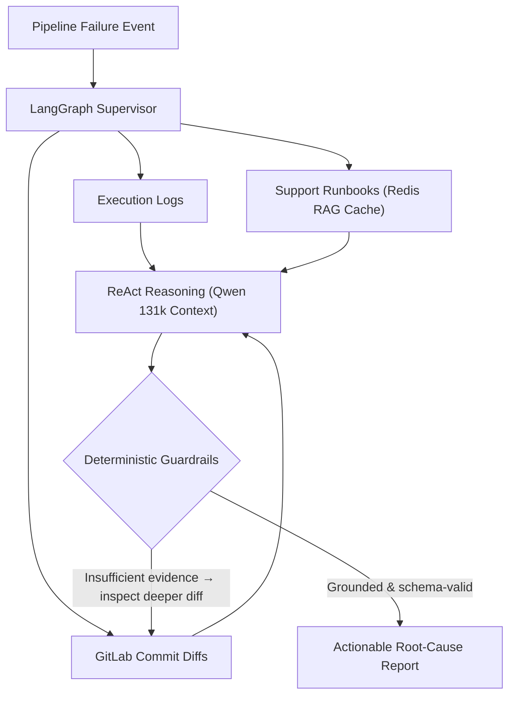

# The PoC Was the Easy Part: Lessons from Building an Agentic CI/CD Diagnostic Engine in Banking

Most engineering posts about AI agents end at the moment the prototype works on a benchmark dataset. In a regulated enterprise, that is actually where the hardest part begins.

When we designed and validated the **Orion AI** Proof of Concept (PoC) at BBVA — a multi-agent system built with **LangGraph** and **ReAct** loops to automate CI/CD root-cause failure analysis — the technical goal was clear: stop engineers from spending hours digging through megabytes of execution logs, internal runbooks, and GitLab commit diffs every time a pipeline failed.

The prototype worked: it slashed triage from hours of manual log correlation to seconds. Yet its current status — **validated and prepared, awaiting integration guidelines for central AI infrastructure** — taught me just as much about enterprise platform architecture as writing the LangGraph nodes themselves.

<!-- more -->

## 1. Why Linear LLM Chains Fail at Incident Triage

Early experiments with LLM-assisted ops usually follow a naive linear recipe: take the tail of a failed build log, paste it into a prompt, and ask the model what went wrong.

In real infrastructure pipelines, that fails for two reasons:

1. **The root cause is rarely in the last 50 lines:** A build failure at minute 18 is often caused by an environment variable or network timeout that happened at minute 2.
2. **Logs tell you *what* broke, not *what changed*:** An exit code in a deployment log is ambiguous until you correlate it with the recent GitLab commit diff or a known operational runbook.

That is why we modeled **Orion AI** as a **stateful, cyclic graph in LangGraph** rather than a linear chain:

- **Concurrent context gathering:** The graph pulls raw execution traces, operational runbooks (cached in Redis to accelerate RAG retrieval), and repository metadata in parallel.
- **Long-context correlation (`Qwen` 131k):** Feeding consolidated evidence into a high-context model preserves the causal chain from initialization to failure.
- **Bounded ReAct loops:** When a log trace points to a modified configuration file, the agent loops back to inspect the exact commit diff before formulating its diagnosis.

## 2. Deterministic Guardrails: Treating the LLM as an Untrusted Component

In banking operations, a hallucinated remediation command is worse than no diagnosis at all. To make the PoC trustworthy for engineers, we applied standard distributed-systems discipline to the model's inputs and outputs:

- **Strict output schemas:** The agent cannot return free-form prose; it must populate a typed diagnostic contract.
- **Explicit evidence grounding:** Every root-cause claim must point to concrete evidence retrieved during the run (log fragments, runbook entries, or commit diffs).
- **Isolated tool contracts (MCP):** External systems (Jenkins, Redis runbook cache, GitLab) are queried through strictly typed read-only tool interfaces rather than giving the agent arbitrary shell access.

## 3. Why a Validated PoC Still Waits on Enterprise Foundations

Once the PoC was validated against real failure scenarios, why didn't we immediately wire it into every production pipeline the next morning?

Because in a large financial institution, an operational AI agent sits at the intersection of two separate platform domains: **Infrastructure Operations** (which we own) and **Central Corporate AI Infrastructure** (owned by partner platform teams).

Moving from a validated prototype to organization-wide production requires three cross-team foundations to be in place:

1. **Shared inference capacity & routing standards:** Productionizing high-context (131k token) agent runs across hundreds of daily pipeline failures requires formal capacity allocation and integration standards on the bank's centralized LLM inference clusters.
2. **Operational data governance:** CI/CD logs and commit diffs inevitably touch internal hostnames, configuration metadata, and repository structures. Formalizing how operational telemetry is redacted, transmitted, and retained by shared internal AI endpoints is a mandatory governance milestone.
3. **Clear ownership of the evaluation loop:** In production, models and prompts drift as infrastructure evolves. Defining who owns the continuous evaluation dataset and SLOs for diagnostic accuracy is just as important as the code.

## The Takeaway for Platform Engineers

If you are building agentic systems for real-world operations, design your state graph, tool boundaries, and deterministic guardrails so the system is ready for production from day one — and keep your architecture decoupled from any single model endpoint so that when central AI infrastructure guidelines land, integration is a configuration change rather than a rewrite.

---

*Explore the technical architecture in the [Orion AI case study](../../projects/orion-ai.md).*
