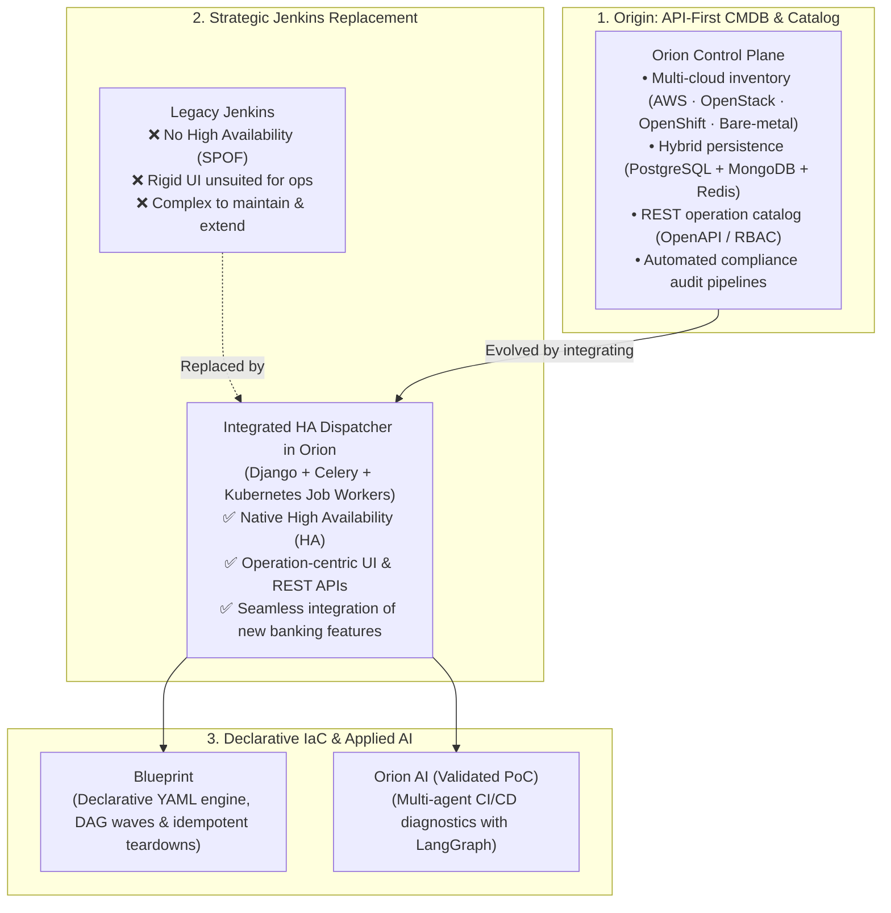

Senior Platform Engineer · Python · Madrid, Spain

# Oscar Redondo { .hero__title }

I design and build <strong>infrastructure deployment and provisioning platforms rooted in a custom Infrastructure as Code philosophy</strong> — abstracting the distributed complexity of hybrid cloud across AWS, OpenStack, OpenShift, and bare metal into clean self-service APIs, declarative lifecycle engines, and deterministic automation.

[:material-sitemap-outline: Explore the platform ecosystem](projects/index.md){ .md-button .md-button--primary }
[:material-file-account-outline: Read my CV](cv/index.md){ .md-button }
[:fontawesome-brands-github: GitHub (@oredondo)](https://github.com/oredondo){ .md-button }

  

    30,000+
    Machines governed
  

  

    40,000+
    Daily operations
  

  

    500+
    Engineers served
  

  

    10+ yrs
    Platform &amp; Python
  

## The Evolution of Orion: From API-First CMDB & Inventory to a High-Availability Dispatcher

**Orion** was not built as a static tool, but as an evolving architectural response to enterprise infrastructure bottlenecks at BBVA:

1. **The Origin: API-First CMDB, Inventory & Operation Catalog:** Orion was conceived as a unified control plane across AWS, OpenStack, OpenShift, and bare metal to consolidate real-time multi-cloud inventory, fine-grained RBAC, hybrid persistence (PostgreSQL + MongoDB + Redis), and automated compliance audit pipelines directly consumed by bank auditors.
2. **The Jenkins Bottleneck:** Initially, operation execution relied on Jenkins. However, Jenkins lacked native High Availability (creating a critical single point of failure), offered a rigid UI poorly suited for infrastructure state machines, and was notoriously complex to operate, scale, and integrate with new bank functionalities.
3. **Evolution into a Purpose-Built HA Dispatcher:** Orion evolved by absorbing the execution plane into a **native High-Availability Operation Dispatcher (Django + Celery + Kubernetes Jobs)**. This migration completely replaced Jenkins for platform operations, providing clean REST APIs, real-time job state observability, and isolated execution inside ephemeral containers.
4. **Maturity: Declarative IaC & Operational AI:** With inventory and execution united under the same architecture, Orion expanded with **Blueprint** (asynchronous YAML engine with DAG wave scheduling and idempotent teardowns) and **Orion AI** (multi-agent root-cause failure triage with LangGraph).

## Enterprise Architecture Case Studies

*System topology, architectural trade-offs, and failure modes across multi-cloud production environments:*

-   :material-cloud-cog-outline:{ .lg .middle } __[Orion — Central IaaS Platform & Driver Pipeline](projects/orion-iaas.md)__

    ---

    Sole architect of BBVA's central IaaS and deployment platform: one OpenAPI interface governing 30,000+ machines across AWS, OpenStack, OpenShift, and bare metal (40,000+ daily ops), backed by PostgreSQL, MongoDB, Redis, and automated compliance pipelines.

    PythonDjango RESTCeleryPostgreSQLMongoDBRedis

    [:octicons-arrow-right-24: Read architecture case study](projects/orion-iaas.md)

-   :material-file-tree-outline:{ .lg .middle } __[Blueprint — Declarative Lifecycle Engine](projects/blueprint.md)__

    ---

    Terraform-like asynchronous Python engine driven by versioned YAML blueprints. Orchestrates parallel DAG waves against Orion, emits full audit traces, and supports idempotent teardowns — eliminating commercial automation licensing.

    PythonAsyncIODAG SchedulingDeclarative YAMLGitOps

    [:octicons-arrow-right-24: Read architecture case study](projects/blueprint.md)

-   :material-cached:{ .lg .middle } __[Leaving Jenkins — HA Dispatcher & K8s Execution](projects/dispatcher-migration.md)__

    ---

    How we evolved from Groovy Jenkins Shared Libraries to a purpose-built High-Availability Operation Dispatcher (Django + Celery), dynamic runtime configuration injection, and ephemeral Kubernetes Job execution.

    DjangoCeleryKubernetes JobsAnsibleOpenAPI

    [:octicons-arrow-right-24: Read architecture case study](projects/dispatcher-migration.md)

-   :material-radar:{ .lg .middle } __[Orion AI — CI/CD Auto-Diagnostics (Validated PoC)](projects/orion-ai.md)__

    ---

    Validated multi-agent prototype using LangGraph and ReAct loops to correlate execution logs, Redis-indexed runbooks, and GitLab diffs under deterministic guardrails — plus a candid breakdown of enterprise rollout constraints.

    LangGraphReActMCPQwen 131kDeterministic Guardrails

    [:octicons-arrow-right-24: Read architecture case study](projects/orion-ai.md)

## Open-Source Systems on GitHub

-   :material-waveform:{ .lg .middle } __[OmniLecture Studio — Linux Multimodal AI Suite](projects/omni-lecture.md)__

    ---

    Native Linux (Wayland/GNOME, GTK 3) suite with an optimized FFmpeg multimedia pipeline (tuned H.264 10 FPS stillimage encoding cutting file size by 70%, hardware PTS clock sync, and afftdn spectral audio filtering) paired with dual Whisper transcription, 16×16 slide diffing, and LangGraph workflows.

    PythonFFmpegGTK 3 / WaylandLangGraphWhisper int8OpenCV / OCR

    [:octicons-arrow-right-24: Case study](projects/omni-lecture.md) · [:fontawesome-brands-github: Source on GitHub](https://github.com/oredondo/omnilecture-studio)

-   :material-wrench-outline:{ .lg .middle } __[WrenchBuddy — AI Vehicle Lifecycle & pgvector RAG](projects/wrenchbuddy.md)__

    ---

    Full-stack platform built with Django 6, DRF, PostgreSQL (`pgvector` 768-dim RAG), Celery, Redis, S3/MinIO, LangChain Vision invoice OCR, ReportLab PDF export, and a TypeScript frontend.

    Django 6 / DRFPostgreSQL pgvectorCelery &amp; RedisLangChain RAGTypeScript

    [:octicons-arrow-right-24: Case study](projects/wrenchbuddy.md) · [:fontawesome-brands-github: Backend](https://github.com/oredondo/WrenchBuddy) · [:fontawesome-brands-github: Frontend](https://github.com/oredondo/WrenchBuddy-frontend)

## Engineering Notes & Essays

-   __[When Shared Libraries Hit a Wall: Why We Replaced Jenkins with a Custom HA Dispatcher](blog/posts/2026-02-15-leaving-jenkins-at-scale-custom-dispatcher.md)__

    ---

    Why standardizing CI/CD on Jenkins Shared Libraries was necessary first — and how it exposed the limits that led to a Django/Celery HA dispatcher and ephemeral Kubernetes Jobs.

-   __[Nine Years of Internal Cloud Platforms: Why Declarative YAML Replaced Our Commercial Orchestrator](blog/posts/2026-03-01-declarative-infrastructure-python.md)__

    ---

    How owning the central control plane changes the build-vs-buy calculus, why we avoided local state files, and why idempotent teardown is the true test of an infrastructure engine.

-   __[The PoC Was the Easy Part: Lessons from Building an Agentic CI/CD Diagnostic Engine in Banking](blog/posts/2026-03-10-agentic-cicd-diagnostics-langgraph.md)__

    ---

    Why cyclic LangGraph state machines beat linear chains for log triage, and what actually blocks validated AI prototypes from wide production rollout in regulated institutions.

### Technical Discussion & Collaboration

Open to discussions on infrastructure deployment architecture, custom declarative IaC engines, distributed Python systems, and production-grade operational AI.

[:material-linkedin: Connect on LinkedIn](https://linkedin.com/in/oscarredondodjangopython){ .md-button .md-button--primary }
[:fontawesome-brands-github: GitHub (@oredondo)](https://github.com/oredondo){ .md-button }
[:material-email-outline: o.redondo91@gmail.com](mailto:o.redondo91@gmail.com){ .md-button }

