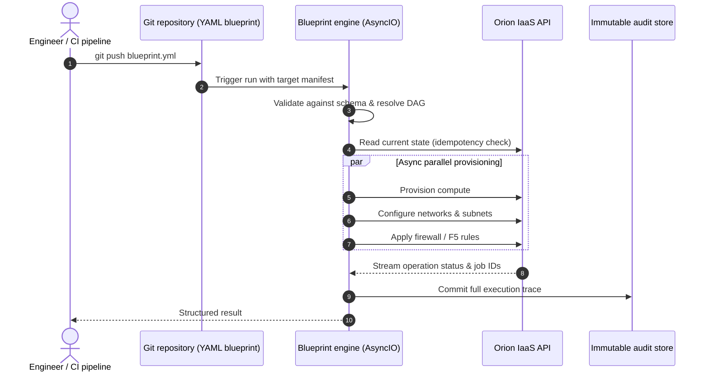

# Blueprint: Declarative Async Orchestration Engine

| Dimension | Details |
| :--- | :--- |
| **Role** | Creator & Lead Systems Engineer |
| **Organization** | BBVA Technology (Core Banking Infrastructure) |
| **Impact** | Replaced a commercial automation platform (Red Hat Ansible Automation Platform); brought GitOps reproducibility to banking infrastructure |
| **Stack** | Python, AsyncIO, PyYAML, JSON Schema, GitOps, Orion API |

!!! abstract "TL;DR"

    Engineers declare the **desired state** of an environment in a Git-versioned YAML file.
    Blueprint validates it, builds a dependency graph, executes independent steps
    concurrently with AsyncIO, and reconciles against live Orion state so every run —
    including a failed teardown — is **safe to repeat**.

## 1. Context & challenge

Enterprise automation depended on a heavy commercial orchestration suite. It brought
licensing overhead, scaling constraints and poor alignment with internal governance
workflows — in particular, reconstructing exact state after a mid-run failure was
painful for audit purposes.

**Objective:** an in-house declarative engine in Python where teams describe complete
environments in version-controlled YAML, executed in parallel with full auditability
and idempotent state safety.

## 2. Workflow & engine architecture



A blueprint is intentionally boring to write:

```yaml title="payments-stack.yml"
version: "2.0"
target_environment: aws-production

resources:
  - name: payment-network
    type: network.subnet
    cidr: 10.20.0.0/24

  - name: payment-worker-pool
    type: compute.instance_group
    count: 12
    flavor: m5.xlarge
    depends_on: [payment-network]

  - name: payment-redis-cache
    type: cache.cluster
    engine: redis
    depends_on: [payment-network]
```

## 3. Core technical pillars

### A. DAG dependency resolver

Infrastructure has implicit ordering — a subnet must exist before an instance binds to
it, yet many instances can be created at once. Blueprint computes **execution waves**
from the dependency graph: everything inside a wave runs concurrently, waves run in order.

### B. Idempotency, self-reconciliation & crash-resilient teardowns

Traditional scripting and procedural playbooks fail abruptly on re-runs because a resource already exists or has already been deleted. Blueprint enforces a **three-phase reconciliation model**:

1. **Observed state query:** Prior to executing any mutation, Blueprint queries Orion for live reality rather than relying on stale local state files.
2. **Intent delta evaluation:** Computes a strict diff (`NOOP`, `CREATE`, `UPDATE`, `DELETE`). If the live state already satisfies the target specification, the action is marked as `NOOP` and immediately resolves.
3. **Resumable teardown with inverted DAG:** Teardowns invert the dependency graph automatically (e.g., instances are terminated before subnets). If a pipeline crashes or times out midway through a teardown, re-running the job safely skips already-deleted resources and resumes right where it left off — eliminating manual database intervention or orphaned cloud resources.

### C. Zero commercial lock-in

Automation is plain, fully owned Python tailored to banking standards — removing a
recurring licence cost and letting the platform team evolve the engine at its own pace.

### Trade-offs

| Decision | Alternative considered | Why this choice |
| :--- | :--- | :--- |
| Build in-house engine | Keep commercial suite / adopt Terraform | Tight fit with the internal Orion API, custom retry & rollback semantics, audit trail ownership, no per-host licensing |
| AsyncIO | Threads / process pools | Workload is I/O-bound (API calls, polling); thousands of concurrent waits at negligible cost |
| Reconcile against live state | Local state file | Orion is already the source of truth; avoids state drift and lock management |

## 4. Python implementation highlights

### Wave-based DAG scheduler with dynamic state reconciliation

An illustrative core of the scheduler combining `graphlib.TopologicalSorter`, `asyncio.TaskGroup`, and idempotency diffing:

```python title="reconciliation.py (illustrative)"
import asyncio
from enum import Enum, auto
from graphlib import TopologicalSorter
from typing import NamedTuple


class DesiredState(NamedTuple):
    name: str
    resource_type: str
    spec: dict


class Action(Enum):
    NOOP = auto()
    CREATE = auto()
    UPDATE = auto()
    DESTROY = auto()


class BlueprintReconciler:
    def __init__(self, client: "OrionClient") -> None:
        self.client = client

    async def diff(self, desired: DesiredState, is_teardown: bool = False) -> Action:
        live = await self.client.get_resource(desired.name)
        if is_teardown:
            return Action.NOOP if live is None else Action.DESTROY

        if live is None:
            return Action.CREATE
        if live.spec == desired.spec:
            return Action.NOOP
        return Action.UPDATE

    async def reconcile_resource(self, desired: DesiredState, is_teardown: bool) -> None:
        action = await self.diff(desired, is_teardown=is_teardown)
        match action:
            case Action.NOOP:
                return  # Safe no-op makes re-runs idempotent
            case Action.CREATE:
                await self.client.create_resource(desired.spec)
            case Action.UPDATE:
                await self.client.update_resource(desired.name, desired.spec)
            case Action.DESTROY:
                await self.client.delete_resource(desired.name)

    async def run(
        self,
        manifest: dict[str, DesiredState],
        dependencies: dict[str, set[str]],
        teardown: bool = False,
    ) -> None:
        """Execute dependencies in concurrent waves.

        If teardown=True, the graph is reversed (dependents torn down before dependencies).
        """
        graph_deps = dependencies if not teardown else self._invert_graph(dependencies)
        sorter = TopologicalSorter(graph_deps)
        sorter.prepare()  # (1)!

        while sorter.is_active():
            ready_wave = sorter.get_ready()
            async with asyncio.TaskGroup() as tg:  # (2)!
                for name in ready_wave:
                    tg.create_task(
                        self.reconcile_resource(manifest[name], is_teardown=teardown)
                    )
            sorter.done(*ready_wave)

    @staticmethod
    def _invert_graph(deps: dict[str, set[str]]) -> dict[str, set[str]]:
        inverted: dict[str, set[str]] = {k: set() for k in deps}
        for node, upstream in deps.items():
            for parent in upstream:
                inverted.setdefault(parent, set()).add(node)
        return inverted
```

1.  `sorter.prepare()` validates the entire graph upfront; circular dependencies immediately trigger a `CycleError` before any infrastructure mutation occurs.
2.  `asyncio.TaskGroup` runs independent steps in parallel per wave; if any task fails, all concurrent sibling operations are canceled cleanly, preserving a deterministically resumable state.

## 5. Outcome

- :moneybag: **Licence cost removed** — commercial orchestration replaced by owned Python.
- :repeat: **GitOps reproducibility** — every environment change is a reviewed, versioned commit.
- :mag: **Full traceability** — each run produces a complete execution trace for auditors.
- :zap: **Parallel by default** — independent resources provision concurrently instead of sequentially.

[:octicons-arrow-right-24: Related post: Why we built our own declarative YAML engine](../blog/posts/2026-03-01-declarative-infrastructure-python.md)
