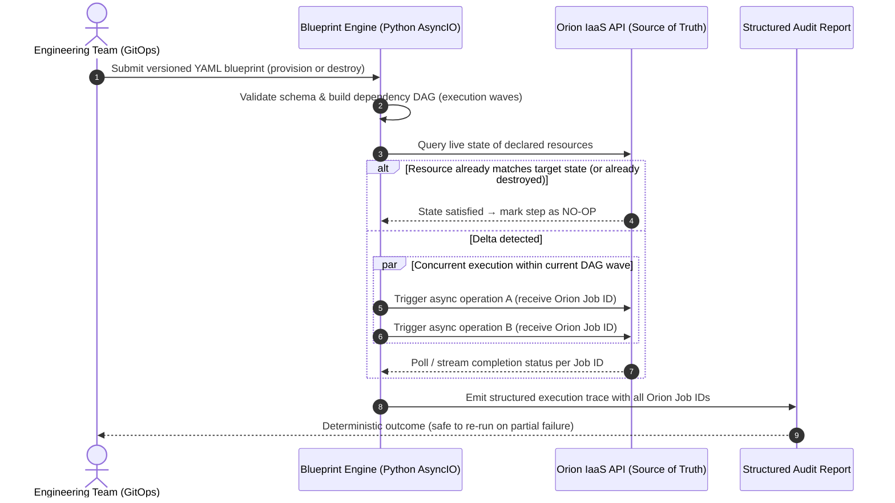
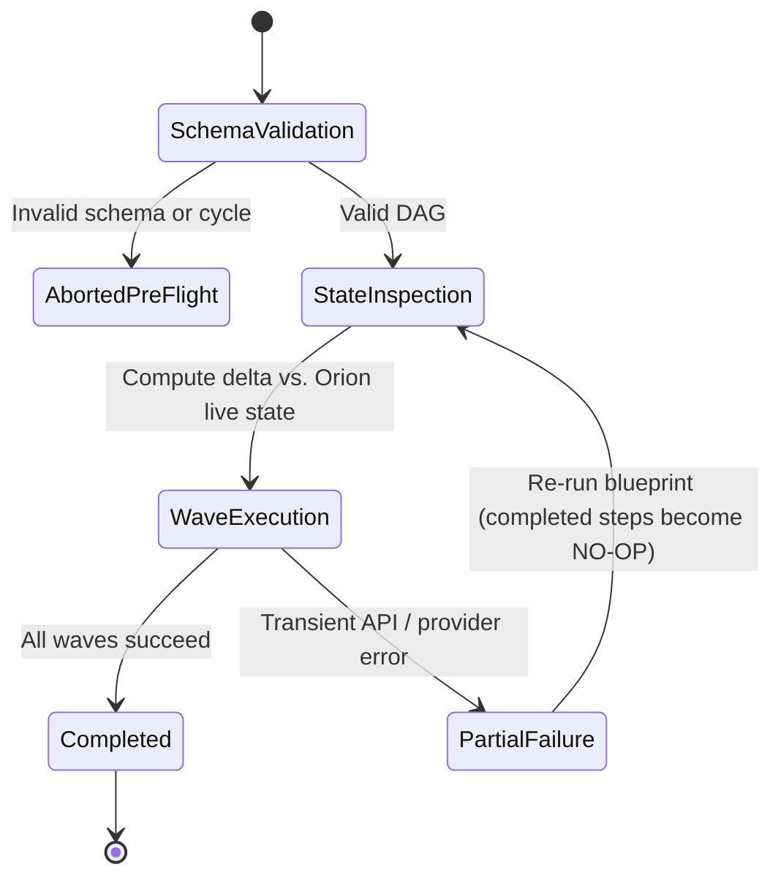

# Blueprint: Asynchronous Declarative Lifecycle Engine

| Dimension | Details |
| :--- | :--- |
| **Role** | Architect & Platform Lead |
| **Organization** | BBVA (Core Banking Infrastructure) |
| **Outcome** | Eliminated commercial orchestration licensing (Red Hat Automation Platform); brought declarative GitOps and resumable teardowns to Orion |
| **Stack** | Python, AsyncIO, Declarative YAML DSL, JSON Schema, GitOps, Orion REST API |

!!! abstract "Architectural summary"

    Blueprint is an internal asynchronous orchestration engine in Python — conceptually analogous to Terraform, purpose-built for BBVA's **Orion** platform. Engineering teams declare the desired state of complete environments in versioned YAML blueprints; the engine resolves the dependency graph, executes independent operations in parallel, produces a complete Orion job trace for auditors, and supports **idempotent destroy workflows** that safely resume interrupted teardowns without rework.

---

## 1. Context & Why Commercial Suites Did Not Fit

Once **Orion** exposed a unified REST API over AWS, OpenStack, OpenShift, and bare-metal, teams needed to orchestrate multi-tier environments (networks, load balancers, compute pools, middleware) as a single unit rather than firing individual API calls.

Relying on commercial orchestration suites such as **Red Hat Automation Platform (Ansible Tower)** introduced three friction points:

1. **Per-node licensing overhead:** Commercial licensing scales with managed hosts, penalizing adoption across tens of thousands of banking nodes.
2. **Mid-run failure opacity:** When a 40-step procedural workflow fails at step 27 due to a transient network timeout, reconstructing exact state for audit compliance or safely tearing down the partial environment required manual intervention.
3. **Impedance mismatch with Orion:** We already owned the central source of truth (Orion). We needed an orchestrator that natively understood Orion's job identifiers, async polling contracts, RBAC model, and compliance reports.

---

## 2. Abstract Execution & Teardown Flow

---

## 3. Key Architectural Decisions

### A. Declarative YAML Blueprints over Procedural Scripts
Instead of maintaining imperative scripts that mix control flow with infrastructure state, teams commit a declarative YAML blueprint defining **what** the environment should look like and the dependencies between components. Schema validation catches structural and dependency errors before a single API call reaches Orion.

### B. Asynchronous Wave-Based Concurrency
Provisioning infrastructure is fundamentally I/O-bound (waiting on cloud APIs, hypervisors, and network appliances). Blueprint organizes the dependency graph into **execution waves**:

- Resources with no unmet dependencies run **concurrently** via Python's `AsyncIO` event loop.
- Downstream resources wait until their upstream wave completes successfully.
- If a step fails mid-wave, the engine records the exact state of every in-flight Orion job rather than losing track of sibling operations.

### C. Idempotent Destroy & Resumable Partial Teardowns
Decommissioning complex environments is where most automation breaks. If a destroy run fails halfway through, naive scripts abort on re-run because the first half of the resources no longer exist.

Blueprint manages the **full infrastructure lifecycle**:

- On teardown, the dependency order is reversed so dependent services are removed before shared networks or storage.
- Before acting on any node, the engine inspects live state in Orion. Steps that completed in a previous interrupted run are skipped cleanly, allowing operators to simply re-run the blueprint until teardown completes — with zero manual database surgery.

### D. End-to-End Orion Job Traceability
In a regulated bank, "the pipeline went green" is not sufficient audit evidence. Every Blueprint execution emits a structured trace linking each declared resource in the YAML manifest to the exact **Orion Job IDs**, timestamps, and status transitions executed — even when a run halts midway.

---

## 4. Failure Modes & Resilience Design

| Failure Scenario | Traditional Procedural Playbook | Blueprint Engine Behavior |
| :--- | :--- | :--- |
| **Circular dependency in manifest** | Discovered mid-deployment after mutating production | Rejected during pre-flight DAG resolution before any API call |
| **Timeout halfway through a 20-node teardown** | Re-run crashes on "resource not found" for nodes 1–10 | Re-run inspects Orion state, skips nodes 1–10, and resumes at node 11 |
| **Auditor requests proof of a failed change** | Manual correlation across scattered console logs | Structured report maps every step to its immutable Orion Job ID |

---

## 5. Architectural Trade-Offs

| Decision | Alternative Considered | Rationale |
| :--- | :--- | :--- |
| **Purpose-built Python engine** | Red Hat Automation Platform / Terraform | Eliminated recurring commercial licensing, integrated natively with Orion's job/audit model, and avoided external state-file locking issues. |
| **Orion as live source of truth** | Local state files (`tfstate` equivalent) | Orion already tracks live multi-cloud inventory; querying Orion directly prevents state-file drift and split-brain locks. |
| **AsyncIO concurrency** | Multi-threaded / multi-process runners | High concurrency for hundreds of simultaneous API waits with minimal memory footprint. |

---

## 6. Operational & Business Impact

- **Commercial license elimination:** Architecting an in-house declarative engine natively integrated with Orion eliminated reliance on commercial node-licensed suites (such as Red Hat Ansible Automation Platform / Tower), contributing directly to the €6M+ cumulative cost avoidance across the platform.
- **Idempotent & resumable teardowns:** 100% success rate on interrupted or re-executed environment destructions without leaving orphaned resources or requiring manual database interventions.
- **High-throughput asynchronous concurrency:** Reduced multi-tier environment provisioning time by over 60% through DAG wave concurrency executed on Python's `AsyncIO` event loop.
- **Job ID audit trail:** Automatically generated, immutable audit evidence tying every YAML resource to Orion's internal execution Job IDs for regulatory banking compliance.

---

[:octicons-arrow-left-24: Previous: Orion IaaS Platform](orion-iaas.md) · [:octicons-arrow-right-24: Next: Leaving Jenkins — HA Dispatcher & K8s Execution](dispatcher-migration.md)
