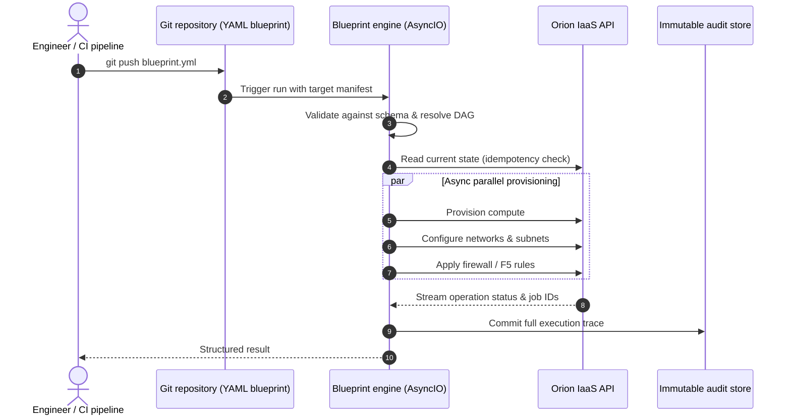

# Blueprint: Declarative Async Orchestration Engine

| Dimension | Details |
| :--- | :--- |
| **Role** | Creator & Lead Systems Engineer |
| **Organization** | BBVA Technology |
| **Impact** | Replaced a commercial automation platform (Red Hat Ansible Automation Platform); brought GitOps reproducibility to banking infrastructure |
| **Stack** | Python, AsyncIO, PyYAML, JSON Schema, GitOps, Orion API |

!!! abstract "TL;DR"

    Engineers declare the **desired state** of an environment in a Git-versioned YAML file.
    Blueprint validates it, builds a dependency graph, executes independent steps
    concurrently with AsyncIO, and reconciles against live Orion state so every run —
    including a failed teardown — is **safe to repeat**.

## 1. Context & challenge

Enterprise automation depended on a heavy commercial orchestration suite. It brought
licensing overhead, scaling constraints and poor alignment with internal governance
workflows — in particular, reconstructing exact state after a mid-run failure was
painful for audit purposes.

**Objective:** an in-house declarative engine in Python where teams describe complete
environments in version-controlled YAML, executed in parallel with full auditability
and idempotent state safety.

## 2. Workflow & engine architecture



A blueprint is intentionally boring to write:

```yaml title="payments-stack.yml"
version: "2.0"
target_environment: aws-production

resources:
  - name: payment-network
    type: network.subnet
    cidr: 10.20.0.0/24

  - name: payment-worker-pool
    type: compute.instance_group
    count: 12
    flavor: m5.xlarge
    depends_on: [payment-network]

  - name: payment-redis-cache
    type: cache.cluster
    engine: redis
    depends_on: [payment-network]
```

## 3. Core technical pillars

### A. DAG dependency resolver

Infrastructure has implicit ordering — a subnet must exist before an instance binds to
it, yet many instances can be created at once. Blueprint computes **execution waves**
from the dependency graph: everything inside a wave runs concurrently, waves run in order.

### B. Idempotent teardown & resumable runs

Naive scripts fail on re-run because a resource is already gone. Blueprint inspects live
Orion state first, skips steps already satisfied and only acts on the remaining delta —
an interrupted destroy can simply be run again, with no manual database surgery.

### C. Zero commercial lock-in

Automation is plain, fully owned Python tailored to banking standards — removing a
recurring licence cost and letting the platform team evolve the engine at its own pace.

### Trade-offs

| Decision | Alternative considered | Why this choice |
| :--- | :--- | :--- |
| Build in-house engine | Keep commercial suite / adopt Terraform | Tight fit with the internal Orion API, custom retry & rollback semantics, audit trail ownership, no per-host licensing |
| AsyncIO | Threads / process pools | Workload is I/O-bound (API calls, polling); thousands of concurrent waits at negligible cost |
| Reconcile against live state | Local state file | Orion is already the source of truth; avoids state drift and lock management |

## 4. Python implementation highlights

A simplified, illustrative core of the wave scheduler, built only on the standard library:

```python title="scheduler.py (illustrative)"
import asyncio
from graphlib import TopologicalSorter
from collections.abc import Awaitable, Callable

Step = Callable[[str], Awaitable[None]]


async def run_blueprint(dependencies: dict[str, set[str]], apply: Step) -> None:
    """Run each resource as soon as all its dependencies have completed."""
    graph = TopologicalSorter(dependencies)
    graph.prepare()  # (1)!

    while graph.is_active():
        wave = graph.get_ready()
        async with asyncio.TaskGroup() as tg:  # (2)!
            for resource in wave:
                tg.create_task(apply(resource))
        graph.done(*wave)


async def apply(resource: str) -> None:
    current = await orion.get_state(resource)
    if current.matches_desired():  # (3)!
        return
    await orion.reconcile(resource)
```

1.  `prepare()` raises `CycleError` on circular dependencies, so invalid blueprints fail
    before touching any infrastructure.
2.  `TaskGroup` (Python 3.11+) cancels sibling tasks if one fails — a wave either fully
    succeeds or stops cleanly.
3.  The idempotency check: if live state already matches, the step is a no-op, which is
    what makes re-runs and resumed teardowns safe.

## 5. Outcome

- :moneybag: **Licence cost removed** — commercial orchestration replaced by owned Python.
- :repeat: **GitOps reproducibility** — every environment change is a reviewed, versioned commit.
- :mag: **Full traceability** — each run produces a complete execution trace for auditors.
- :zap: **Parallel by default** — independent resources provision concurrently instead of sequentially.

[:octicons-arrow-right-24: Related post: Why we built our own declarative YAML engine](../blog/posts/2026-03-01-declarative-infrastructure-python.md)
