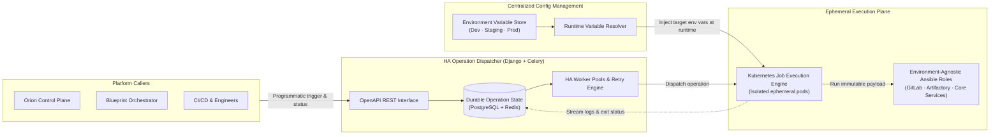

# Leaving Jenkins at Scale: HA Operation Dispatcher, Runtime Configuration & K8s Execution

| Dimension | Details |
| :--- | :--- |
| **Role** | Architect & Platform Lead |
| **Organization** | BBVA (Core Banking Infrastructure) |
| **Scope** | Replaced Jenkins as the infrastructure execution backbone; unified configuration management and ephemeral Kubernetes execution |
| **Stack** | Python, Django, DRF, Celery, Redis, PostgreSQL, Kubernetes Jobs, Ansible, Groovy |

!!! abstract "Architectural summary"

    Before an internal platform can scale to tens of thousands of daily operations, its underlying execution engine must be reliable, API-driven, and stateless at the worker tier. This case study covers a four-part architectural evolution: standardizing pipelines with **Jenkins Shared Libraries**, outgrowing Jenkins and migrating to a purpose-built **High-Availability Operation Dispatcher (Django + Celery)**, decoupling environment state via a **Centralized Configuration Management System**, and running workloads as isolated **Kubernetes Jobs**.

---

## 1. The Evolution: Why Jenkins Shared Libraries Were Necessary — and Why We Outgrew Them

### Stage 1: Standardizing with Jenkins Shared Libraries
Initially, different infrastructure teams maintained duplicated, ad-hoc Jenkinsfiles across repositories. I designed a modular **Jenkins Shared Libraries framework in Groovy** that became the CI/CD standard across multiple infrastructure teams — drastically cutting pipeline duplication and onboarding time.

However, centralizing onto a shared framework also gave us the observability to see **where Jenkins itself became the bottleneck** when used as an infrastructure operation runner at banking scale:

- **Single-controller fragility:** Heavy concurrent infrastructure runs strained the central Jenkins controller and its groovy CPS state serialization.
- **Opaque programmatic control:** Triggering, retrying, and auditing thousands of daily infrastructure operations through Jenkins APIs lacked clean relational state tracking and granular back-pressure.
- **Long-lived worker drift:** Static agent nodes accumulated state and dependency conflicts across runs.

---

## 2. Target Architecture: HA Dispatcher + Config Management + K8s Jobs

To eliminate Jenkins as an operational bottleneck, we decoupled **scheduling & state** (HA Dispatcher), **environment variables** (Configuration Management System), and **compute isolation** (Kubernetes Job Execution Engine):

---

## 3. Key Architectural Decisions

### A. Purpose-Built High-Availability Operation Dispatcher (Django + Celery)
We replaced the Jenkins shared-library execution model entirely with an in-house **Operation Dispatcher** running in High Availability:

- **OpenAPI-first design:** Every operation is triggered, inspected, and monitored through a versioned Swagger/OpenAPI REST contract rather than web-UI-centric build jobs.
- **Full control over execution & retry semantics:** Decoupling scheduling from worker execution allowed custom retry policies, queue prioritization, and granular observability per step.
- **Zero-downtime transition:** Because we already controlled the shared library interface used by teams, we migrated workloads progressively from Jenkins to the Django/Celery dispatcher without interrupting banking operations.

### B. Centralized Configuration Management System
A major source of infrastructure incidents is copying playbooks across `dev`, `staging`, and `prod` branches and editing variables by hand.

- **Strict separation of logic and config:** We built a centralized Configuration Management System that completely decouples variable management from playbook and automation logic.
- **Runtime resolution:** Engineers write **100% environment-agnostic Ansible roles** (including the automation governing BBVA's internal **GitLab, Artifactory, and Jenkins** clusters). At deploy time, the system resolves the target environment and injects the exact validated variable set dynamically — eliminating duplicated repositories and preventing configuration drift.

### C. Kubernetes Job Execution Engine
Instead of running infrastructure automations as long-running processes on shared static servers, we extended the deployment pipeline to execute operations via **Kubernetes Jobs**:

- **Ephemeral isolation:** Every automation run spawns as an isolated, short-lived container inside the cluster with its exact runtime dependencies and injected configuration variables.
- **Clean lifecycle:** Once the operation finishes and streams its telemetry and audit status back to the platform, the pod is destroyed — guaranteeing zero leftover state between runs.

---

## 4. Architectural Trade-Offs

| Decision | Alternative Considered | Rationale |
| :--- | :--- | :--- |
| **Migrate from Jenkins to custom Django/Celery HA Dispatcher** | Scale out multi-controller Jenkins | Eliminated JVM controller bottlenecks, groovy CPS serialization limits, and plugin fragility; gave native Python API control and relational state tracking. |
| **Runtime variable injection via central Config Service** | Per-environment Git branches / inventory folders | Removed duplicated configuration sets across repositories and guaranteed that the exact same tested role runs in dev, staging, and production. |
| **Ephemeral Kubernetes Jobs per operation** | Static worker VMs | Eliminated environment drift, dependency clashes, and noisy-neighbor contention across concurrent runs. |

---

## 5. Operational & Business Impact

- **Zero Single Points of Failure (100% HA):** Eliminated the vulnerability of Jenkins' monolithic master controller for infrastructure workflows, ensuring high availability and seamless worker failover.
- **Zero Configuration Drift:** Dynamic runtime variable injection from a centralized service into environment-agnostic Ansible roles completely eradicated configuration divergences across `dev`, `staging`, and `production`.
- **Compute Isolation & Efficiency:** Replaced static long-lived worker agents with **ephemeral Kubernetes Jobs**, running tasks in isolated containers that release resources immediately upon completion with zero residual state.
- **Proven Banking Scale:** Governed and dispatched **40,000+ daily operations** with real-time state tracking in PostgreSQL and Redis.

---

[:octicons-arrow-left-24: Previous: Blueprint Engine](blueprint.md) · [:octicons-arrow-right-24: Next: Orion AI — Agentic CI/CD Diagnostics (Validated PoC)](orion-ai.md)
