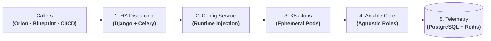

# Leaving Jenkins at Scale: HA Operation Dispatcher, Runtime Configuration & K8s Execution

| Dimension | Details |
| :--- | :--- |
| **Role** | Architect & Platform Lead |
| **Organization** | BBVA (Core Banking Infrastructure) |
| **Scope** | Replaced Jenkins as the infrastructure execution backbone; unified configuration management and ephemeral Kubernetes execution |
| **Stack** | Python, Django, DRF, Celery, Redis, PostgreSQL, Kubernetes Jobs, Ansible, Groovy |

!!! abstract "Architectural summary"

    Before an internal platform can scale to tens of thousands of daily operations, its underlying execution engine must be reliable, API-driven, and stateless. This case study covers an architectural evolution: standardizing pipelines with **Jenkins Shared Libraries**, overcoming the monolith's bottlenecks by migrating to an **in-house HA Dispatcher (Django + Celery)**, decoupling variables via a **Centralized Configuration Service**, and isolating execution in **Kubernetes Jobs**.

---

## 1. The Operational Bottlenecks of Jenkins

We initially standardized enterprise automation using a modular **Jenkins Shared Libraries framework in Groovy**. While it slashed duplication across teams, operating at banking scale revealed structural ceilings within Jenkins:

1. **Master controller fragility (SPOF):** Massive concurrent infrastructure executions strained the JVM master process and Groovy CPS serialization, threatening platform availability and compromising business continuity mandates under **DORA**.
2. **Deficient programmatic control:** Managing thousands of daily infrastructure workflows via Jenkins' web-centric APIs lacked a relational state model and granular back-pressure controls.
3. **Static agent drift:** Long-lived worker nodes accumulated residual state, dependency clashes, and noisy-neighbor resource contention.

---

## 2. Abstract System Topology: Decoupling Execution from State

The architecture decouples the execution lifecycle into five distinct stages:

### Step-by-Step Execution Pipeline

| Stage | Responsible Component | Exactly What Executes | Engineering Guarantee |
| :--- | :--- | :--- | :--- |
| **1. Async Dispatch** | OpenAPI REST Gateway & Celery Workers | Reception of the operation trigger from Orion, Blueprint, or CI/CD; initial state persistence in PostgreSQL. | High-availability, non-blocking ingestion (zero SPOF). |
| **2. Config Injection** | Centralized Configuration Service | Detects target environment (Dev/Staging/Prod) and dynamically injects secrets and parameters into memory at runtime. | Total eradication of configuration drift across environments. |
| **3. Ephemeral Launch** | Kubernetes Job Controller | Spawns a dedicated, short-lived container pod with the exact image and dependencies required for the job. | Strict compute isolation and guaranteed clean dependencies. |
| **4. Agnostic Execution** | Containerized Ansible Runner | Executes 100% environment-agnostic roles (GitLab, Artifactory, core banking services) against target nodes. | Exact same tested automation code runs across dev, staging, and production. |
| **5. Streaming & Teardown** | Redis Broker & PostgreSQL State Store | Continuously streams execution logs, captures exit codes, seals final state, and destroys the pod. | Zero residual state on workers and complete audit history. |

---

## 3. Key Architectural Decisions

### A. Custom Django/Celery Dispatcher vs. Scaling Jenkins Controllers
Scaling out Jenkins controllers multiplied plugin maintenance overhead and did not solve state coupling. Building a lightweight Python dispatcher with Celery and PostgreSQL provided native REST API control, prioritized queues, and a durable relational state machine, allowing seamless workload migration from Shared Libraries without downtime.

### B. Dynamic Runtime Configuration Injection vs. Duplicated Repositories
To eradicate the practice of duplicating playbooks across `dev`, `staging`, and `prod` branches, we built a service that decouples configuration from automation: Ansible roles are 100% environment-agnostic, and variables are resolved and injected into memory at runtime, guaranteeing the exact same tested artifact reaches production.

### C. Ephemeral Kubernetes Jobs vs. Long-Lived Static Workers
Traditional shared worker VMs accumulated leftover files and colliding dependencies. Migrating execution to Kubernetes Jobs turned every task into an ephemeral pod that provisions on demand, executes in isolation, and terminates immediately after emitting telemetry, completely removing worker host maintenance.

---

## 4. Architectural Trade-Offs

| Decision | Alternative Considered | Trade-Off Rationale |
| :--- | :--- | :--- |
| **In-house Django/Celery HA Dispatcher** | Scale out multi-controller Jenkins | Eliminated the JVM master SPOF, fulfilling operational resilience and business continuity requirements under DORA with native REST API control. |
| **Runtime variable injection** | Per-environment Git branches / inventories | Removed duplicated configuration sets across repositories and guaranteed the exact same tested role runs in dev, staging, and production. |
| **Ephemeral Kubernetes Jobs** | Static worker VMs | Eliminated environment drift, dependency clashes, and noisy-neighbor contention across concurrent runs. |

---

## 5. Operational & Business Impact

- **Zero SPOF & DORA Operational Resilience (100% HA):** Eliminated the fragility of Jenkins' monolithic master controller for infrastructure workflows, eradicating single points of failure (SPOF) and ensuring business continuity mandated by financial digital resilience frameworks during host outages.
- **Zero Configuration Drift:** Dynamic runtime variable injection from a centralized service into environment-agnostic Ansible roles completely eradicated configuration divergences across `dev`, `staging`, and `production`.
- **Compute Isolation & Efficiency:** Replaced static long-lived worker agents with **ephemeral Kubernetes Jobs**, running tasks in isolated containers that release resources immediately upon completion with zero residual state.
- **Proven Banking Scale:** Governed and dispatched **40,000+ daily operations** with real-time state tracking in PostgreSQL and Redis.

---

[:octicons-arrow-left-24: Previous: Blueprint Engine](blueprint.md) · [:octicons-arrow-right-24: Next: Orion AI — Agentic CI/CD Diagnostics (Validated PoC)](orion-ai.md)
