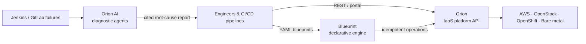

# Case Studies

Code is only one part of a platform. These case studies focus on what matters at
scale: **the problem, the architecture, the trade-offs and the measurable outcome** —
plus a look at the Python design patterns behind each system.

!!! note "About confidentiality"

    The enterprise systems below were built at BBVA. Architecture is described at a
    level that respects confidentiality; code snippets are **simplified, illustrative
    re-implementations** of the patterns used, not proprietary source code.

## Enterprise platform systems

-   :material-cloud-cog-outline:{ .lg .middle } __[Orion — Enterprise IaaS Platform](orion-iaas.md)__

    ---

    One self-service API over AWS, OpenStack, OpenShift and bare metal.

    **Scale:** Tens of thousands of nodes · High-throughput ops · 500+ engineers 
    **Stack:** Python, Django, DRF, Celery, PostgreSQL, MongoDB, Redis

    [:octicons-arrow-right-24: Read the case study](orion-iaas.md)

-   :material-file-tree-outline:{ .lg .middle } __[Blueprint — Declarative Orchestrator](blueprint.md)__

    ---

    Terraform-style AsyncIO engine driven by versioned YAML blueprints.

    **Impact:** Replaced a commercial automation platform licence 
    **Stack:** Python, AsyncIO, YAML + JSON Schema, GitOps

    [:octicons-arrow-right-24: Read the case study](blueprint.md)

## Applied operational AI

-   :material-stethoscope:{ .lg .middle } __[Orion AI — CI/CD Auto-Diagnostics](orion-ai.md)__

    ---

    Multi-agent root-cause triage over logs, diffs and runbooks.

    **Impact:** Initial triage from hours to < 15 seconds 
    **Stack:** LangGraph, ReAct, MCP, Qwen (131k context), vector search

    [:octicons-arrow-right-24: Read the case study](orion-ai.md)

-   :material-school-outline:{ .lg .middle } __[OmniLecture — Multimodal AI Suite](omni-lecture.md)__

    ---

    Personal project turning lectures into grounded notes and flashcards.

    **Focus:** Multimodal pipelines & local edge inference 
    **Stack:** Python, LangGraph, Whisper (int8 + cloud), OpenCV, OCR

    [:octicons-arrow-right-24: Read the case study](omni-lecture.md)

## How the systems fit together

