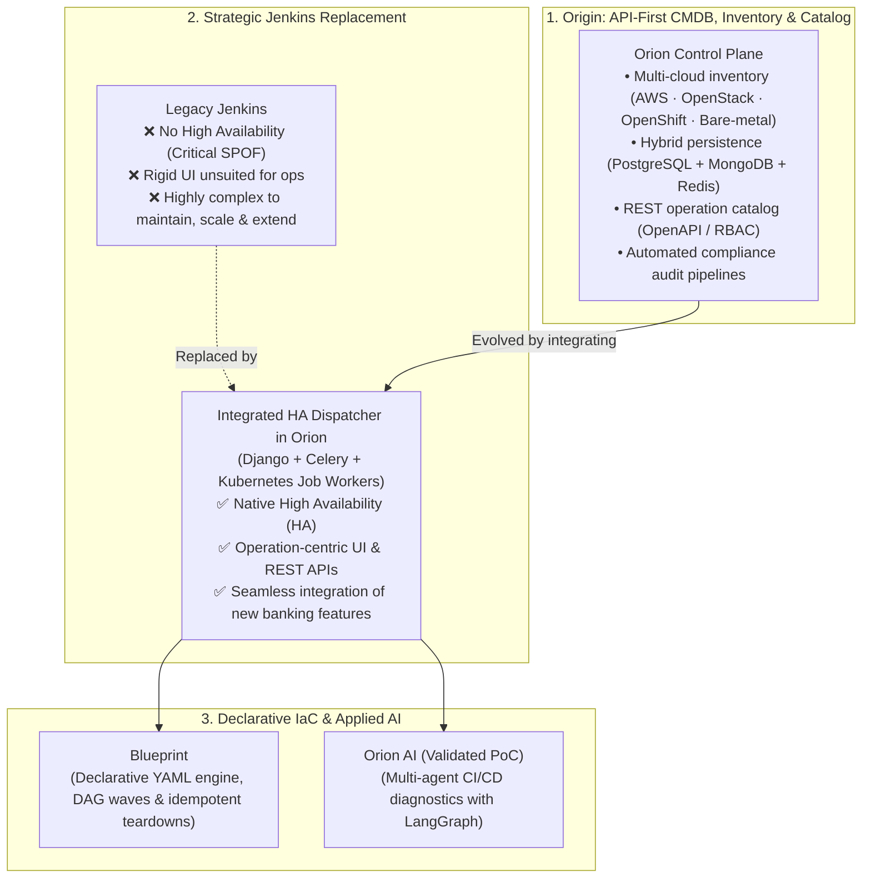

# Platform Ecosystem & Case Studies

Great platforms are rarely designed on a blank whiteboard in a single afternoon. They evolve **layer by layer** as existing tools hit scaling ceilings, vendor integrations get deprecated, and manual governance stops working.

This section maps how the systems I architected over the last decade connect into a single, cohesive engineering trajectory — followed by deep-dive case studies and my public open-source work.

---

## 1. The Evolution of Orion: From API-First CMDB & Inventory to a High-Availability Dispatcher

At **BBVA Technology** (2017 – Present), **Orion** was not built as a static tool, but as an evolving architectural response to enterprise infrastructure bottlenecks at scale — governing **30,000+ machines** across **AWS, OpenStack, OpenShift, and bare metal**, processing **40,000+ daily operations** for **500+ engineers**:

1. **Phase 1 — The Origin: Multi-Cloud CMDB, Inventory & API-First Catalog:** Orion originated as a centralized control plane to inventory and govern heterogeneous assets across AWS, OpenStack, OpenShift, and bare metal, combining a hybrid database tier (PostgreSQL, MongoDB, Redis), RBAC, and automated compliance audit pipelines directly consumed by bank auditors.
2. **Phase 2 — The Jenkins Bottleneck:** Initially, operation catalog execution relied on Jenkins. However, Jenkins lacked native High Availability (posing a critical single point of failure for the bank), its UI was tailored for software compilation logs rather than infrastructure state machines, and it was notoriously complex to operate, scale, and integrate with new bank functionalities and core systems.
3. **Phase 3 — Evolution into a Purpose-Built HA Dispatcher:** Orion evolved by absorbing the execution plane into a **native High-Availability Operation Dispatcher (Django + Celery + Kubernetes Jobs)**. This migration completely replaced Jenkins for infrastructure workflows, decoupled variables at runtime (preventing configuration drift), and delivered an API-first architecture with isolated ephemeral container execution.
4. **Phase 4 — Declarative Extension (Blueprint) & Operational AI (Orion AI):** With the CMDB and dispatcher united under the same architecture, Orion expanded into declarative provisioning with **Blueprint** (asynchronous YAML engine with DAG waves and idempotent teardowns, eliminating suites like Red Hat Automation Platform) and agentic auto-diagnostics with **Orion AI** (LangGraph).

---

## 2. Enterprise Architecture Deep-Dives

-   :material-cloud-cog-outline:{ .lg .middle } __[Orion — Central IaaS Platform & Driver Pipeline](orion-iaas.md)__

    ---

    Sole architect of the central IaaS and deployment control plane: one OpenAPI interface governing 30,000+ machines across AWS, OpenStack, OpenShift, and bare metal (40,000+ daily ops), backed by a hybrid PostgreSQL + MongoDB + Redis tier and automated compliance audit pipelines.

    [:octicons-arrow-right-24: Architecture & trade-offs](orion-iaas.md)

-   :material-file-tree-outline:{ .lg .middle } __[Blueprint — Declarative Lifecycle Engine](blueprint.md)__

    ---

    Asynchronous Python orchestration engine driven by versioned YAML blueprints. Computes execution DAGs, reconciles against live Orion state, and resumes interrupted teardowns idempotently — eliminating commercial automation licensing.

    [:octicons-arrow-right-24: Architecture & trade-offs](blueprint.md)

-   :material-cached:{ .lg .middle } __[Leaving Jenkins — HA Dispatcher & K8s Execution](dispatcher-migration.md)__

    ---

    How we migrated away from centralized Jenkins bottlenecks to a purpose-built High-Availability Operation Dispatcher (Django + Celery), dynamic runtime configuration injection, and ephemeral Kubernetes Job execution.

    [:octicons-arrow-right-24: Architecture & trade-offs](dispatcher-migration.md)

-   :material-radar:{ .lg .middle } __[Orion AI — Agentic CI/CD Diagnostics (Validated PoC)](orion-ai.md)__

    ---

    Multi-agent LangGraph + ReAct diagnostic prototype that correlates pipeline logs, Redis-indexed runbooks, and GitLab diffs under deterministic guardrails — plus a candid look at enterprise rollout constraints.

    [:octicons-arrow-right-24: Architecture & rollout lessons](orion-ai.md)

---

## 3. Core Platform Subsystems & Earlier Infrastructure Work

Beyond the four flagship deep-dives above, these subsystems formed critical building blocks of the platform stack:

-   :material-swap-horizontal-bold:{ .lg .middle } __F5 / OpenStack REST API Bridge (BBVA)__

    ---

    **Problem:** The native F5 Load Balancer integration with OpenStack was officially deprecated, threatening automated traffic balancing across banking environments.
    
    **Solution:** Engineered a custom RESTful API bridge in Python that restored full interoperability between F5 appliances and OpenStack networking. Delivered with **zero downtime**, avoiding a disruptive platform migration.

-   :material-tune-variant:{ .lg .middle } __Centralized Configuration Management System (BBVA)__

    ---

    **Problem:** Environment-specific variables hardcoded inside Ansible playbooks led to repository duplication and configuration drift across dev, staging, and production.
    
    **Solution:** Built a centralized configuration service that decouples variable management from playbook logic, dynamically resolving and injecting target-environment variables at deploy time.

-   :material-dharmachakra:{ .lg .middle } __Kubernetes Job Execution Engine (BBVA)__

    ---

    **Problem:** Running heavy automation and static validation workflows on long-lived worker nodes caused resource contention and environment drift.
    
    **Solution:** Extended the deployment pipeline to execute any infrastructure operation as an isolated, ephemeral **Kubernetes Job**, injecting environment variables at runtime and streaming telemetry back to central monitoring.

-   :material-server-security:{ .lg .middle } __Ansible Shared Services Governance (BBVA)__

    ---

    **Scope:** Owned and maintained the environment-agnostic Ansible codebase provisioning and configuring BBVA's core developer platforms — including **GitLab, Artifactory, and Jenkins** clusters — consuming variables automatically from the Configuration Management System.

-   :material-source-branch:{ .lg .middle } __Jenkins Shared Libraries Framework (BBVA)__

    ---

    **Scope:** Authored modular Groovy shared libraries and reusable pipeline templates that standardized CI/CD across multiple infrastructure teams, cutting pipeline duplication and establishing the operational baseline later superseded by the custom HA Dispatcher.

-   :material-harddisk:{ .lg .middle } __Private Cloud Storage Platform on OpenStack Swift (Oesia · 2015–2017)__

    ---

    **Scope:** Administered a production private cloud on **OpenStack and Ceph** distributed storage, and developed an enterprise self-hosted file storage and sharing application (Dropbox-equivalent) in Python on top of **OpenStack Swift** object storage.

---

## 4. Open-Source Projects & Personal R&D

Public systems built outside enterprise constraints — with complete source code available on GitHub:

-   :material-waveform:{ .lg .middle } __[OmniLecture Studio — Linux Multimodal AI Suite](omni-lecture.md)__

    ---

    Native Linux (Wayland/GNOME, GTK 3) screen/audio recorder with an optimized FFmpeg multimedia pipeline (tuned H.264 10 FPS stillimage encoding cutting file size by 70%, hardware PTS clock sync, and afftdn spectral filtering) paired with LangGraph workflows. Combines dual-engine Whisper (`faster-whisper` CPU `int8` + cloud API), OpenCV CLAHE + Tesseract slide/handwriting OCR, and anti-hallucination guardrails to generate Markdown notes, `.docx` documents, and Anki decks.

    [:octicons-arrow-right-24: Case study](omni-lecture.md) · [:fontawesome-brands-github: GitHub repo](https://github.com/oredondo/omnilecture-studio)

-   :material-wrench-outline:{ .lg .middle } __[WrenchBuddy — AI Vehicle Lifecycle & RAG Platform](wrenchbuddy.md)__

    ---

    Full-stack vehicle maintenance and telemetry platform built with **Django 6, DRF, PostgreSQL (`pgvector`), Celery, Redis, and LangChain** (plus a TypeScript frontend). Uses Vision/OCR to parse workshop invoices and 768-dim vector RAG over technical manuals to power a context-aware mechanical assistant.

    [:octicons-arrow-right-24: Case study](wrenchbuddy.md) · [:fontawesome-brands-github: Backend](https://github.com/oredondo/WrenchBuddy) · [:fontawesome-brands-github: Frontend](https://github.com/oredondo/WrenchBuddy-frontend)

