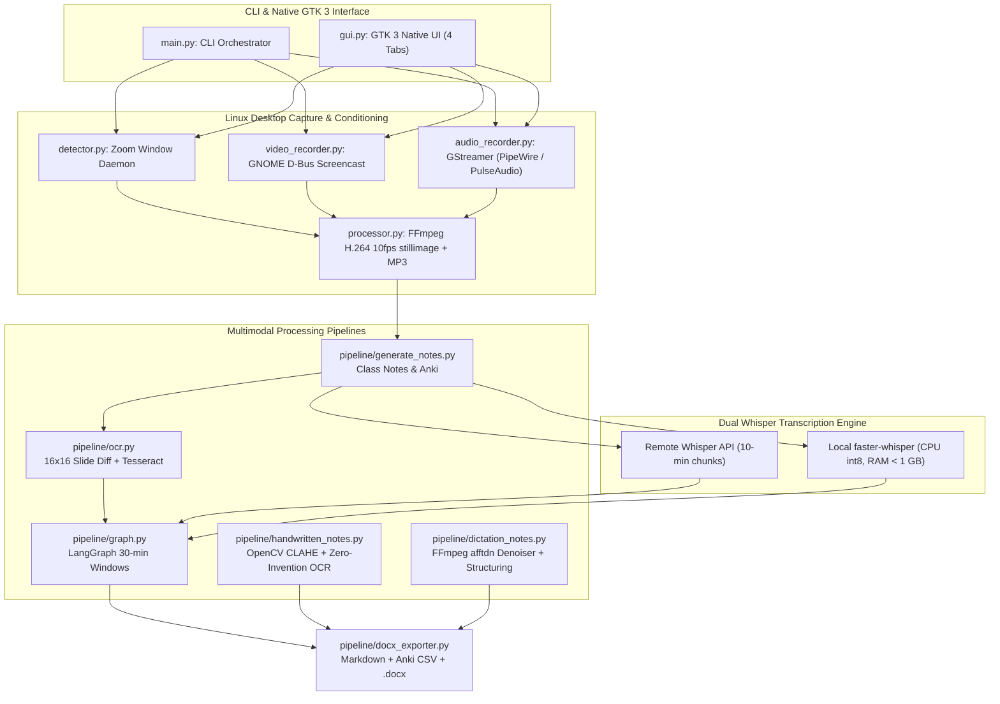

# OmniLecture Studio: Native Linux Multimodal AI Suite

| Dimension | Details |
| :--- | :--- |
| **Role** | Creator & Maintainer (Open Source) |
| **Repository** | [:fontawesome-brands-github: `github.com/oredondo/omnilecture-studio`](https://github.com/oredondo/omnilecture-studio) (MIT License) |
| **Domain** | Linux desktop engineering (Wayland / GNOME / GTK 3) & multimodal LangGraph pipelines |
| **Stack** | Python 3.10+, GTK 3, D-Bus Screencast, GStreamer (PipeWire/PulseAudio), FFmpeg, LangGraph, `faster-whisper` (`int8`) + Whisper API, OpenCV (CLAHE), Tesseract OCR |

!!! abstract "Overview"

    **OmniLecture Studio** is an open-source, Linux-native academic and technical productivity suite built for GNOME (Wayland & X11). It captures online lectures, slides, handwritten notebook photos, and voice dictations, processing them through a multi-node **LangGraph** workflow into structured Markdown notes, Microsoft Word (`.docx`) documents, and spaced-repetition **Anki** flashcard decks under a strict zero-invention policy.

---

## 1. Real System Architecture

Unlike web wrappers, OmniLecture Studio integrates directly with the Linux desktop stack (`GNOME Shell D-Bus Screencast`, `GStreamer`, `FFmpeg`) and orchestrates local and cloud AI models through modular pipelines:

---

## 2. Key Engineering Highlights

### A. Linux-Native Capture & Slide-Optimized Compression
- **Wayland D-Bus & GStreamer:** Captures screen video via GNOME Shell's D-Bus Screencast API and mixes system/microphone audio via GStreamer pipelines over PipeWire/PulseAudio.
- **Tuned for typography, not 60 FPS gaming:** Encodes H.264 video at 10 FPS with `--tune stillimage` and CRF 24 — keeping code and slide text razor-sharp while cutting disk usage by up to 70%.
- **Crash recovery (`recover.py`):** Recovers and merges uncommitted media chunks in `.temp/` if a session is interrupted by a system crash or power loss.

### B. Low-CPU Slide OCR & Dual-Engine Whisper
- **16×16 perceptual frame diffing (`pipeline/ocr.py`):** Downscales frames to 16×16 thumbnails to detect slide transitions before invoking Tesseract OCR, skipping static frames and cropping out the rightmost 25% of the frame to ignore webinar chat sidebars.
- **Dual Whisper transcription (`pipeline/transcription.py`):** Supports OpenAI-compatible remote endpoints with automatic 10-minute audio chunking alongside an offline `faster-whisper` (`int8` quantized) fallback engineered to keep memory usage under 1 GB on CPU.

### C. LangGraph Synthesis in 30-Minute Windows & Zero-Invention Guardrails
- **Windowed LangGraph DAG (`pipeline/graph.py`):** Processes long lectures in 30-minute windows (`Consolidate → Segment by STUDY_TARGET → Generate Notes & Anki CSV → Editorial Refinement Pass`), preventing context dilution on multi-hour recordings.
- **Handwritten notes digitization (`pipeline/handwritten_notes.py`):** Applies OpenCV **CLAHE** (Contrast Limited Adaptive Histogram Equalization) before OCR, translating handwritten diagrams into Mermaid blocks and formulas into LaTeX under strict system prompts that forbid inventing missing facts.
- **Acoustic conditioning for voice dictation (`pipeline/dictation_notes.py`):** Runs an FFmpeg spectral denoiser (`afftdn`), a 100 Hz–4000 Hz human speech bandpass filter, and silence stripping before transcription.

---

## 3. Repository Structure & Source Code

The complete Python codebase, GTK 3 components, FFmpeg pipelines, and LangGraph definitions are public on GitHub:

- :fontawesome-brands-github: **Source Repository:** [`github.com/oredondo/omnilecture-studio`](https://github.com/oredondo/omnilecture-studio)

---

[:octicons-arrow-left-24: Previous: Orion AI (PoC)](orion-ai.md) · [:octicons-arrow-right-24: Next: WrenchBuddy — AI Vehicle Lifecycle & RAG Platform (Open Source)](wrenchbuddy.md)
