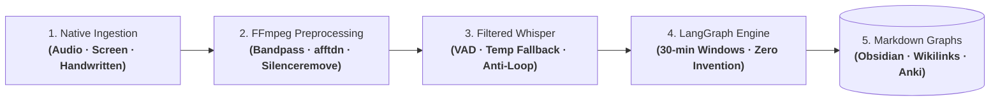

# OmniLecture Studio: Native Linux Multimodal AI Suite

| Dimension | Details |
| :--- | :--- |
| **Role** | Creator & Maintainer (Open Source) |
| **Repository** | [:fontawesome-brands-github: `github.com/oredondo/omnilecture-studio`](https://github.com/oredondo/omnilecture-studio) (MIT License) |
| **Domain** | Linux desktop engineering (Wayland / GNOME / GTK 3) & multimodal LangGraph pipelines |
| **Stack** | Python 3.10+, GTK 3, D-Bus Screencast, GStreamer, FFmpeg, LangGraph, `faster-whisper` (`int8`), Whisper API, OpenCV (CLAHE), Tesseract OCR |

!!! abstract "Architectural summary"

    **OmniLecture Studio** is an open-source academic and technical productivity suite built natively for Linux desktops (GNOME / Wayland and X11). It combines native screen and audio capture via system APIs, an advanced **FFmpeg acoustic conditioning pipeline for voice dictations**, **speech filtering in Whisper to prevent hallucinations**, and a multi-node **LangGraph** engine that synthesizes content into **interconnected Markdown (`.md`) knowledge graphs** (compatible with Obsidian and PKM tools) alongside spaced-repetition **Anki** flashcard decks under strict zero-invention guardrails.

---

## 1. Context & Engineering Challenges

Automating the processing of technical lectures, conferences, and voice dictations on Linux presented three critical engineering challenges:

1. **Acoustic noise & transcription hallucinations:** Raw audio (breathing, keyboard clicks, dead silence, background hum) frequently drives Whisper into infinite repetition loops or hallucinated phrases.
2. **Compute & storage overhead:** Standard screen recording tools capture video at 30/60 FPS, creating massive, inefficient files for content where the majority of the display (slides, terminals, code) remains static.
3. **Loss of conceptual relationships:** Dumping notes into flat, linear text blocks discards the semantic richness of a technical session, hindering the connection between interdependent concepts.

---

## 2. Abstract System Topology: Multimodal & Dictation Pipeline

OmniLecture Studio decouples capture, signal preprocessing, filtered transcription, and conceptual synthesis into a deterministic pipeline:

### Step-by-Step Processing Pipeline

| Stage | Responsible Component | Exactly What Executes | Engineering Guarantee |
| :--- | :--- | :--- | :--- |
| **1. Native Ingestion** | GTK 3, D-Bus Screencast & GStreamer | Desktop video screencast via GNOME Portal; system and microphone audio mixing via PipeWire/PulseAudio. | Native, secure capture without root privileges or browser-wrapper overhead. |
| **2. FFmpeg Conditioning** | Multimedia Pipeline (`processor.py`) | FFT spectral denoising (`afftdn`), speech bandpass (100 Hz–4000 Hz), dead silence removal (`silenceremove`), and 10 FPS H.264 encoding (`-tune stillimage`). | Up to 70% video size reduction and pristine, normalized audio tuned for inference. |
| **3. Filtered Whisper** | Dual Transcription Engine | Voice Activity Detection (VAD), compression ratio thresholding, temperature fallback, and dual-engine execution (`faster-whisper int8` local or cloud API in 10-min chunks). | **Zero infinite loops:** elimination of hallucinations during pauses and low resource consumption (< 1 GB RAM on CPU). |
| **4. LangGraph Orchestration** | Stateful Cyclic Graph | Session partitioning into 30-minute processing windows, multimodal slide OCR correlation (CLAHE + Tesseract), and reflective evaluation. | Temporal coherence and full traceability without context dilution during long sessions. |
| **5. Markdown Graph Synthesis** | Conceptual Network Generator | Structured Markdown (`.md`) generation with bidirectional *wikilinks* (`[[concept]]`), YAML frontmatter metadata, and Anki card decks. | Native integration with Obsidian and PKM tools for semantic graph exploration. |

---

## 3. Key Architectural Decisions

### A. FFmpeg Acoustic Conditioning for Dictation & Speech
Audio preprocessing in FFmpeg serves as the primary line of defense to guarantee accurate technical dictation transcripts:
- **FFT spectral denoising (`afftdn`):** Eliminates continuous background hum (system cooling fans, electrical noise) before the waveform reaches the speech model.
- **Strict vocal bandpass (100 Hz–4000 Hz):** Filters out low-frequency mechanical rumble (desk vibrations) and high-frequency harmonics outside human speech formants.
- **Intelligent silence stripping (`silenceremove`):** Trims extended pauses and dead air that commonly trigger hallucinations in phonetic inference engines.
- **Tuned visual compression:** 10 FPS H.264 encoding with `-tune stillimage` and CRF 24 preserves razor-sharp edges on typography and code while slashing storage footprint by up to 70%.

### B. Advanced Filters & Anti-Hallucination Controls in Whisper
To counter Whisper's tendency to loop or hallucinate text when audio signal degrades, the pipeline enforces strict phonetic guardrails:
- **Voice Activity Detection (VAD):** Discards silent or low-energy segments prior to invoking the neural network.
- **Temperature Fallback:** Begins inference at temperature `0.0` (maximum determinism) and only steps up temperature if the compression ratio exceeds `compression_ratio_threshold` (2.4), preventing phrase repetition cascades.
- **Dual execution engine:** Allows seamless toggling between an offline `faster-whisper` engine quantized in `int8` (running on CPU with under 1 GB RAM without sending data over the network) and the remote Whisper API with automatic 10-minute chunking.

### C. Markdown (`.md`) Knowledge Graphs & LangGraph Orchestration
OmniLecture avoids closed, proprietary document formats in favor of **interconnected Markdown knowledge graphs**:
- **Stateful LangGraph machine:** Orchestrates the session across consecutive 30-minute windows (`Segmentation → Entity Extraction → Refinement`), preventing context degradation on multi-hour recordings.
- **Semantic interlinking (Obsidian Knowledge Graphs):** Every key concept, formula, or definition is linked via bidirectional *wikilinks* (`[[Key Concept]]`) and hierarchical taxonomies in Markdown (`.md`), enabling full semantic graph visualization in Obsidian and Personal Knowledge Management (PKM) ecosystems.
- **Spaced repetition:** Automatically outputs Anki flashcard decks mapped to concepts within the graph, ensuring long-term knowledge retention.

---

## 4. Architectural Trade-Offs

| Decision | Alternative Considered | Trade-Off Rationale |
| :--- | :--- | :--- |
| **Upstream FFmpeg conditioning** | Feeding raw audio directly to Whisper | Eliminates background hum and silence that provoke infinite repetition loops and hallucinations. |
| **VAD & Temperature Fallback filters** | Standard single-pass fixed-temperature inference | Prevents repetitive phrase generation and enforces deterministic transcription outputs. |
| **Markdown knowledge graphs (`.md`)** | Proprietary word-processing formats | Models linked conceptual networks via *wikilinks* compatible with Obsidian and versionable in Git. |
| **Dual Whisper (`int8` local + Cloud)** | Cloud-only or heavy unquantized local model | Delivers full privacy and low compute (< 1 GB CPU RAM) offline, while retaining cloud capacity for massive recordings. |
| **30-minute LangGraph windows** | Single monolithic prompt over entire transcript | Prevents context window saturation and preserves granular technical detail across multi-hour lectures. |

---

## 5. Source Code & Open Source Repository

The complete Python source code, FFmpeg filtering pipelines, native GTK 3 interface, and LangGraph definitions are published under the MIT license:

- :fontawesome-brands-github: **Official GitHub Repository:** [`github.com/oredondo/omnilecture-studio`](https://github.com/oredondo/omnilecture-studio)

---

[:octicons-arrow-left-24: Previous: Orion AI (PoC)](orion-ai.md) · [:octicons-arrow-right-24: Next: WrenchBuddy — AI Vehicle Lifecycle & RAG Platform (Open Source)](wrenchbuddy.md)
