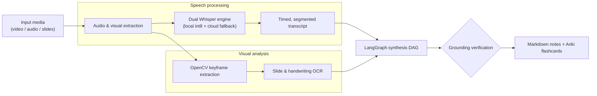

# OmniLecture Studio: Multimodal AI Suite

| Dimension | Details |
| :--- | :--- |
| **Role** | Creator & Developer (personal engineering project) |
| **Domain** | Multimodal agentic AI & local edge inference |
| **Stack** | Python, LangGraph, Whisper (CPU int8 & cloud), OpenCV, OCR, vector embeddings |

!!! abstract "TL;DR"

    Raw recordings, slide decks and handwritten notes go in; structured Markdown notes
    and Anki flashcards come out. Speech and visuals are processed in parallel, merged
    in a LangGraph DAG, and every generated card must be traceable to a timestamp or a
    slide excerpt.

## 1. Overview

OmniLecture Studio converts unstructured educational media into structured,
searchable knowledge. It runs locally on Linux for privacy and offline use, and
scales out to cloud endpoints when throughput matters.



## 2. Key engineering decisions

- **Dual-engine speech recognition** — local CPU inference with `int8` quantization for
  private / offline work, with automatic fallback to a cloud endpoint for large batches.
- **Domain vocabulary prompting** — technical glossaries are injected into transcription
  prompts to avoid phonetically similar mis-transcriptions of jargon.
- **Grounded flashcard generation** — each Q&A pair must reference an explicit timestamp
  or slide excerpt; ungrounded cards are rejected rather than "fixed" by the model.

## 3. Python implementation highlights

The dual engine is a small strategy pattern — illustrative version:

```python title="transcription.py (illustrative)"
from pathlib import Path
from typing import Protocol


class Transcriber(Protocol):
    def transcribe(self, audio: Path, *, prompt: str) -> list["Segment"]: ...


class DualTranscriber:
    """Prefer private local inference; fall back to the cloud when needed."""

    def __init__(self, local: Transcriber, cloud: Transcriber, max_local_minutes: float = 90) -> None:
        self.local, self.cloud, self.max_local_minutes = local, cloud, max_local_minutes

    def transcribe(self, audio: Path, *, prompt: str) -> list["Segment"]:
        if duration_minutes(audio) <= self.max_local_minutes:
            try:
                return self.local.transcribe(audio, prompt=prompt)
            except MemoryError:
                pass  # degrade gracefully to the cloud engine
        return self.cloud.transcribe(audio, prompt=prompt)
```

Because both engines satisfy the same `Protocol`, the rest of the pipeline — and its
tests — never needs to know which one produced the transcript.

[:octicons-arrow-left-24: Back to all case studies](index.md)
