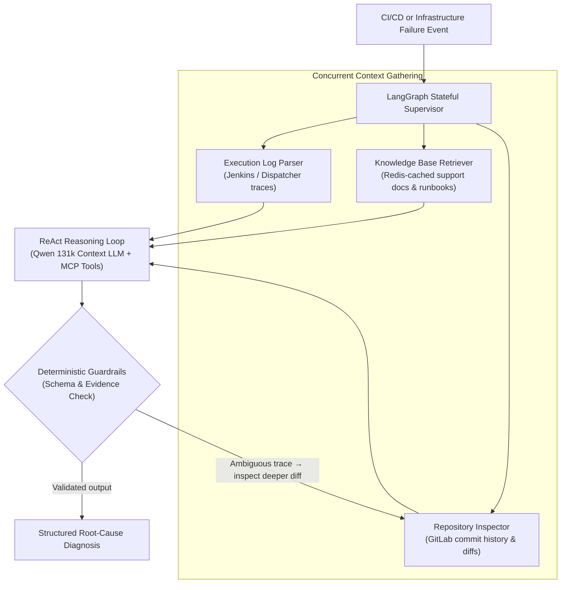

# Orion AI: Operational AI & Auto-Diagnostic Engine for CI/CD (Validated PoC)

| Dimension | Details |
| :--- | :--- |
| **Role** | Architect & Developer |
| **Organization / Stage** | BBVA Technology · **Validated Proof of Concept (PoC)** |
| **Outcome** | Validated prototype reducing incident log triage from hours to seconds; prepared and awaiting central AI infrastructure integration guidelines |
| **Stack** | Python, LangGraph, ReAct Agents, Qwen LLM (131k context), Model Context Protocol (MCP), Redis, Jenkins & GitLab APIs |

!!! abstract "Architectural summary"

    Orion AI is a functional, validated **Proof of Concept (PoC)** built to evaluate parallel, multi-agent root-cause diagnostics across CI/CD and infrastructure pipelines. Using **LangGraph** state machines and **ReAct** reasoning loops, the system concurrently aggregates execution logs, Redis-cached support documentation, and GitLab commit diffs with high-context LLMs (`Qwen` 131k context) under strict deterministic guardrails — cutting manual triage from hours to seconds during validation.

---

## 1. Operational Problem Statement

When CI/CD pipelines or infrastructure deployments fail at enterprise scale, the fix is rarely what consumes the most engineering time. Instead, **Mean Time to Resolution (MTTR)** is dominated by manual context gathering:

1. Opening massive Jenkins or dispatcher execution logs to locate the first true failure trace.
2. Searching internal runbooks and historical incident tickets for known infrastructure errors.
3. Inspecting recent GitLab repository commits and diffs to check whether a code or configuration change triggered the failure.

**Goal of the PoC:** Prove that an autonomous multi-agent workflow could gather those three sources of evidence concurrently and synthesize an accurate, zero-hallucination root-cause report within seconds of a pipeline failure.

---

## 2. Abstract Multi-Agent Topology

---

## 3. Core Design Decisions

### A. Cyclic Graph Orchestration (LangGraph) over Linear Prompts
Pipeline failures are rarely diagnosable in a single linear pass. When a raw log only shows a generic exit code, the agent needs to loop back and inspect recent commit diffs or configuration changes before concluding. **LangGraph** maintains a typed state across nodes, enabling conditional branching and bounded ReAct loops rather than brittle one-shot prompting.

### B. Concurrent Evidence Aggregation with Long-Context Reasoning
Rather than querying tools sequentially, the graph fetches execution traces, Redis-cached operational documentation, and repository metadata in parallel, feeding the consolidated evidence into a **131k-context LLM (Qwen)** so long dependency chains in build logs are preserved without losing early setup errors.

### C. Strict Deterministic Guardrails
In a regulated banking environment, an operational diagnostic tool cannot speculate or invent commands:

- **Typed output contracts:** Agent responses are constrained to strict schemas rather than free-form chat.
- **Grounded evidence:** Every diagnostic finding must correlate directly with retrieved log fragments, known runbook entries, or actual commit diffs.
- **Standardized tool boundaries (MCP):** External integrations (logs, Redis cache, GitLab APIs) are isolated behind clean tool interfaces so the reasoning layer cannot execute arbitrary side effects.

---

## 4. Why This Is a Validated PoC — and What Blocked Production Rollout

> [!IMPORTANT]
> Including the real organizational constraints behind a PoC is essential to an honest architectural post-mortem.

The technical prototype was fully built, tested against real failure scenarios, and validated — demonstrating that automated multi-agent triage reduces diagnostic time from hours of manual log digging to seconds.

However, moving an LLM-powered system from a **validated PoC** to **wide production rollout** inside a tier-1 bank depends on platform boundaries outside a single team:

1. **Central AI infrastructure dependencies:** Wide production deployment requires standardized guidelines and quota allocation on the bank's shared internal AI inference infrastructure (managed by partner platform teams).
2. **Governance & compliance sign-off for operational data:** Even when using internal models, routing CI/CD logs and repository diffs into an inference endpoint requires formal cross-team definitions around data retention, redaction, and multi-tenant isolation.
3. **Key engineering takeaway:** Building a reliable LangGraph + ReAct agent with deterministic guardrails is the tractable engineering problem; aligning shared corporate GPU/inference platforms and governance boundaries is what ultimately sets the timeline in regulated enterprises.

---

[:octicons-arrow-left-24: Previous: Leaving Jenkins — HA Dispatcher](dispatcher-migration.md) · [:octicons-arrow-right-24: Next: OmniLecture Studio (Open Source)](omni-lecture.md)
