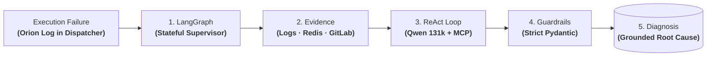

# Orion AI: Operational AI & Auto-Diagnostic Engine for CI/CD (Validated PoC)

| Dimension | Details |
| :--- | :--- |
| **Role** | Architect & Technical Lead |
| **Organization / Stage** | BBVA · **Validated Proof of Concept (PoC)** |
| **Outcome** | Validated prototype reducing incident log triage from hours to seconds; prepared and awaiting central AI infrastructure integration guidelines |
| **Stack** | Python, LangGraph, ReAct Agents, Qwen LLM (131k context), Model Context Protocol (MCP), Redis, Dispatcher & GitLab APIs |

!!! abstract "Architectural summary"

    Orion AI is a functional, validated **Proof of Concept (PoC)** built to evaluate parallel, multi-agent root-cause diagnostics across CI/CD and infrastructure pipelines. Using **LangGraph** state machines and **ReAct** reasoning loops, the system concurrently aggregates execution logs, operational runbooks in Redis cache, and GitLab commit diffs with high-context LLMs (`Qwen` 131k context) under strict deterministic guardrails — cutting manual triage from hours to seconds during validation.

---

## 1. Operational Problem Statement

When enterprise CI/CD pipelines or infrastructure deployments fail, **Mean Time to Resolution (MTTR)** is overwhelmingly dominated by manual context gathering. In a banking environment subject to frameworks like **DORA**, rapid ICT incident detection and triage is a critical regulatory priority:
1. Sifting through extensive Orion execution logs in the Dispatcher to isolate the first genuine error trace.
2. Searching internal wikis and historical incident tickets for known failure patterns.
3. Inspecting recent GitLab repository diffs to correlate code or configuration changes.

**Goal of the PoC:** Prove that an autonomous multi-agent workflow can synthesize those three evidence sources concurrently and emit an accurate, zero-hallucination root-cause diagnosis within seconds.

---

## 2. Abstract System Topology: Multi-Agent Diagnostic Pipeline

Orion AI structures root-cause analysis as a sequential workflow with reflective loops:

### Step-by-Step Diagnostic Pipeline

| Stage | Responsible Component | Exactly What Executes | Engineering Guarantee |
| :--- | :--- | :--- | :--- |
| **1. Failure Ingestion** | Webhook / API Listener | Ingests the failure event and Orion log from the Dispatcher with the Job ID and initial exit code. | Instant diagnostic trigger without manual developer intervention. |
| **2. Concurrent Gathering** | LangGraph Parallel Nodes | Fetches full execution logs, operational runbooks from Redis cache, and recent GitLab commit diffs in parallel. | Millisecond context aggregation without serial I/O bottlenecks. |
| **3. Multimodal Reasoning** | ReAct Loop (Qwen 131k) | Evaluates consolidated evidence across the 131k token window to isolate the failure's root cause. | Detects broken dependencies, environment drift, or subtle Git changes. |
| **4. Deterministic Check** | Pydantic Schema Guardrails | Verifies that every assertion in the diagnostic output maps directly to actual logs, runbooks, or diffs. | **Zero hallucination:** outright rejection of ungrounded hypotheses. |
| **5. Diagnostic Emission** | Incident Report Generator | Emits a structured summary containing the exact failure line, culprit commit, and recommended remediation action. | Drops MTTR from hours to seconds for on-call operations teams. |

---

## 3. Key Architectural Decisions

### A. Cyclic Stateful Graphs (LangGraph) vs. Linear Chains
Pipeline failures are rarely diagnosable in a single linear pass. When a raw log only shows a generic exit code, the agent needs to loop back and inspect recent commit diffs before concluding. LangGraph maintains a typed state across nodes, enabling conditional branching and bounded ReAct loops impossible in traditional linear chains.

### B. High-Context Reasoning Window (131k) vs. Chunked Fragmentation
Rather than fragmenting build logs through standard vector RAG chunking that loses causality between distant execution phases, the system streams consolidated context into a 131k-token model (Qwen), preserving the full operational timeline from initialization to the terminal crash.

### C. Strict Deterministic Guardrails vs. Free-Form Text
In a regulated banking environment, an operational diagnostic agent cannot speculate. Responses are strictly validated against typed Pydantic contracts and tool integrations (logs, GitLab) are isolated behind Model Context Protocol (MCP) interfaces, eradicating hallucinations and ensuring every finding maps directly to grounded evidence.

---

## 4. Architectural Trade-Offs

| Decision | Alternative Considered | Trade-Off Rationale |
| :--- | :--- | :--- |
| **Stateful cyclic graphs (LangGraph)** | Linear chains or single-turn prompts | Enabled reflective conditional retries and backtracking to code diff inspection when logs are ambiguous. |
| **Self-hosted long-context LLM (Qwen 131k)** | Public cloud black-box APIs | Protected sensitive banking source code while accommodating entire execution histories in a single context window. |
| **Strict typed deterministic guardrails (Pydantic)** | Unstructured free-form text output | Completely eliminated hallucinated diagnostic commands, ensuring all outputs map directly to grounded evidence. |

---

## 5. Why This Is a Validated PoC — and Enterprise Rollout Constraints

> [!IMPORTANT]
> Including the real organizational constraints behind a PoC is essential to an honest architectural post-mortem.

The technical prototype was fully built, tested against real failure scenarios, and validated. However, moving an LLM-powered system to **wide production rollout** inside a tier-1 bank depends on cross-cutting corporate factors:

1. **Central AI inference infrastructure:** Requires standardized guidelines and capacity allocation on shared internal GPU platforms managed by dedicated corporate AI teams.
2. **Operational data privacy & governance:** Routing CI/CD logs and source code into inference endpoints requires formal cross-team definitions around retention, redaction, and multi-tenant isolation.
3. **Key engineering takeaway:** Building a reliable LangGraph + ReAct agent with deterministic guardrails is the tractable engineering problem; aligning shared corporate GPU platforms and governance boundaries is what sets adoption timelines in regulated industries.

---

## 6. Operational Impact & Validation

- **Radical MTTR reduction (DORA Alignment):** Reduced root cause isolation time for complex CI/CD pipeline failures from hours of manual digging to under 15 seconds, supporting rapid ICT incident response thresholds mandated by DORA.
- **Zero-hallucination multi-source correlation:** Proved the capability to synthesize runtime logs, Redis-cached runbooks, and GitLab diffs concurrently under strict evidence schemas.
- **Agentic architecture blueprint:** Established reference patterns for graph-based multi-agent orchestration, MCP contracts, and deterministic guardrails for operational AI across the bank.

---

[:octicons-arrow-left-24: Previous: Leaving Jenkins — HA Dispatcher](dispatcher-migration.md) · [:octicons-arrow-right-24: Next: OmniLecture Studio (Open Source)](omni-lecture.md)
