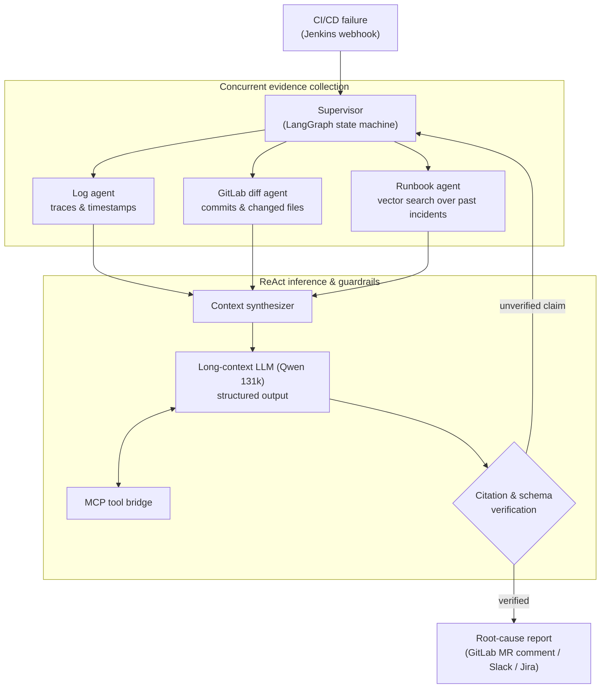

# Orion AI: CI/CD Auto-Diagnostic Agentic Engine

| Dimension | Details |
| :--- | :--- |
| **Role** | Architect & Lead AI Engineer |
| **Organization** | BBVA — validated proof of concept for FONIL |
| **Impact** | Initial triage from hours to under 15 seconds; manual log digging eliminated |
| **Stack** | Python, LangGraph, ReAct, Qwen LLM (131k context), MCP, Redis vector search, GitLab & Jenkins APIs |

!!! abstract "TL;DR"

    When a pipeline fails, Orion AI gathers evidence in parallel (logs, diffs, past
    incidents), reasons over it with a long-context LLM, and only publishes a report
    once **every claim is backed by a log line or a commit SHA**. If it can't prove it,
    it doesn't say it.

## 1. The engineering challenge

At enterprise scale, CI/CD pipelines fail every day for many reasons: transient
infrastructure glitches, configuration drift, broken dependencies or bad commits.

- Engineers spent hours opening multi-megabyte Jenkins logs, hunting the first real
  stack trace, checking GitLab diffs and searching runbooks.
- **Mean Time to Resolution (MTTR)** was dominated by human triage, not by the fix.

## 2. Multi-agent architecture

Orion AI is a stateful, parallel agentic system built with **LangGraph** and
**ReAct (Reason + Act)** loops.



## 3. Key design decisions

### A. Cyclic, stateful graphs instead of linear chains

LangGraph maintains a typed state across steps. If log extraction yields an ambiguous
stack trace, the graph routes back to the diff agent to inspect recently changed
dependencies before concluding — something a linear chain cannot express.

### B. Model Context Protocol (MCP) for tools

LLM reasoning is decoupled from integrations through **MCP**: Jenkins artifacts, Redis
and GitLab endpoints are exposed as uniformly typed tools, so integrations can evolve
independently of prompts and models.

### C. Deterministic guardrails

In banking operations an agent must never guess. The model is constrained to a strict
output schema, and a deterministic verifier checks that **every claim cites a real log
line or an existing commit SHA** before anything is published.

### Trade-offs

| Decision | Alternative considered | Why this choice |
| :--- | :--- | :--- |
| LangGraph state machine | Single prompt / linear chain | Needs branching, loops and verifiable intermediate state |
| Deterministic verifier after the LLM | Trusting model self-critique | Verification must be reproducible and auditable, not probabilistic |
| Long-context model (131k) | Aggressive log chunking only | Failures often span distant parts of a log; context preserves causality |

## 4. Python implementation highlights

A simplified, illustrative version of the verification loop:

```python title="graph.py (illustrative)"
from typing import TypedDict

from langgraph.graph import END, StateGraph
from pydantic import BaseModel, Field


class Finding(BaseModel):
    claim: str
    evidence_log_line: int | None = None
    evidence_commit: str | None = Field(default=None, pattern=r"^[0-9a-f]{7,40}$")


class Diagnosis(BaseModel):
    category: str  # e.g. "infrastructure", "dependency", "code", "config"
    findings: list[Finding]
    recommended_action: str


class TriageState(TypedDict):
    log: list[str]
    commits: set[str]
    diagnosis: Diagnosis | None
    attempts: int


def verify(state: TriageState) -> str:
    """Deterministic gate: every finding must point at real evidence."""
    diagnosis = state["diagnosis"]
    for f in diagnosis.findings:
        line_ok = f.evidence_log_line is not None and 0 <= f.evidence_log_line < len(state["log"])
        commit_ok = f.evidence_commit in state["commits"]
        if not (line_ok or commit_ok):
            return "retry" if state["attempts"] < 3 else "escalate"
    return "publish"


graph = StateGraph(TriageState)
graph.add_node("gather", gather_evidence)      # parallel log / diff / runbook agents
graph.add_node("reason", reason_with_llm)      # ReAct loop, structured output -> Diagnosis
graph.add_node("publish", publish_report)
graph.add_node("escalate", hand_off_to_human)
graph.set_entry_point("gather")
graph.add_edge("gather", "reason")
graph.add_conditional_edges("reason", verify, {"retry": "gather", "publish": "publish", "escalate": "escalate"})
graph.add_edge("publish", END)
graph.add_edge("escalate", END)
app = graph.compile()
```

## 5. Outcomes

<div class="kpi-grid">
  <div class="kpi-card"><span class="kpi-value">&lt; 15 s</span><span class="kpi-label">Time to diagnosis</span></div>
  <div class="kpi-card"><span class="kpi-value">94%+</span><span class="kpi-label">Accuracy in validation</span></div>
  <div class="kpi-card"><span class="kpi-value">~45 min</span><span class="kpi-label">Manual triage replaced</span></div>
</div>

- :zap: **Immediate triage** — a diagnosis is ready in under 15 seconds after the pipeline ends.
- :mag: **Precise insights** — distinguishes subtle causes (e.g. DNS timeout pulling from a registry vs. a genuine test failure) with 94%+ accuracy during validation.
- :building_construction: **Production-ready design** — validated PoC architected to plug into shared enterprise AI inference clusters.

[:octicons-arrow-right-24: Related post: Automating CI/CD root-cause triage with LangGraph](../blog/posts/2026-03-10-agentic-cicd-diagnostics-langgraph.md)
