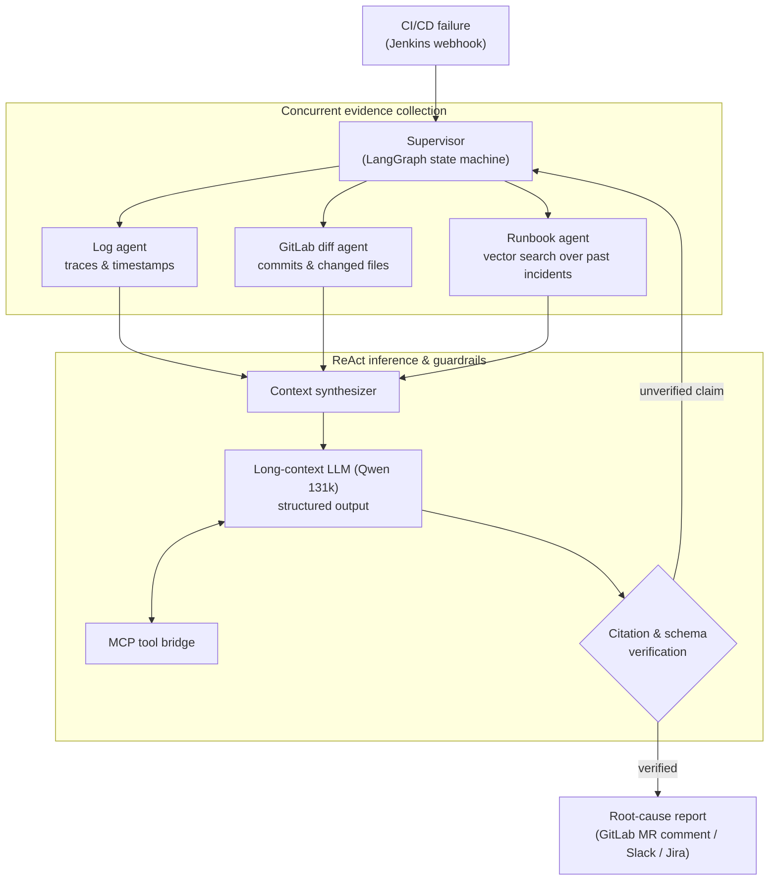

# Orion AI: CI/CD Auto-Diagnostic Agentic Engine

| Dimension | Details |
| :--- | :--- |
| **Role** | Architect & Lead AI Engineer |
| **Organization / Scope** | BBVA Core Banking Infrastructure (Autonomous AI Ops) |
| **Impact** | Initial triage from hours to under 15 seconds; manual log digging eliminated |
| **Stack** | Python, LangGraph, ReAct, Qwen LLM (131k context), MCP, Redis vector search, GitLab & Jenkins APIs |

!!! abstract "TL;DR"

    When a pipeline fails, Orion AI gathers evidence in parallel (logs, diffs, past
    incidents), reasons over it with a long-context LLM, and only publishes a report
    once **every claim is backed by a log line or a commit SHA**. If it can't prove it,
    it doesn't say it.

## 1. The engineering challenge

At enterprise scale, CI/CD pipelines fail every day for many reasons: transient
infrastructure glitches, configuration drift, broken dependencies or bad commits.

- Engineers spent hours opening multi-megabyte Jenkins logs, hunting the first real
  stack trace, checking GitLab diffs and searching runbooks.
- **Mean Time to Resolution (MTTR)** was dominated by human triage, not by the fix.

## 2. Multi-agent architecture

Orion AI is a stateful, parallel agentic system built with **LangGraph** and
**ReAct (Reason + Act)** loops.



## 3. Key design decisions

### A. Cyclic, adaptive graph orchestration (LangGraph + ReAct)

Linear chains (DAGs without loops) are inherently brittle for incident diagnostics: if early log analysis produces ambiguous signals, a linear pipeline is forced to guess or fail. 

Orion AI uses **LangGraph** to model diagnostic investigation as a stateful, cyclic state machine with an autonomous Supervisor:

1. **Initial signal extraction:** The `log_extractor` node isolates stack traces, exit codes, and timestamps.
2. **Ambiguity detection & adaptive loop-back:** If a failure lacks explicit stack traces (e.g., an opaque container exit code 137 OOM or silent dependency resolution failure), the supervisor evaluates the state and dynamically branches to `git_diff_inspector` to examine recent commits, dependency manifests (`pyproject.toml`, `requirements.txt`), and Dockerfile changes.
3. **Causal re-evaluation:** Armed with git commit diffs, the graph cycles back into the ReAct reasoning agent with enriched context, enabling the LLM to correlate an obscure error with an exact upstream commit or dependency bump before proposing root cause.

### B. Model Context Protocol (MCP) for tools

LLM reasoning is decoupled from integrations through **MCP**: Jenkins artifacts, Redis
and GitLab endpoints are exposed as uniformly typed tools, so integrations can evolve
independently of prompts and models.

### C. Deterministic guardrails

In banking operations an agent must never guess. The model is constrained to a strict
output schema, and a deterministic verifier checks that **every claim cites a real log
line or an existing commit SHA** before anything is published.

### Trade-offs

| Decision | Alternative considered | Why this choice |
| :--- | :--- | :--- |
| LangGraph state machine | Single prompt / linear chain | Needs branching, loops and verifiable intermediate state |
| Deterministic verifier after the LLM | Trusting model self-critique | Verification must be reproducible and auditable, not probabilistic |
| Long-context model (131k) | Aggressive log chunking only | Failures often span distant parts of a log; context preserves causality |

## 4. Python implementation highlights

### Cyclic supervisor state machine with adaptive routing

Illustrative implementation of the LangGraph state machine featuring cyclical re-routing between log triage and git diff inspection:

```python title="graph.py (illustrative)"
from typing import Annotated, Literal
from operator import add
from typing_extensions import TypedDict
from langgraph.graph import END, StateGraph
from pydantic import BaseModel, Field


class Finding(BaseModel):
    claim: str
    evidence_log_line: int | None = None
    evidence_commit: str | None = Field(default=None, pattern=r"^[0-9a-f]{7,40}$")


class Diagnosis(BaseModel):
    category: Literal["infrastructure", "dependency", "code", "configuration"]
    findings: list[Finding]
    root_cause: str
    confidence_score: float = Field(ge=0.0, le=1.0)


class TriageState(TypedDict):
    job_id: str
    raw_logs: list[str]
    diff_patches: Annotated[list[str], add]  # Appends evidence across cycles
    diagnosis: Diagnosis | None
    investigation_depth: int
    is_ambiguous: bool


def supervisor_router(
    state: TriageState,
) -> Literal["inspect_git_diff", "reason_with_llm", "escalate"]:
    """Evaluate current evidence ambiguity and route cyclically or proceed."""
    if state["investigation_depth"] > 3:
        return "escalate"  # Circuit breaker against infinite investigation loops

    if state["is_ambiguous"] and not state["diff_patches"]:
        return "inspect_git_diff"  # Loop back: fetch code/manifest diffs for context

    return "reason_with_llm"


def verify_guardrails(state: TriageState) -> Literal["publish", "retry_deeper", "escalate"]:
    """Deterministic gate: every claim must cite genuine log lines or verified commit SHAs."""
    diagnosis = state.get("diagnosis")
    if not diagnosis or diagnosis.confidence_score < 0.85:
        return "retry_deeper" if state["investigation_depth"] < 3 else "escalate"

    for finding in diagnosis.findings:
        valid_line = (
            finding.evidence_log_line is not None
            and 0 <= finding.evidence_log_line < len(state["raw_logs"])
        )
        valid_commit = bool(finding.evidence_commit and finding.evidence_commit in state.get("diff_patches", ""))
        if not (valid_line or valid_commit):
            return "escalate"

    return "publish"


# Build the stateful cyclic graph
graph = StateGraph(TriageState)

graph.add_node("parse_logs", parse_logs_node)
graph.add_node("inspect_git_diff", fetch_gitlab_diff_node)
graph.add_node("reason_with_llm", llm_react_reasoning_node)
graph.add_node("publish", publish_to_mr_and_slack_node)
graph.add_node("escalate", notify_oncall_engineer_node)

graph.set_entry_point("parse_logs")

# Conditional cyclic branching from supervisor
graph.add_conditional_edges(
    "parse_logs",
    supervisor_router,
    {
        "inspect_git_diff": "inspect_git_diff",
        "reason_with_llm": "reason_with_llm",
        "escalate": "escalate",
    },
)

# After fetching diffs, cycle back into reasoning
graph.add_edge("inspect_git_diff", "reason_with_llm")

# Post-reasoning verification gate
graph.add_conditional_edges(
    "reason_with_llm",
    verify_guardrails,
    {
        "publish": "publish",
        "retry_deeper": "inspect_git_diff",  # Adaptive feedback loop
        "escalate": "escalate",
    },
)

graph.add_edge("publish", END)
graph.add_edge("escalate", END)

app = graph.compile()
```

## 5. Outcomes

<div class="kpi-grid">
  <div class="kpi-card"><span class="kpi-value">&lt; 15 s</span><span class="kpi-label">Time to diagnosis</span></div>
  <div class="kpi-card"><span class="kpi-value">94%+</span><span class="kpi-label">Accuracy in validation</span></div>
  <div class="kpi-card"><span class="kpi-value">~45 min</span><span class="kpi-label">Manual triage replaced</span></div>
</div>

- :zap: **Immediate triage** — a diagnosis is ready in under 15 seconds after the pipeline ends.
- :mag: **Precise insights** — distinguishes subtle causes (e.g. DNS timeout pulling from a registry vs. a genuine test failure) with 94%+ accuracy during validation.
- :building_construction: **Production-ready design** — validated PoC architected to plug into shared enterprise AI inference clusters.

[:octicons-arrow-right-24: Related post: Automating CI/CD root-cause triage with LangGraph](../blog/posts/2026-03-10-agentic-cicd-diagnostics-langgraph.md)
