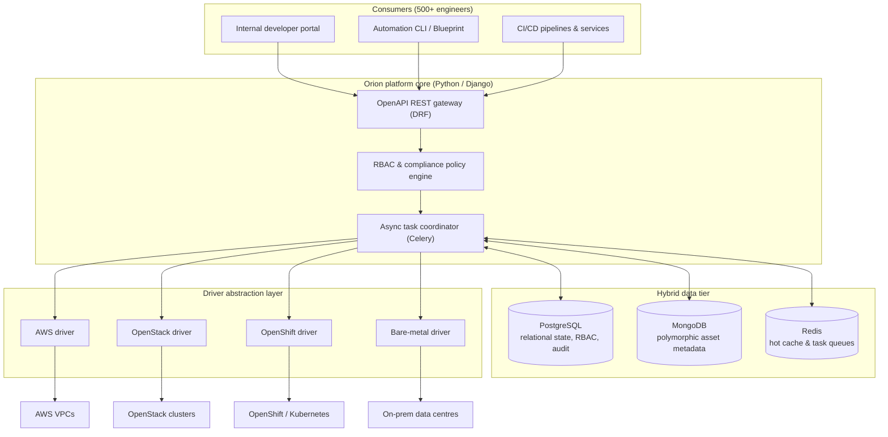

# Orion: Enterprise IaaS Audit & Deployment Platform

| Dimension | Details |
| :--- | :--- |
| **Role** | Sole Architect & Platform Owner |
| **Organization** | BBVA Technology (Core Banking Infrastructure) · 2017 – present |
| **Scale** | Tens of thousands of nodes · High-throughput daily operations · 500+ engineers |
| **Stack** | Python, Django, DRF, Celery, PostgreSQL, MongoDB, Redis, AWS, OpenStack, OpenShift |

!!! abstract "TL;DR"

    Orion turns four very different infrastructure worlds into **one self-service,
    auditable Python API**. A pluggable driver layer isolates provider specifics, Celery
    decouples long-running operations from HTTP, and a hybrid data tier keeps strict
    audit history in PostgreSQL while MongoDB absorbs heterogeneous asset metadata.

## 1. Context & engineering challenge

At banking scale, teams provisioned and audited infrastructure through disparate
pipelines across heterogeneous environments: **AWS**, private cloud (**OpenStack**),
container platforms (**OpenShift**) and legacy **on-premises bare metal**.

1. **Environment silos** — every environment needed its own tooling, skills and manual tickets.
2. **Audit bottlenecks** — regulators require continuous tracking of machine state, security
   baselines and ownership across tens of thousands of heterogeneous nodes.
3. **Developer friction** — provisioning took days instead of minutes because there was no
   self-service abstraction.

## 2. High-level architecture

Orion was designed to make infrastructure effectively **invisible** to 500+ engineers
while guaranteeing fully auditable governance.



## 3. Key architectural decisions

### A. Hybrid data tier (PostgreSQL + MongoDB + Redis)

Operating tens of thousands of machines across disparate clouds with wildly different metadata
(networking, tags, disk layouts, hypervisor-specific fields) made a single rigid relational schema unmaintainable.

- **PostgreSQL** owns everything that must be transactional and immutable: audit
  logs, permissions, operation state histories.
- **MongoDB** ingests and indexes polymorphic asset metadata, enabling fast queries
  across tens of thousands of heterogeneous nodes.
- **Redis** caches permission graphs and hot lookups to keep API responses fast
  under heavy concurrent load, and backs the Celery queues.

### B. The universal driver pattern & isolated testing

All provider-specific concerns — authentication, API calls, status polling, and payload transformation — live strictly behind an abstract driver contract. A developer submits the **same normalized specification** regardless of the target cloud; the platform resolves the right driver dynamically at runtime without touching core business logic.

Key engineering advantages of this pattern:

- **Zero core refactoring for new clouds:** Adding a new cloud provider requires writing a single isolated plugin module that inherits from `InfrastructureDriver`. The core platform remains untouched.
- **Self-registration with capability negotiation:** Drivers declare capabilities (e.g., live resize, VPC peering, bare-metal PXE boot) during class registration, allowing the platform to validate requests before delegating work.
- **Isolated, mock-free testing:** Because drivers encapsulate all provider SDKs (boto3, openstacksdk, kubernetes client), core platform services and Celery workflows are tested against an `InMemoryDriver` without fragile third-party SDK monkeypatching. Conformance tests run against the abstract contract to verify every driver satisfies the expected lifecycle invariants.

### C. Asynchronous processing by default

Provisioning can take minutes; HTTP requests should take milliseconds. Long-running
workflows run in Celery worker pools tuned for I/O-bound concurrency, and publish
granular status events so clients can follow progress instead of blocking.

### Trade-offs

| Decision | Alternative considered | Why this choice |
| :--- | :--- | :--- |
| Hybrid PostgreSQL + MongoDB | Single relational DB with JSON columns | Audit data needs strict relational guarantees; asset metadata is genuinely schemaless and query-heavy |
| Driver abstraction in Python | One pipeline per environment | One API and one audit trail; new providers are additive, not invasive |
| Celery async workers | Synchronous API calls | Decouples user latency from provider latency; enables retries and back-pressure |

## 4. Python implementation highlights

### Abstract driver contract & registry

A simplified, illustrative version of the driver contract with auto-registration and capability flags:

```python title="drivers.py (illustrative)"
from __future__ import annotations

from abc import ABC, abstractmethod
from dataclasses import dataclass, field
from enum import Flag, auto
from typing import ClassVar


class Capability(Flag):
    NONE = 0
    RESIZE = auto()
    VPC_PEERING = auto()
    SNAPSHOT = auto()
    BAREMETAL_PXE = auto()


@dataclass(frozen=True, slots=True)
class MachineSpec:
    name: str
    flavor: str
    image: str
    environment: str  # "aws" | "openstack" | "openshift" | "baremetal"
    tags: dict[str, str] = field(default_factory=dict)


class InfrastructureDriver(ABC):
    """Abstract contract that every provider driver must fulfill."""

    registry: ClassVar[dict[str, type[InfrastructureDriver]]] = {}
    environment: ClassVar[str]
    capabilities: ClassVar[Capability] = Capability.NONE

    def __init_subclass__(cls, **kwargs) -> None:
        super().__init_subclass__(**kwargs)
        if not hasattr(cls, "environment"):
            raise TypeError(f"Driver class {cls.__name__} must declare 'environment'")
        InfrastructureDriver.registry[cls.environment] = cls  # (1)!

    @abstractmethod
    def provision(self, spec: MachineSpec) -> str:
        """Provision resource synchronously or return a provider-assigned job ID."""
        ...

    @abstractmethod
    def status(self, resource_id: str) -> str: ...

    @abstractmethod
    def decommission(self, resource_id: str) -> None: ...


def driver_for(spec: MachineSpec) -> InfrastructureDriver:
    try:
        return InfrastructureDriver.registry[spec.environment]()
    except KeyError:
        raise ValueError(f"No driver registered for environment: {spec.environment!r}") from None
```

1.  Drivers self-register automatically at import time via `__init_subclass__`. Adding a new cloud provider is strictly an additive module import — zero changes to the core dispatch logic.

### Decoupled conformance testing without SDK mocking

Instead of writing fragile unit tests that mock dozens of deep AWS boto3 or OpenStack SDK calls, platform tests enforce a universal behavioral contract suite. Any driver implementation can be tested against the same contract:

```python title="test_driver_contract.py (illustrative)"
import pytest
from drivers import Capability, InfrastructureDriver, MachineSpec


class ConformanceTestSuite:
    """Base conformance test suite that every driver implementation must pass."""

    @pytest.fixture
    def driver(self) -> InfrastructureDriver:
        raise NotImplementedError("Subclasses must yield a configured driver fixture")

    def test_provision_returns_valid_identifier(self, driver: InfrastructureDriver) -> None:
        spec = MachineSpec(
            name="test-node-01",
            flavor="standard-2",
            image="rhel9-hardened",
            environment=driver.environment,
        )
        resource_id = driver.provision(spec)
        assert isinstance(resource_id, str) and len(resource_id) > 0
        assert driver.status(resource_id) in {"PENDING", "ACTIVE"}

    def test_decommission_is_idempotent(self, driver: InfrastructureDriver) -> None:
        spec = MachineSpec(
            name="test-node-02",
            flavor="standard-2",
            image="rhel9-hardened",
            environment=driver.environment,
        )
        resource_id = driver.provision(spec)
        driver.decommission(resource_id)
        # Decommissioning an already terminated resource should not raise an unhandled exception
        driver.decommission(resource_id)
        assert driver.status(resource_id) == "DELETED"
```

### Celery async task coordination

And on the Celery side, keeping HTTP cycles thin while publishing real-time audit logs:

```python title="tasks.py (illustrative)"
from celery import shared_task


@shared_task(
    bind=True,
    autoretry_for=(ConnectionError,),
    retry_backoff=True,
    max_retries=5,
    acks_late=True,
)
def provision_machine(self, spec_payload: dict, operation_id: str) -> str:
    spec = MachineSpec(**spec_payload)
    driver = driver_for(spec)
    resource_id = driver.provision(spec)
    record_audit_event(operation_id, action="provision", resource_id=resource_id)
    return resource_id
```

## 5. Measurable impact

<div class="kpi-grid">
  <div class="kpi-card"><span class="kpi-value">Days → min</span><span class="kpi-label">Provisioning lead time</span></div>
  <div class="kpi-card"><span class="kpi-value">100%</span><span class="kpi-label">Audit compliance</span></div>
  <div class="kpi-card"><span class="kpi-value">3</span><span class="kpi-label">Countries rolled out</span></div>
</div>

- :rocket: **Zero-ticket provisioning** — self-service replaced manual tickets; delivery went from days to automated minutes.
- :shield: **100% audit compliance** — automated export pipelines deliver verified governance snapshots straight to audit teams.
- :earth_africa: **International scale** — rolled out across engineering hubs in Spain, Mexico and Turkey, with onboarding and platform enhancements for each team.

[:octicons-arrow-right-24: Next: Blueprint — the declarative engine built on top of Orion](blueprint.md)
