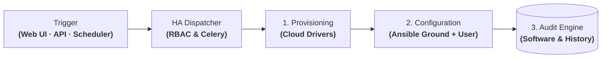

# Orion: Central IaaS Platform & Universal Driver Pipeline

| Dimension | Details |
| :--- | :--- |
| **Role** | Architect & Platform Lead |
| **Organization** | BBVA (Core Banking Infrastructure) |
| **Scale** | 30,000+ governed machines · 40,000+ daily operations · 500+ engineers |
| **Stack** | Python, Django, DRF, Celery, PostgreSQL, MongoDB, Redis, Ansible, AWS, OpenStack, OpenShift, Infoblox |

!!! abstract "Architectural summary"

    Orion is the central control plane for infrastructure governance, comprehensive auditing, and self-service deployment across BBVA's hybrid cloud. It abstracts four technological substrates (**AWS, OpenStack, OpenShift, and physical bare-metal**) behind an OpenAPI-documented REST interface and scheduled **automation schedulers**, combining a **universal driver provisioning pipeline**, **two-layer Ansible configuration (corporate Ground + User workloads)**, a **hybrid persistence tier**, and an **end-to-end machine traceability audit engine**.

---

## 1. The Evolution of Orion: From API-First CMDB & Inventory to a High-Availability Dispatcher

Orion was not built as a static monolithic tool, but as an evolving architectural response to enterprise infrastructure bottlenecks at scale within **BBVA** — governing **30,000+ machines** across **AWS, OpenStack, OpenShift, and bare metal**, processing **40,000+ daily operations** for **500+ engineers**:

### Architectural Evolution Milestones

- **Phase 1 · Origin: Multi-Cloud CMDB, Inventory & API-First Catalog**
    - *Context:* Orion originated as a centralized control plane to inventory and govern heterogeneous assets across AWS, OpenStack, OpenShift, and physical bare metal.
    - *Solution:* Hybrid data tier (PostgreSQL for transactions, MongoDB for polymorphic assets, Redis for caching), OpenAPI catalog, and compliance export pipelines tailored to banking regulations.

- **Phase 2 · The Jenkins Bottleneck**
    - *Problem:* Catalog operation execution initially relied on a centralized Jenkins cluster.
    - *Friction:* Jenkins lacked native High Availability (posing a critical single point of failure for the bank), its UI was designed for code builds rather than infrastructure state machines, and plugin bloat made integrating new banking services notoriously complex.

- **Phase 3 · Emergence of the Integrated HA Dispatcher**
    - *Transformation:* Orion absorbed the execution plane by developing an **in-house High-Availability Operation Dispatcher (Django + Celery + Kubernetes Jobs)**.
    - *Outcome:* 100% replacement of Jenkins for infrastructure, dynamic runtime variable injection, native support for API-driven and scheduled automation, and structured two-stage provisioning: cloud drivers followed by layered Ansible pipelines (Ground and User).

- **Phase 4 · Declarative Extension (Blueprint) & Operational AI (Orion AI)**
    - *Maturity:* With the CMDB, the audit engine, and the dispatcher unified under a single architecture, Orion expanded into declarative provisioning with **Blueprint** (asynchronous YAML engine with DAG waves and idempotent teardowns) and agentic CI/CD failure diagnostics with **Orion AI** (LangGraph).

---

## 2. Context & Problem Statement

Operating infrastructure at banking scale across public cloud, private cloud, container clusters, and legacy data centers created three structural bottlenecks:

1. **Siloed provisioning & heterogeneity:** Every target environment (AWS, OpenStack, OpenShift, physical hardware) required its own specialized tooling, credentials, and manual ticket handoffs — turning simple provisioning requests into multi-day waits.
2. **Audit blindness & fragmented traceability:** In a strictly regulated banking environment, infrastructure provisioning requires proof of authorization: who requested the asset, who holds permissions, **what exact software packages are installed on each machine, and every operational event that occurred over its entire lifecycle**. Dispersed provider logs prevented rapid, reliable audit and forensic reporting.
3. **Configuration drift & baseline security vulnerabilities:** Without an enforced operational baseline, application teams provisioned systems inconsistently, resulting in servers lacking mandatory monitoring agents, unpatched operating systems, or non-compliant corporate package repositories.

---

## 3. Abstract System Topology: Operation Lifecycle

Orion centralizes the banking infrastructure lifecycle through a strict, sequential pipeline: from user self-service forms in the web frontend, REST API calls, or scheduled jobs, through cloud provisioning and two-layer Ansible configuration, down to the final seal in the audit engine.

### Step-by-Step Execution Pipeline

| Stage | Responsible Component | Exactly What Executes | Engineering Guarantee |
| :--- | :--- | :--- | :--- |
| **1. Trigger** | Web UI Form / REST API / Schedulers (Celery Beat) | Self-service web frontend form, direct CI/CD pipeline invocation, or recurring scheduled job (reconciliation/maintenance). | Asynchronous, non-blocking ingestion with immediate HTTP response. |
| **2. Authorization** | RBAC Engine & PostgreSQL | Validation of requester permissions, corporate token, and immutable logging of the operation request. | Zero anonymous or untracked operational requests. |
| **3. Provisioning** | Multi-Cloud Driver Layer | Downstream call to target provider (**AWS, OpenStack, OpenShift, or Bare-Metal**) to create the compute instance and assign IP/DNS. | Consistent abstraction without vendor lock-in to proprietary APIs. |
| **4. Ground Ops** | Ansible Core (Banking Baseline) | **Mandatory pre-user baseline:** CIS operating system hardening, corporate TLS certificates, firewall policies, and monitoring agent deployment. | **100% compliance guarantee:** if Ground validation fails, provisioning is aborted immediately. |
| **5. User Ops** | Ansible Runner (User Workload) | Dynamic runtime variable injection and execution of user-defined playbooks (middleware, databases, microservices). | Strict isolation between corporate infrastructure baseline and app logic. |
| **6. Audit** | Audit Engine (PostgreSQL + MongoDB) | Collection of final forensic telemetry: exact versions of all installed packages on the node, open ports, and execution event logs. | Instant forensic compliance reports for internal auditors and regulators. |

---

## 4. Key Architectural Decisions

### A. Comprehensive Platform Auditing: Permissions & Machine Traceability
Orion acts as the **single source of truth for infrastructure auditing** across BBVA:

- **RBAC & Authorization Audit:** Strict role-based access control with complete accountability. Every operation — whether submitted through the web frontend form by an engineer, triggered via the REST API, or invoked automatically by a **Scheduler** — is tied to a verified identity, role, approval chain, and change ticket.
- **Full Machine Lifecycle Traceability:** Every compute asset retains an immutable lifecycle ledger from initial bootstrap to decommissioning. The platform tracks every playbook executed, configuration change applied, detected failure, and technician interaction.
- **Exhaustive Software & Historical Reporting:** Internal compliance teams and banking regulators can instantaneously export complete reports showing **exactly what software packages are installed on any machine** (versions, security patches, agents) and **every operational event that occurred on that node throughout its existence**.

### B. Universal Multi-Cloud Driver Provisioning Pipeline
Instead of maintaining provider-specific provisioning pipelines:

- **One lifecycle contract, swappable backends:** AWS, OpenStack, OpenShift, and bare-metal targets implement a common abstract lifecycle interface. The control plane dispatches normalized workloads regardless of target infrastructure.
- **Provider decoupling:** Organizational business logic and consumer platforms interact with uniform resource specifications, shielding downstream systems from individual cloud vendor API variations.

### C. Layered Ansible Configuration Pipeline: Ground vs. User Operations
Once raw compute resources are provisioned by cloud drivers, Orion orchestrates operating system configuration via Ansible structured into two sequential and isolated stages:

1. **Ground Layer (Mandatory Banking Baseline):**
    - **Security:** CIS benchmark OS hardening, corporate root and TLS certificates, firewall rules, and privileged access management.
    - **Observability:** Automated installation and configuration of corporate monitoring, metric, and log forwarding agents.
    - **Core Packaging:** Configuration of approved internal repositories and system utility dependencies.
    - *Policy:* No machine progresses to the next phase without a successful Ground verification check.
2. **User Operation Layer:**
    - Execution of user-defined playbooks and roles: deployment of application middleware, databases, microservices, and workload-specific configuration.

### D. Operational Channels: Web Frontend, REST APIs & Schedulers
Operational interactions with Orion avoid manual console work on servers:

- **Self-Service Web Frontend Forms:** Intuitive graphical interface where engineers submit validated dynamic forms aligned in real time with Orion's product catalog and team quotas, simplifying provisioning without requiring manual JSON payload authoring.
- **API-First Architecture:** The complete catalog of operations (creation, remediation, start/stop, scaling, teardown, reports) is fully exposed via OpenAPI/REST, enabling headless execution from CI/CD pipelines and declarative engines like **Blueprint**.
- **Integrated Schedulers:** Orion incorporates an asynchronous scheduler (Celery Beat) for recurring workflows: nightly inventory state reconciliation across physical and cloud estates, automated compliance scans, scheduled credential rotation, and maintenance tasks outside core banking hours.

### E. Hybrid Persistence Tier (PostgreSQL + MongoDB + Redis)
- **PostgreSQL** handles relational models requiring strict ACID transactions: RBAC permissions, operation catalogs, state machines, and the immutable audit log.
- **MongoDB** stores polymorphic documents detailing multi-cloud assets, arbitrary cloud attribute trees, and point-in-time snapshots of installed packages and software components.
- **Redis** provides hot caching for frequent inventory queries and serves as the high-throughput task queue broker for Celery workers.

---

## 5. Architectural Trade-Offs

| Decision | Alternative Considered | Rationale |
| :--- | :--- | :--- |
| **Two-layer Ansible pipeline (Ground + User)** | Monolithic user-managed playbook | Guarantees that 100% of compute instances adhere to corporate security, hardening, and monitoring baselines before user workloads are applied. |
| **Centralized audit engine in Orion** | Traceability delegated to ephemeral pipeline logs | Enables immediate generation of comprehensive audit reports showing complete software inventory and operational history for any machine. |
| **API-first operations & Celery Schedulers** | Manual console triggers or isolated cron scripts | Unifies access control, traceability, and concurrency under a single high-availability dispatcher. |
| **Hybrid PostgreSQL + MongoDB** | Single relational DB with JSONB | Retains strict relational integrity for RBAC and audit logs while providing high-performance indexing across heterogeneous cloud metadata and package inventories. |
| **In-house Python driver abstraction** | Separate cloud-specific tooling stacks | Unifies permissions, operation catalogs, and governance in a vendor-neutral control plane. |

---

## 6. Operational & Business Impact

- **Cost efficiency & technology sovereignty:** Consolidating an in-house control plane and HA dispatcher with native layered Ansible execution eliminated the need for commercial node-licensed automation suites (such as Red Hat Ansible Automation Platform), generating an **estimated cumulative cost avoidance exceeding €6M** in enterprise licensing fees for the organization.
- **Auditability & complete traceability:** Reduced audit preparation from weeks of manual data compilation to instant queries covering any machine: who authorized it, what is installed, and its full historical event log.
- **Enforced security & observability baseline (Ground):** 100% of the **30,000+ managed machines** run verified corporate security policies and monitoring agents from the moment of provisioning.
- **Self-service at banking scale:** Over **500 engineers** govern infrastructure autonomously, executing **40,000+ daily operations** via web forms, REST APIs, and scheduled automations.
- **International adoption:** Successfully deployed across multiple international banking divisions (**Spain, Mexico, and Turkey**).

---

[:octicons-arrow-right-24: Next: Blueprint — Declarative Lifecycle Engine](blueprint.md)
