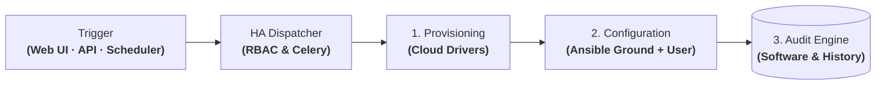

# Orion: Central IaaS Platform & Universal Driver Pipeline

| Dimension | Details |
| :--- | :--- |
| **Role** | Architect & Platform Lead |
| **Organization** | BBVA (Core Banking Infrastructure) |
| **Scale** | 30,000+ governed machines · 40,000+ daily operations · 500+ engineers |
| **Stack** | Python, Django, DRF, Celery, PostgreSQL, MongoDB, Redis, Ansible, AWS, OpenStack, OpenShift, Infoblox |

!!! abstract "Architectural summary"

    Orion is the central control plane for infrastructure governance, comprehensive auditing, and self-service deployment across BBVA's hybrid cloud. It abstracts four technological substrates (**AWS, OpenStack, OpenShift, and physical bare-metal**) behind an OpenAPI-documented REST interface, web self-service forms, and **automation schedulers**, combining a **universal driver provisioning pipeline**, **two-layer Ansible configuration (corporate Ground + User workloads)**, and an **end-to-end machine traceability audit engine**.

---

## 1. The Evolution of Orion: From CMDB to a High-Availability Dispatcher

Orion was not built as a static monolithic tool, but as an evolving architectural response to enterprise scaling bottlenecks within **BBVA**:

- **Phase 1 · Origin (CMDB & API-First Inventory):** A centralized control plane to govern heterogeneous multi-cloud assets via hybrid persistence (PostgreSQL + MongoDB + Redis) and a REST catalog with RBAC permissions.
- **Phase 2 · The Jenkins Bottleneck:** Execution initially relied on a centralized Jenkins cluster that lacked native high availability (critical SPOF), had a rigid UI for operational workflows, and introduced high maintenance overhead.
- **Phase 3 · Emergence of the Integrated HA Dispatcher:** Orion absorbed the execution plane by developing an **in-house HA Dispatcher (Django + Celery + Kubernetes Jobs)**, decoupling runtime variables and structuring provisioning into cloud drivers and layered Ansible pipelines.
- **Phase 4 · Declarative Extension & AI (Blueprint & Orion AI):** Unification with declarative orchestration via **Blueprint** (YAML engine with DAGs) and agentic CI/CD failure diagnostics with **Orion AI** (LangGraph).

---

## 2. Context & Problem Statement

Operating tens of thousands of banking workloads across public cloud, private cloud, and on-premises data centers created three critical challenges:

1. **Siloed provisioning:** Target environments required isolated tools and credentials, turning simple requests into multi-day manual handoffs.
2. **Audit blindness & dispersed tracking:** Regulatory banking compliance requires knowing at any moment who authorized an asset, exactly what software packages are installed, and its full historical event log.
3. **Configuration drift & baseline vulnerabilities:** Without an enforced separation between the bank's operational baseline (security, monitoring) and user applications, systems drifted from corporate compliance.

---

## 3. Abstract System Topology: Operation Lifecycle

Orion centralizes the banking infrastructure lifecycle through a strict sequential pipeline:

### Step-by-Step Execution Pipeline

| Stage | Responsible Component | Exactly What Executes | Engineering Guarantee |
| :--- | :--- | :--- | :--- |
| **1. Trigger** | Web UI Form / REST API / Schedulers (Celery Beat) | Self-service web form submission, direct REST API call, or recurring scheduled job. | Asynchronous, non-blocking ingestion with immediate HTTP response. |
| **2. Authorization** | RBAC Engine & PostgreSQL | Strict validation of requester permissions, team quotas, and immutable logging of the operation request. | Zero anonymous or untracked operational requests. |
| **3. Provisioning** | Multi-Cloud Driver Layer | Downstream call to target provider (**AWS, OpenStack, OpenShift, or Bare-Metal**) to create the compute instance and assign IP/DNS. | Consistent abstraction without vendor lock-in to proprietary APIs. |
| **4. Ground Ops** | Ansible Core (Banking Baseline) | **Mandatory pre-user baseline:** CIS operating system hardening, corporate TLS certificates, firewall policies, and monitoring agent deployment. | **100% compliance guarantee:** if Ground validation fails, provisioning is aborted immediately. |
| **5. User Ops** | Ansible Runner (User Workload) | Dynamic runtime variable injection and execution of user-defined playbooks (middleware, databases, microservices). | Strict isolation between corporate infrastructure baseline and app logic. |
| **6. Audit** | Audit Engine (PostgreSQL + MongoDB) | Collection of final forensic telemetry: exact versions of all installed packages on the node, open ports, and execution event logs. | Instant forensic compliance reports for internal auditors and regulators. |

---

## 4. Key Architectural Decisions

### A. Hybrid Persistence: Relational Integrity vs. Document Flexibility
A single database engine could not simultaneously satisfy strict banking compliance and multi-cloud inventory scale:
- **PostgreSQL** handles relational models requiring strict ACID transactions: RBAC permissions, product catalogs, state machines, and the immutable audit log.
- **MongoDB** stores polymorphic documents detailing multi-cloud assets across tens of thousands of machines (where AWS instances, OpenStack VMs, and bare-metal nodes have completely disparate attribute trees), indexing the complete software tree for high-volume cross-estate querying.
- **Redis** provides hot caching for frequent queries and serves as the high-throughput task queue broker for Celery workers.

### B. Separation of Concerns: Two-Layer Ansible Pipeline
To eliminate configuration drift without bottlenecking development autonomy, automation is divided into two sequential layers:
- **Ground Layer (Corporate Guarantee):** CIS operating system hardening, firewall rules, corporate TLS certificates, and monitoring agents. No compute instance progresses to user workload provisioning without a successful Ground check.
- **User Operation Layer (Application Autonomy):** Isolated runtime variable injection to deploy application middleware, databases, and service configurations.

### C. End-to-End Auditability & Lifecycle Traceability
Orion avoids delegating audit compliance to ephemeral pipeline logs. It maintains an immutable lifecycle ledger for each node: who authorized it, what configuration changes occurred over time, exact package and library versions installed, and full incident history — generating comprehensive audit reports in seconds.

---

## 5. Architectural Trade-Offs

| Decision | Alternative Considered | Trade-Off Rationale |
| :--- | :--- | :--- |
| **Two-layer Ansible pipeline (Ground + User)** | Monolithic user-managed playbook | Guarantees 100% compliance with corporate security, hardening, and monitoring standards without relying on individual team discipline. |
| **Centralized audit engine in Orion** | Traceability delegated to ephemeral pipeline logs | Enables immediate responses to regulatory audits with complete forensic histories for every machine and its installed packages. |
| **Hybrid PostgreSQL + MongoDB** | Single relational DB with JSONB | Retains strict relational integrity for RBAC and audit logs while providing high-performance indexing across heterogeneous cloud metadata and package inventories. |
| **In-house Python driver abstraction** | Separate cloud-specific tooling stacks | Unifies permissions, operation catalogs, and governance in a vendor-neutral control plane. |

---

## 6. Operational & Business Impact

- **Cost efficiency & technology sovereignty:** Consolidating an in-house control plane and HA dispatcher with native layered Ansible execution eliminated the need for commercial node-licensed automation suites (such as Red Hat Ansible Automation Platform), generating an **estimated cumulative cost avoidance exceeding €6M** in enterprise licensing fees for the organization.
- **Auditability & complete traceability:** Reduced audit preparation from weeks of manual data compilation to instant queries covering any machine: who authorized it, what is installed, and its full historical event log.
- **Enforced security & observability baseline (Ground):** 100% of the **30,000+ managed machines** run verified corporate security policies and monitoring agents from the moment of provisioning.
- **Self-service at banking scale:** Over **500 engineers** govern infrastructure autonomously, executing **40,000+ daily operations** via web forms, REST APIs, and scheduled automations.
- **International adoption:** Successfully deployed across multiple international banking divisions (**Spain, Mexico, and Turkey**).

---

[:octicons-arrow-right-24: Next: Blueprint — Declarative Lifecycle Engine](blueprint.md)
