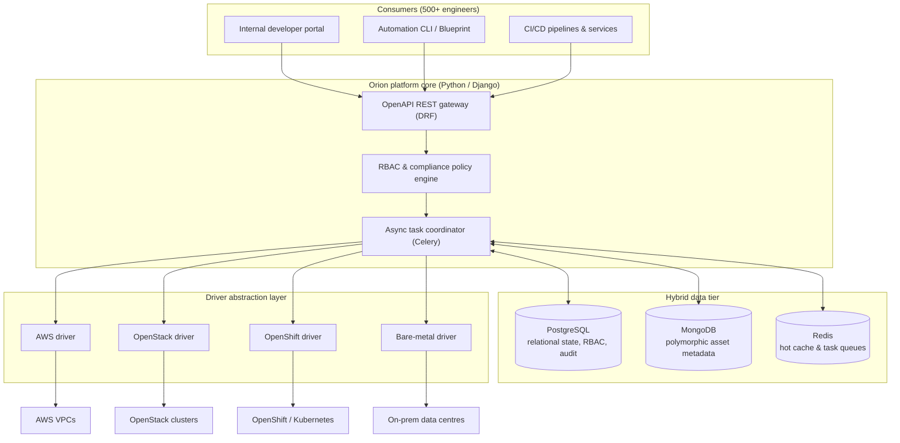

# Orion: Enterprise IaaS Audit & Deployment Platform

| Dimension | Details |
| :--- | :--- |
| **Role** | Sole Architect & Platform Owner |
| **Organization** | BBVA Technology (Core Banking Infrastructure) · 2017 – present |
| **Scale** | Tens of thousands of nodes · High-throughput daily operations · 500+ engineers |
| **Stack** | Python, Django, DRF, Celery, PostgreSQL, MongoDB, Redis, AWS, OpenStack, OpenShift |

!!! abstract "TL;DR"

    Orion turns four very different infrastructure worlds into **one self-service,
    auditable Python API**. A pluggable driver layer isolates provider specifics, Celery
    decouples long-running operations from HTTP, and a hybrid data tier keeps strict
    audit history in PostgreSQL while MongoDB absorbs heterogeneous asset metadata.

## 1. Context & engineering challenge

At banking scale, teams provisioned and audited infrastructure through disparate
pipelines across heterogeneous environments: **AWS**, private cloud (**OpenStack**),
container platforms (**OpenShift**) and legacy **on-premises bare metal**.

1. **Environment silos** — every environment needed its own tooling, skills and manual tickets.
2. **Audit bottlenecks** — regulators require continuous tracking of machine state, security
   baselines and ownership across tens of thousands of heterogeneous nodes.
3. **Developer friction** — provisioning took days instead of minutes because there was no
   self-service abstraction.

## 2. High-level architecture

Orion was designed to make infrastructure effectively **invisible** to 500+ engineers
while guaranteeing fully auditable governance.



## 3. Key architectural decisions

### A. Hybrid data tier (PostgreSQL + MongoDB + Redis)

Operating tens of thousands of machines across disparate clouds with wildly different metadata
(networking, tags, disk layouts, hypervisor-specific fields) made a single rigid relational schema unmaintainable.

- **PostgreSQL** owns everything that must be transactional and immutable: audit
  logs, permissions, operation state histories.
- **MongoDB** ingests and indexes polymorphic asset metadata, enabling fast queries
  across tens of thousands of heterogeneous nodes.
- **Redis** caches permission graphs and hot lookups to keep API responses fast
  under heavy concurrent load, and backs the Celery queues.

### B. The universal driver pattern

All provider-specific concerns — authentication, API calls, status polling — live
behind a single driver contract. A developer submits the **same JSON specification**
regardless of target; the platform resolves the right driver at runtime without
touching core business logic. Adding a new environment means adding a driver, not
changing the platform.

### C. Asynchronous processing by default

Provisioning can take minutes; HTTP requests should take milliseconds. Long-running
workflows run in Celery worker pools tuned for I/O-bound concurrency, and publish
granular status events so clients can follow progress instead of blocking.

### Trade-offs

| Decision | Alternative considered | Why this choice |
| :--- | :--- | :--- |
| Hybrid PostgreSQL + MongoDB | Single relational DB with JSON columns | Audit data needs strict relational guarantees; asset metadata is genuinely schemaless and query-heavy |
| Driver abstraction in Python | One pipeline per environment | One API and one audit trail; new providers are additive, not invasive |
| Celery async workers | Synchronous API calls | Decouples user latency from provider latency; enables retries and back-pressure |

## 4. Python implementation highlights

A simplified, illustrative version of the driver contract and registry:

```python title="drivers.py (illustrative)"
from __future__ import annotations

from abc import ABC, abstractmethod
from dataclasses import dataclass
from typing import ClassVar


@dataclass(frozen=True, slots=True)
class MachineSpec:
    name: str
    flavor: str
    image: str
    environment: str  # "aws" | "openstack" | "openshift" | "baremetal"


class InfrastructureDriver(ABC):
    """Contract every provider driver must fulfil."""

    registry: ClassVar[dict[str, type[InfrastructureDriver]]] = {}
    environment: ClassVar[str]

    def __init_subclass__(cls, **kwargs) -> None:
        super().__init_subclass__(**kwargs)
        InfrastructureDriver.registry[cls.environment] = cls  # (1)!

    @abstractmethod
    def provision(self, spec: MachineSpec) -> str: ...

    @abstractmethod
    def status(self, resource_id: str) -> str: ...

    @abstractmethod
    def decommission(self, resource_id: str) -> None: ...


def driver_for(spec: MachineSpec) -> InfrastructureDriver:
    try:
        return InfrastructureDriver.registry[spec.environment]()
    except KeyError:
        raise ValueError(f"No driver registered for {spec.environment!r}") from None
```

1.  Drivers self-register on import, so supporting a new environment is a new module —
    the core platform never changes.

And the Celery side, keeping the HTTP request cycle thin:

```python title="tasks.py (illustrative)"
from celery import shared_task


@shared_task(bind=True, autoretry_for=(ConnectionError,), retry_backoff=True, max_retries=5)
def provision_machine(self, spec_payload: dict, operation_id: str) -> str:
    spec = MachineSpec(**spec_payload)
    resource_id = driver_for(spec).provision(spec)
    record_audit_event(operation_id, action="provision", resource_id=resource_id)
    return resource_id
```

## 5. Measurable impact

<div class="kpi-grid">
  <div class="kpi-card"><span class="kpi-value">Days → min</span><span class="kpi-label">Provisioning lead time</span></div>
  <div class="kpi-card"><span class="kpi-value">100%</span><span class="kpi-label">Audit compliance</span></div>
  <div class="kpi-card"><span class="kpi-value">3</span><span class="kpi-label">Countries rolled out</span></div>
</div>

- :rocket: **Zero-ticket provisioning** — self-service replaced manual tickets; delivery went from days to automated minutes.
- :shield: **100% audit compliance** — automated export pipelines deliver verified governance snapshots straight to audit teams.
- :earth_africa: **International scale** — rolled out across engineering hubs in Spain, Mexico and Turkey, with onboarding and platform enhancements for each team.

[:octicons-arrow-right-24: Next: Blueprint — the declarative engine built on top of Orion](blueprint.md)
