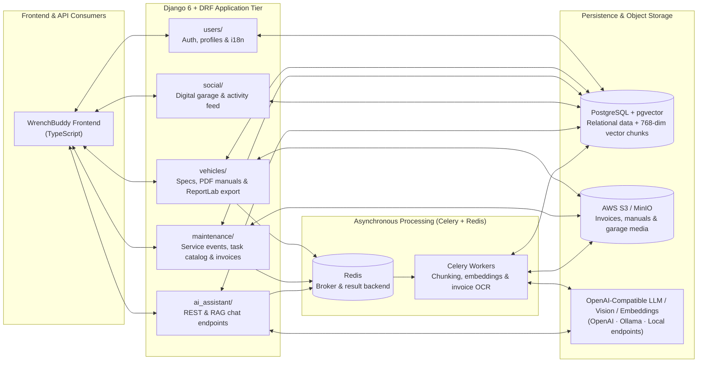

# WrenchBuddy: AI Vehicle Lifecycle & `pgvector` RAG Platform

| Dimension | Details |
| :--- | :--- |
| **Role** | Creator & Maintainer (Open Source) |
| **Repositories** | [:fontawesome-brands-github: `oredondo/WrenchBuddy` (Backend)](https://github.com/oredondo/WrenchBuddy) · [:fontawesome-brands-github: `oredondo/WrenchBuddy-frontend` (TypeScript)](https://github.com/oredondo/WrenchBuddy-frontend) (Apache 2.0 License) |
| **Domain** | Full-stack backend architecture, asynchronous task queues, Vision OCR & `pgvector` RAG |
| **Stack** | Python 3.12, Django 6.0, Django REST Framework, PostgreSQL (`pgvector`), Celery 5.4, Redis, AWS S3 / MinIO (`boto3`), LangChain, ReportLab, Docker, TypeScript |

!!! abstract "Overview"

    While my enterprise work on Orion at BBVA is proprietary, **WrenchBuddy** is a public, production-structured **Django + DRF + Celery + Redis + PostgreSQL** platform on GitHub. It combines relational domain modeling with **768-dimensional `pgvector` embeddings** over technical workshop manuals, asynchronous **Vision/OCR invoice parsing**, S3-compatible media storage, and a context-injected conversational maintenance assistant for motorcycles and cars.

---

## 1. System Architecture

---

## 2. Core Engineering Pillars

### A. Unified Relational + Vector Storage (`PostgreSQL` + `pgvector`)
Instead of introducing a separate external vector database that can drift out of sync with relational records, WrenchBuddy uses PostgreSQL with the **`pgvector`** extension:

- Uploaded workshop manuals and technical specification sheets (`PDF` / images) are extracted asynchronously, split into semantic chunks, embedded into **768-dimensional vectors**, and stored alongside the vehicle foreign keys in PostgreSQL.
- Queries combine strict relational filtering (exact vehicle ID, ownership permissions) with cosine similarity search in a single database tier.

### B. Asynchronous Vision/OCR Invoice Parsing & Smart Catalogs (`Celery` + `Redis`)
Heavy I/O and LLM calls never block HTTP request threads:

- **Invoice & receipt extraction:** When a user uploads a photo or PDF of a workshop invoice, a Celery task invokes vision and text models to automatically extract performed labor, replaced parts, odometer readings, and itemized costs into structured `maintenance` records.
- **Smart task catalog synthesis:** Background jobs synthesize periodic maintenance schedules tailored to exact vehicle make, model, year, displacement, and riding conditions.

### C. Grounded Vehicle-Contextual RAG Assistant (`ai_assistant/`)
When a user asks a natural-language question about service intervals, torque specs, or historical repairs, the LangChain pipeline injects:

1. The vehicle's real specifications and current odometer state.
2. Computed maintenance schedules and historical invoice records.
3. Top-K retrieved technical manual chunks from `pgvector` — responding in the user's configured language (English or Spanish).

### D. Portable Cloud-Native Storage & PDF Dossier Export
- **S3 / MinIO abstraction:** Media attachments (manuals, invoices, garage galleries) use `django-storages` and `boto3`, switching seamlessly between local storage, self-hosted MinIO, and AWS S3 via environment configuration.
- **ReportLab PDF export:** Generates downloadable full-history vehicle condition and maintenance dossiers for resale or workshop handoff.

---

## 3. Repository Structure & Source Code

Both the Django/Celery backend and the TypeScript frontend are open-source under the Apache 2.0 License:

- :fontawesome-brands-github: **Backend (`Django` / `Celery` / `pgvector`):** [`github.com/oredondo/WrenchBuddy`](https://github.com/oredondo/WrenchBuddy)
- :fontawesome-brands-github: **Frontend (`TypeScript`):** [`github.com/oredondo/WrenchBuddy-frontend`](https://github.com/oredondo/WrenchBuddy-frontend)

---

[:octicons-arrow-left-24: Previous: OmniLecture Studio](omni-lecture.md) · [:octicons-arrow-right-24: Back to Platform Ecosystem Overview](index.md)
