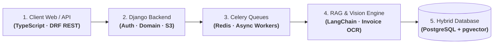

# WrenchBuddy: AI Vehicle Lifecycle & `pgvector` RAG Platform

| Dimension | Details |
| :--- | :--- |
| **Role** | Creator & Maintainer (Open Source) |
| **Stage** | **Early-stage idea / Under active construction** (Working prototype) |
| **Repositories** | [:fontawesome-brands-github: `oredondo/WrenchBuddy` (Backend)](https://github.com/oredondo/WrenchBuddy) · [:fontawesome-brands-github: `oredondo/WrenchBuddy-frontend` (TypeScript)](https://github.com/oredondo/WrenchBuddy-frontend) (Apache 2.0 License) |
| **Domain** | Full-stack backend architecture, asynchronous task queues, Vision OCR & `pgvector` RAG |
| **Stack** | Python 3.12, Django 6.0, Django REST Framework, PostgreSQL (`pgvector`), Celery 5.4, Redis, AWS S3 / MinIO (`boto3`), LangChain, ReportLab, Docker, TypeScript |

!!! note "Early-stage development project"

    WrenchBuddy is a personal project and an **early-stage idea currently under active initial construction**. It serves as an architectural testbed applying enterprise infrastructure patterns (Django, Celery, PostgreSQL, Redis) to a consumer use case powered by applied AI (computer vision and `pgvector` RAG).

!!! abstract "Architectural summary"

    **WrenchBuddy** is an open-source early-stage project under construction on GitHub exploring the same architectural foundation as my enterprise work: **Django + DRF + Celery + Redis + PostgreSQL**. It combines transactional relational modeling with **768-dimensional `pgvector` embeddings** across technical workshop manuals, asynchronous **Vision/OCR invoice extraction**, S3-compatible cloud-native storage, and a prototype conversational RAG assistant that injects the vehicle's exact technical specs and maintenance history.

---

## 1. Context & Engineering Challenges

Digital vehicle fleet and personal maintenance tracking typically relies on dispersed manual records or generic tools disconnected from OEM workshop manuals:

1. **Relational and vector split-brain:** Operating a separate external vector database introduces severe data desynchronization risks against the transactional model of users, vehicles, and maintenance logs.
2. **Vision & AI inference latency:** Processing OCR on scanned invoices and generating dense embeddings are resource-intensive tasks that must never block API HTTP request-response cycles.
3. **Hallucinations in technical assistance:** Mechanical queries (such as torque specifications or oil viscosity grades) demand exact precision grounded solely in the manufacturer's official documentation.

---

## 2. Abstract System Topology: Operation & RAG Workflow

The architecture decouples synchronous API ingestion, background dispatching, vision inference, and hybrid persistence into a modular pipeline:

### Step-by-Step Processing Pipeline

| Stage | Responsible Component | Exactly What Executes | Engineering Guarantee |
| :--- | :--- | :--- | :--- |
| **1. API Ingestion** | TypeScript Frontend / Django REST | Receives natural language queries, invoice image uploads, or workshop manual PDFs. | Strict validation via typed serializers with immediate, non-blocking HTTP response. |
| **2. Async Dispatch** | Redis Broker & Celery Workers | Enqueues heavy I/O, image processing, and inference jobs into dedicated queues with automatic retries. | Total isolation from the user's interactive HTTP request cycle. |
| **3. Vision & OCR** | Vision Celery Tasks | Multimodal invoice analysis extracting replaced parts, labor hours, odometer readings, and itemized costs. | Structured extraction from non-standard documents into relational records. |
| **4. RAG Engine** | LangChain Pipeline | Semantic chunking of workshop manuals, 768-dimensional vector embedding generation, and cosine similarity retrieval. | Factual responses grounded strictly in official vehicle documentation. |
| **5. Hybrid Persistence** | PostgreSQL with `pgvector` Extension | Unified persistence of relational tables (ACID) and vector collections linked by foreign keys. | Zero data drift or split-brain without external vector database overhead. |

---

## 3. Key Architectural Decisions

### A. Unified Relational and Vector Storage (`pgvector`)
Rather than introducing a dedicated external vector database (such as Pinecone or Milvus) that introduces operational overhead and sync lag:
- **`pgvector` on PostgreSQL:** Combines strict relational filters (vehicle ownership, user RBAC permissions) with 768-dimensional vector similarity searches in a single transactional SQL query.
- **Atomic consistency:** Deleting a vehicle or updating a service record immediately guarantees referential integrity across associated embeddings.

### B. Asynchronous Decoupling via Celery & Redis
Any operation requiring more than 200 ms of compute is delegated to background workers:
- **Background invoice OCR:** Image and PDF uploads trigger computer vision tasks that analyze the document, structure financial figures, and notify the user once records are consolidated.
- **Automated maintenance schedule synthesis:** Background algorithms calculate personalized service intervals based on odometer progression, riding conditions, and elapsed time.

### C. Vehicle-Contextualized RAG Assistant
The conversational assistant does not answer from generic training data:
1. Resolves the exact vehicle metadata (make, model, year, displacement, current odometer reading).
2. Pulls the relational history of past invoices and completed services.
3. Retrieves top-K relevant chunks from the workshop manual via `pgvector` and constructs an enriched prompt under strict technical grounding guardrails.

### D. Cloud-Native S3 Abstraction & PDF Dossier Generation
- **S3 / MinIO portability:** Leveraging `django-storages` and `boto3`, the storage layer toggles seamlessly between local disks for development, self-hosted MinIO, and AWS S3 in production with zero code modifications.
- **Automated PDF dossiers via ReportLab:** Programmatically compiles comprehensive maintenance dossiers containing vehicle condition histories, invoices, and service records for ownership transfer or workshop handoffs.

---

## 4. Architectural Trade-Offs

| Decision | Alternative Considered | Trade-Off Rationale |
| :--- | :--- | :--- |
| **PostgreSQL + `pgvector`** | Dedicated vector database (Pinecone/Milvus) | Eliminates operational overhead of synchronizing two databases while guaranteeing ACID transactional consistency in a single tier. |
| **Asynchronous Celery workers** | Synchronous execution within HTTP request threads | Prevents web socket timeouts and request blocking during heavy multimodal vision inference. |
| **S3 / MinIO storage abstraction** | Static local filesystem storage | Provides instant cloud-native portability between local development and cloud production deployments. |
| **Vehicle-scoped RAG retrieval** | Unfiltered generalist LLM queries | Enforces that torque specs, tolerances, and fluid capacities come directly from official OEM service manuals. |

---

## 5. Source Code & Open Source Repositories

Both the Django/Celery backend and the TypeScript frontend are open-source under the Apache 2.0 License:

- :fontawesome-brands-github: **Backend (`Django 6` / `Celery` / `pgvector`):** [`github.com/oredondo/WrenchBuddy`](https://github.com/oredondo/WrenchBuddy)
- :fontawesome-brands-github: **Frontend (`TypeScript` / `Vite`):** [`github.com/oredondo/WrenchBuddy-frontend`](https://github.com/oredondo/WrenchBuddy-frontend)

---

[:octicons-arrow-left-24: Previous: OmniLecture Studio](omni-lecture.md) · [:octicons-arrow-right-24: Back to Platform Ecosystem Overview](index.md)
