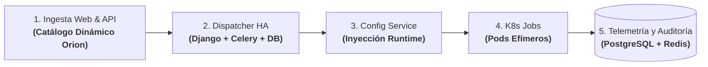

# Cuando las Shared Libraries Tocan Techo: Por Qué Sustituimos Jenkins por un Dispatcher HA Propio

Casi cualquier organización de infraestructura en crecimiento atraviesa la misma historia en dos actos con Jenkins.

En el **Acto I**, los equipos tienen decenas de pipelines copiados y pegados en distintos repositorios. Introduces **Jenkins Shared Libraries** en Groovy, estandarizas cómo se lanzan los despliegues, eliminas duplicación y aceleras la incorporación de ingenieros. Se percibe como una victoria técnica rotunda — y en esa etapa temprana, lo es.

En el **Acto II**, esa estandarización tiene tanto éxito que cientos de ingenieros y flujos automáticos empiezan a canalizar miles de operaciones diarias de infraestructura a través de ese framework compartido. Es entonces cuando descubres una dolorosa realidad de arquitectura: **un servidor de integración continua jamás fue diseñado para ser un plano de control de autoservicio ni un despachador distribuido de infraestructura**.

<!-- more -->

## 1. El Espejismo de la Estandarización: De Shared Libraries a la Pesadilla de Job DSL

Antes de poder reemplazar un motor de ejecución a gran escala, necesitas un contrato uniforme. Construir nuestro framework corporativo de **Jenkins Shared Libraries** en Groovy fue un paso imprescindible: obligó a todos los equipos a consumir una interfaz común para lanzar operaciones de infraestructura.

Sin embargo, a medida que la plataforma crecía, intentar parametrizar cientos de operaciones heterogéneas desató el primer gran problema: **la fragilidad de los Job DSL**.

Para no configurar cientos de jobs a mano en la interfaz web, recurrimos a **Jenkins Job DSL**: scripts en Groovy (*seed jobs*) que generaban automáticamente la estructura de pipelines en XML. La teoría sonaba impecable, pero la realidad operativa fue demoledora:

- **Fragilidad en la ejecución de Groovy:** El motor interno de Jenkins ejecuta los pipelines bajo un modelo CPS (*Continuation Passing Style*), un intérprete propio sobre la JVM que serializa continuamente el estado a disco. Cualquier objeto no serializable o función idiomática de Groovy arrojaba un temido `NotSerializableException` en mitad de un despliegue crítico.
- **Sobrecarga de regeneración (*Seed Jobs*):** Cada vez que un catálogo cambiaba o se añadía un nuevo entorno, había que relanzar los jobs semilla para reescribir cientos de archivos XML en el master de Jenkins, introduciendo retrasos y bloqueos en el controlador.
- **Depuración a ciegas:** Probar cambios en el DSL exigía desplegarlos en un entorno real de Jenkins; la retroalimentación local era prácticamente nula y los errores de sintaxis se descubrían cuando un usuario intentaba lanzar una operación en producción.

## 2. Formularios Rígidos y la Fricción de Integrar Catálogos Dinámicos con Orion

El síntoma más visible para los desarrolladores era la paupérrima experiencia de usuario. Una plataforma interna de infraestructura necesita ofrecer **autoservicio real**, pero Jenkins solo ofrece su vetusta pantalla de *"Build with Parameters"*:

### La pobreza de los formularios de Jenkins
- **Campos rígidos y propensos a error:** Jenkins no soporta validaciones reactivas ni interfaces complejas. Los ingenieros terminaban rellenando parámetros críticos de infraestructura en cajas de texto libre desestructuradas (`TEXTAREA`), donde una errata tipográfica o un espacio invisible provocaba que un despliegue de 20 minutos fallara en su última fase.
- **Sin cascada de dependencias:** Si un usuario elegía el entorno `producción` y la región `aws-eu-west-1`, el formulario no era capaz de filtrar de forma nativa qué redes, balanceadores o tamaños de máquina correspondían a esa selección.

### La pesadilla de consultar catálogos en vivo
Nuestra plataforma central de IaaS (**Orion**) ya mantenía en tiempo real el inventario de más de 30.000 máquinas, cuotas de proyecto, redes y políticas de seguridad sobre PostgreSQL y MongoDB. Conectar Jenkins con esa fuente de verdad fue un choque frontal entre dos filosofías:

- **Saturación del master con plugins como Active Choices:** Para poblar listas desplegables en los formularios de Jenkins consultando las APIs REST de Orion, dependíamos de plugins como *Active Choices Reactive Reference Parameter*. Cada vez que un usuario abría un formulario, el navegador lanzaba peticiones Groovy que ejecutaban llamadas HTTP sincrónicas desde el propio proceso maestro de Jenkins.
- **Bloqueos y caídas en cascada:** Cuando decenas de ingenieros abrían formularios a la vez en horas punta, el master de Jenkins se ahogaba esperando respuestas de red, agotando los hilos de la JVM y congelando la UI para toda la compañía.
- **Desalineación semántica:** Orion requería operaciones tipadas, idempotentes y trazables mediante identificadores únicos inmutables. Jenkins solo entendía de números secuenciales de build (`#1842`) y registros de texto plano en consola.

## 3. El Cuello de Botella Operativo: Un Punto Único de Fallo (SPOF)

A las limitaciones de interfaz y DSL se sumó el problema fundamental de la resiliencia operativa:

1. **El controlador como SPOF crítico:** En una entidad bancaria sujeta a normativas de continuidad de negocio y resiliencia como **DORA**, un único proceso JVM gestionando la memoria, la interfaz web, el programador de tareas y la persistencia en disco es un riesgo inaceptable. Una fuga de memoria o un reinicio del master dejaba a la organización entera sin capacidad de desplegar infraestructura.
2. **Deriva en agentes estáticos:** Los nodos de ejecución de larga duración acumulaban archivos temporales, versiones cruzadas de librerías y cachés obsoletas, provocando fallos fantasma difíciles de reproducir.

## 4. La Arquitectura Desacoplada: Frontal Web, Dispatcher HA y Kubernetes Jobs

La decisión arquitectónica no fue "parchear Jenkins", sino **desacoplar las tres responsabilidades que Jenkins empaqueta juntas de forma monolítica**:

### 1. Autoservicio Real con Validación Reactiva de Catálogos
Sustituimos *"Build with Parameters"* por una **interfaz web moderna integrada directamente en Orion** y documentada mediante **OpenAPI/Swagger**:
- Los formularios consumen el inventario en vivo de Orion de forma asíncrona, ofreciendo selectores en cascada (*cascading dropdowns*), comprobación instantánea de cuotas y validación estricta de esquemas antes de enviar la solicitud.
- Cero peticiones malformadas: el usuario recibe retroalimentación inmediata en el cliente sin esperas de red bloqueantes en el servidor.

### 2. Dispatcher de Operaciones en Alta Disponibilidad (Django + Celery)
En lugar de tratar una operación de infraestructura como un simple "build", la modelamos como una **máquina de estados transaccional** en **Django, Celery, PostgreSQL y Redis**:
- **Alta Disponibilidad real (cero SPOF):** Múltiples workers y nodos de API independientes absorben más de 40.000 operaciones diarias sin contención de memoria.
- **Control programático total:** Colas asíncronas con priorización, reintentos con *exponential backoff* y seguimiento de estado milisegundo a milisegundo accesible por API.

### 3. Gestión Centralizada de Configuración (Zero Drift)
Construimos un servicio centralizado que inyecta variables y secretos en memoria en tiempo de ejecución. Los playbooks de automatización pasaron a ser **100% agnósticos del entorno**, eliminando la duplicación de repositorios e inventarios entre `dev`, `staging` y `prod`.

### 4. Cómputo Efímero sobre Kubernetes Jobs
Erradicamos definitivamente los agentes estáticos migrando la ejecución a **Kubernetes Jobs**. Cada tarea genera un pod aislado con la imagen y dependencias exactas del trabajo, ejecuta su carga en segundos, transmite logs en tiempo real al dispatcher y se destruye sin dejar residuo alguno.

---

## Comparativa: Jenkins Monolítico vs. Dispatcher HA Desacoplado

| Dimensión | Jenkins Tradicional con Shared Libraries / DSL | Dispatcher HA Propio sobre Orion |
| :--- | :--- | :--- |
| **Experiencia de Usuario (UI)** | Formularios rígidos (*Build with Parameters*), cajas de texto plano, sin validación en tiempo real. | Formularios web modernos con selectores en cascada, validación de esquemas y comprobación de cuotas. |
| **Integración de Catálogos** | Plugins como Active Choices que saturaban la JVM maestra con llamadas HTTP síncronas. | Ingesta nativa API-first consumiendo el inventario vivo de Orion sin intermediarios. |
| **Definición de Trabajos** | Job DSL en Groovy, frágil ante serialización CPS y dependiente de seed jobs. | Contratos de API tipados (OpenAPI) y manifiestos declarativos sin código procedimental cautivo. |
| **Resiliencia Operativa** | Master JVM centralizado como Punto Único de Fallo (SPOF crítico). | Arquitectura sin estado (*stateless*) en Django/Celery sobre Kubernetes (100% HA, alineado con DORA). |
| **Aislamiento de Cómputo** | VMs o agentes de larga duración propensos a deriva de paquetes y colisiones. | Contenedores efímeros en Kubernetes Jobs destruidos inmediatamente tras emitir su telemetría. |

---

## La Lección de Ingeniería

Estandarizar primero con Jenkins Shared Libraries no fue un error: fue el peldaño necesario para entender con precisión qué necesitábamos desacoplar.

Jenkins es una herramienta histórica y respetable para compilar código y ejecutar suites de pruebas unitarias. Pero cuando tu misión es operar una plataforma IaaS bancaria a escala —con miles de ingenieros aprovisionando infraestructura crítica, exigencias estrictas de auditoría DORA y catálogos dinámicos multi-cloud—, intentar estirar un servidor de CI mediante plugins y Job DSLs es una batalla perdida contra la arquitectura de la herramienta. Separar el frontal, el despacho de estado y el cómputo efímero fue la mejor decisión de ingeniería que tomamos.

---

*Para profundizar en la implementación técnica de la plataforma, consulta los casos de estudio del [Dispatcher HA y Ejecución en K8s](../../projects/dispatcher-migration.md) y de la [Plataforma IaaS Orion](../../projects/orion-iaas.md).*
