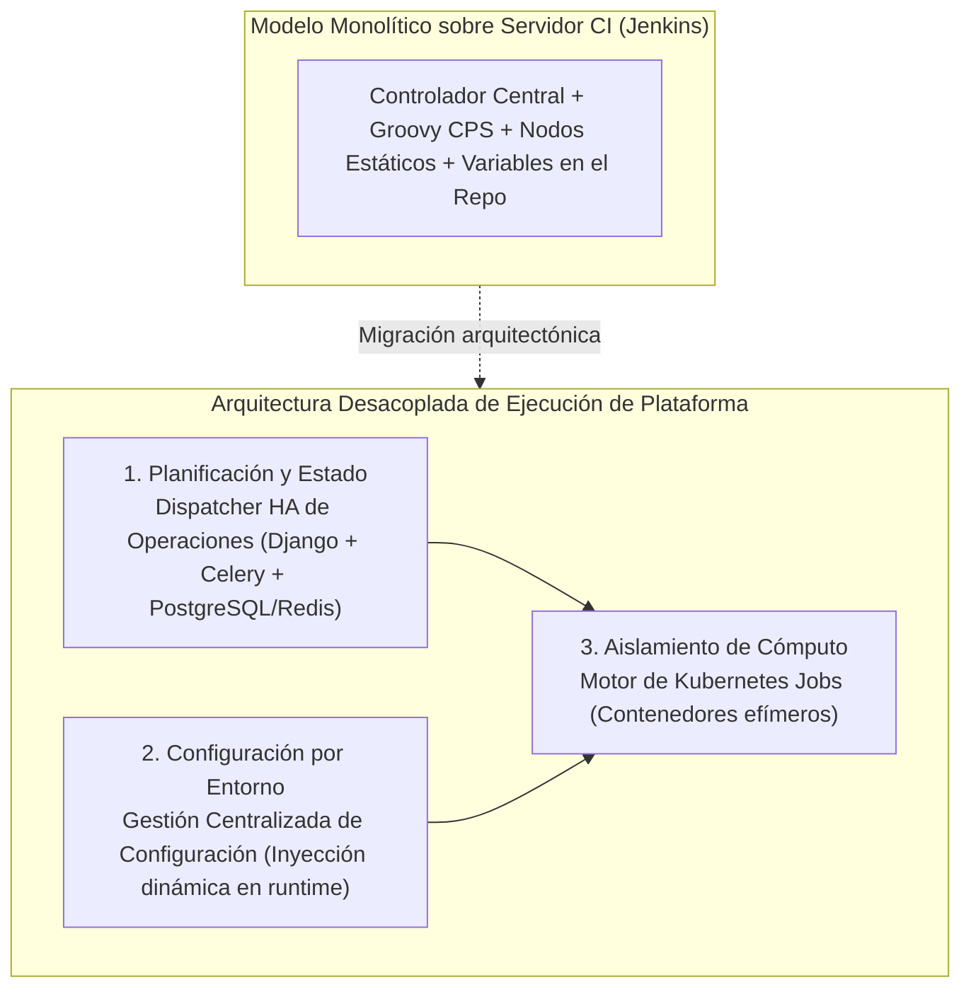

# Cuando las Shared Libraries Tocan Techo: Por Qué Sustituimos Jenkins por un Dispatcher HA Propio

Casi cualquier organización de infraestructura en crecimiento atraviesa la misma historia en dos actos con Jenkins.

En el **Acto I**, los equipos tienen decenas de pipelines copiados y pegados en distintos repositorios. Introduces **Jenkins Shared Libraries** en Groovy, estandarizas cómo se lanzan los despliegues y las tareas de infraestructura, eliminas duplicación y aceleras la incorporación de ingenieros. Se percibe como una victoria técnica rotunda — y en esa etapa, lo es.

En el **Acto II**, esa estandarización tiene tanto éxito que cientos de ingenieros y flujos automáticos empiezan a canalizar miles de operaciones diarias de infraestructura a través de ese framework compartido. Es entonces cuando descubres que **un servidor de integración continua no es un despachador distribuido de operaciones**.

<!-- more -->

## Por Qué Fueron Necesarias Primero las Shared Libraries

Antes de poder sustituir un motor de ejecución sin paralizar una organización, necesitas un contrato uniforme. Construir nuestro framework de Jenkins Shared Libraries obligó a todos los equipos a consumir una interfaz común para lanzar operaciones de infraestructura.

Y lo más importante: centralizar esos flujos nos dio la observabilidad necesaria para ver exactamente dónde fallaba el motor subyacente a escala bancaria:

1. **Contención de estado en el controlador central:** El modelo de ejecución Groovy CPS (*Continuation Passing Style*) de Jenkins serializa continuamente el estado del pipeline sobre el controlador. Bajo cargas concurrentes masivas de infraestructura, el propio controlador se convierte en un punto único de contención y fallo.
2. **Semántica orientada a interfaz web frente a API-first:** Cuando una plataforma interna (como nuestro plano de control **Orion**) necesita disparar, sondear, reintentar y auditar decenas de miles de operaciones diarias de forma programática, depender de números de build y salidas de consola resulta una abstracción frágil.
3. **Deriva de entorno en nodos estáticos:** Las máquinas virtuales de agentes permanentes acumulan inevitablemente estado residual, cachés de credenciales y conflictos de paquetes entre ejecuciones.

## Separar lo que Jenkins Empaqueta Junto

Al diseñar la migración fuera de Jenkins, la clave arquitectónica fue comprender que Jenkins acopla tres responsabilidades que a gran escala deben estar estrictamente separadas:

### 1. Un Dispatcher de Operaciones en Alta Disponibilidad (Django + Celery)
En lugar de tratar una operación de infraestructura como un "trabajo de compilación", la modelamos como una máquina de estados de primer nivel en **Django, PostgreSQL, Celery y Redis**, expuesta mediante una **interfaz REST documentada con Swagger/OpenAPI**:

- Los sistemas consumidores envían una petición tipada y reciben al instante un identificador único de operación.
- Pasamos a controlar por completo el enrutamiento de colas, las políticas de reintento con *exponential backoff*, el manejo de fallos y la pista de auditoría paso a paso — operando en Alta Disponibilidad sin el cuello de botella de un único controlador JVM.

### 2. Desacoplar las Variables de la Lógica del Playbook
Cambiar el motor de ejecución solo resuelve la mitad del problema si los equipos siguen acoplando variables de entorno dentro de sus repositorios de automatización. Junto con el dispatcher, construimos un **Sistema Centralizado de Gestión de Configuración**:

- Los playbooks y roles de Ansible pasaron a ser **100% agnósticos del entorno**.
- En el momento del despacho, el servicio de configuración resuelve el entorno destino (`dev`, `staging`, `prod`) e inyecta dinámicamente el conjunto validado de variables. Las ramas de inventario duplicadas desaparecieron de raíz.

### 3. Cómputo Efímero mediante Kubernetes Jobs
Por último, para erradicar la deriva en los nodos trabajadores, extendimos el pipeline para ejecutar las operaciones como **Kubernetes Jobs** aislados. Cada operación levanta un contenedor limpio de corta duración, recibe sus variables en tiempo de ejecución, ejecuta la carga, transmite logs y estado final al dispatcher y se destruye inmediatamente.

## La Lección Principal

Estandarizar primero con Jenkins Shared Libraries no fue trabajo perdido: creó la frontera de abstracción que nos permitió después sustituir Jenkins por debajo sin interrumpir el trabajo de los equipos que lo consumían.

---

*Consulta el desglose completo en el [caso de estudio del Dispatcher HA y Ejecución en K8s](../../projects/dispatcher-migration.md).*
