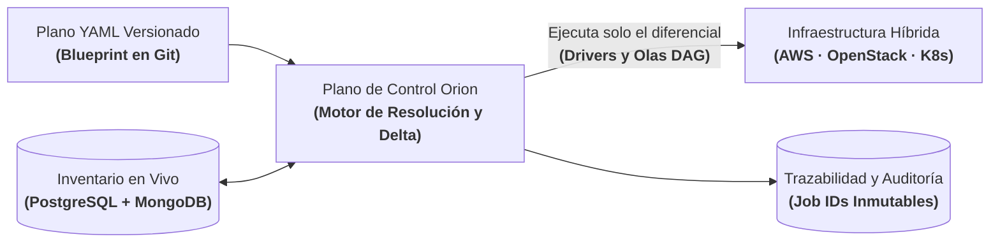

# Nueve Años de Plataformas Cloud Internas: Por Qué el YAML Declarativo Sustituyó a Nuestro Orquestador Comercial

"No construyas tu propio orquestador" suele ser un buen consejo — hasta que analizas en detalle qué piezas ya son propiedad de tu organización y en qué se va realmente el presupuesto de las suites comerciales.

Cuando evaluamos cómo más de 500 ingenieros debían orquestar entornos completos de infraestructura sobre nuestra nube híbrida, la opción corporativa por defecto era una suite comercial como **Red Hat Automation Platform (Ansible Tower)**. En su lugar, diseñamos **Orion**: nuestro propio plano de control IaaS en Python, capaz de interpretar y ejecutar directamente **planos declarativos en YAML (Blueprint)** para gobernar el ciclo de vida completo de la infraestructura.

Este artículo explica por qué esa decisión tuvo sentido en nuestro contexto, qué decidimos *no* construir, por qué **el desmontaje** — no la creación — es la verdadera prueba de fuego de cualquier motor, y por qué la **evangelización cultural entre los equipos de cómputo, networking, storage y monitorización** fue el factor determinante del éxito.

<!-- more -->

## 1. Ser Dueño del Plano de Control Cambia la Ecuación Build vs. Buy

La mayoría de las organizaciones adoptan grandes orquestadores externos porque carecen de una API unificada sobre su infraestructura subyacente.

Nosotros partíamos de un escenario distinto. En 2017 nos incorporamos en plena transición hacia **NextGen**, la iniciativa de BBVA para construir una plataforma cloud propia y desacoplar cargas transaccionales críticas del *mainframe*. Primero lo hicimos en centros de datos propios (*on-premises* sobre OpenStack y servidores físicos) y con los años la infraestructura evolucionó hacia un modelo completamente hibridado entre nube privada y pública. Durante ese viaje construimos **Orion**, nuestro plano de control IaaS central que hoy gobierna decenas de miles de nodos en AWS, OpenStack, OpenShift y bare-metal tras una única API REST basada en drivers. Orion ya resolvía:

- Autenticación, control de acceso (RBAC) y políticas de cumplimiento.
- Traducción específica para cada proveedor cloud mediante drivers.
- Inventario multi-cloud en tiempo real sobre PostgreSQL y MongoDB.
- Trazabilidad de trabajos y pistas inmutables de auditoría.

Comprar una suite comercial de orquestación para colocarla delante de Orion implicaba pagar licencias por nodo sobre decenas de miles de máquinas únicamente para secuenciar llamadas HTTP contra una API que ya era nuestra — perdiendo además la trazabilidad nativa de los Job IDs de Orion cuando un despliegue de múltiples pasos fallaba a mitad de camino.

## 2. Por Qué Evitamos los Archivos Locales de Estado

Las herramientas inspiradas en Terraform suelen heredar su decisión de diseño operativamente más dolorosa: un archivo de estado separado (`tfstate`) que debe almacenarse, bloquearse y reconciliarse cada vez que alguien realiza un cambio fuera de banda.

Dado que **Orion** interpreta de forma nativa los planos declarativos (**Blueprint**) sobre su propio inventario en vivo, tomamos una decisión deliberada de arquitectura: **cero archivos locales de estado**.

La base de datos híbrida de Orion *es* la fuente única de verdad en tiempo real. Cuando Orion procesa un plano YAML (Blueprint), consulta directamente en su inventario el estado actual de los recursos declarados y actúa únicamente sobre el diferencial (*delta*). No hay archivo de estado externo que corromper, ni bloqueos colgados tras la caída de un runner, ni divergencia entre "el estado del orquestador" y "la infraestructura real".

## 3. Crear Es Fácil; el Desmontaje Idempotente Es la Prueba Real

Casi cualquier script puede aprovisionar un entorno desde cero cuando todas las APIs responden `200 OK`. Donde la automatización procedimental se desmorona es ante un **fallo parcial durante la destrucción**.

Imaginemos el desmontaje de un entorno de 25 recursos (grupos de cómputo, reglas de balanceo, volúmenes, subredes). El paso 14 sufre un timeout porque una API cloud externa experimenta una degradación puntual. ¿Qué ocurre cuando el ingeniero relanza el trabajo cinco minutos después?

- **En playbooks procedimentales:** El paso 1 intenta borrar un recurso que ya fue eliminado en el primer intento, recibe un `404 Not Found` y aborta toda la ejecución — obligando a comentar líneas a mano o limpiar recursos manualmente.
- **En la ejecución declarativa de Orion:** Cada paso de un desmontaje (con el grafo de dependencias invertido) verifica el estado real en Orion. Los pasos del 1 al 13 detectan que sus recursos ya no existen, registran un `NO-OP` limpio y el motor reanuda inmediatamente en el paso 14.

Hacer que la destrucción sea **segura de repetir** transformó el desmantelamiento de entornos de un ticket manual crítico a una operación rutinaria en autoservicio.

## 4. El Factor Humano: Evangelizar la Filosofía y Alinear Silos Técnicos

El mayor desafío al construir una plataforma interna no es el código: es cultural y organizativo.

Una plataforma de infraestructura no puede tener éxito como una torre de marfil aislada. Para que más de 500 ingenieros adopten un plano de control unificado, es imprescindible una labor continua de **evangelización de la cultura de plataforma** e **ir todos a una con los equipos especializados de cada dominio**:

- **Cómputo:** Colaborar estrechamente para estandarizar imágenes doradas (*golden images*), dimensionamiento de recursos y ciclo de vida de instancias en nubes públicas, privadas y bare-metal sin fricción para los desarrolladores.
- **Networking:** Diseñar de forma conjunta la asignación dinámica de IPs, enrutamiento, DNS y reglas de balanceo (como nuestro puente a medida con balanceadores F5) para que la provisión de red deje de ser un cuello de botella manual de varios días.
- **Storage:** Integrar volúmenes de bloques, almacenamiento compartido y almacenamiento de objetos (Ceph, Swift, EBS) como primitivas declarativas transparentes en el plano de control.
- **Monitorización y Seguridad:** Trabajar mano a mano para que los agentes de observabilidad, la telemetría y el bastionado CIS corporativo vengan inyectados de forma obligatoria y transparente desde la capa base (*Ground*) antes de entregar cualquier máquina al usuario.

Si la plataforma se percibe como una imposición externa, los equipos buscarán atajos. Cuando evangelizas la filosofía —demostrando que la plataforma reduce la carga cognitiva de cada equipo especialista y les permite gobernar sus dominios a través de APIs limpias y autoservicio—, la infraestructura pasa de ser una suma de silos a un frente común alineado.

## 5. El Coste Honesto de Construir en Casa

Ser propietario de Orion y su capacidad declarativa elimina licencias comerciales y encaja como un guante con la auditoría interna, pero exige disciplina:

- **Asumes los casos límite:** La detección de ciclos en grafos de dependencias, el reporte de fallos parciales y la evolución del esquema pasan a ser responsabilidad directa de tu equipo.
- **La documentación es parte del producto:** Una herramienta comercial cuenta con respuestas en foros públicos; un DSL interno en YAML solo triunfa si sus mensajes de validación y plantillas de referencia se explican por sí solos.

Tras nueve años evolucionando esta arquitectura, la conclusión es clara: no reinventes los SDKs de los proveedores cloud — encapsúlalos tras drivers. Pero cuando el propio plano de control (Orion) interpreta de forma nativa los planos de infraestructura (Blueprint), un sistema en Python supera a una suite comercial pesada tanto en fiabilidad como en coste.

---

*Descubre cómo se conectan ambos sistemas en los casos de estudio de [Orion IaaS](../../projects/orion-iaas.md) y [Blueprint](../../projects/blueprint.md).*
