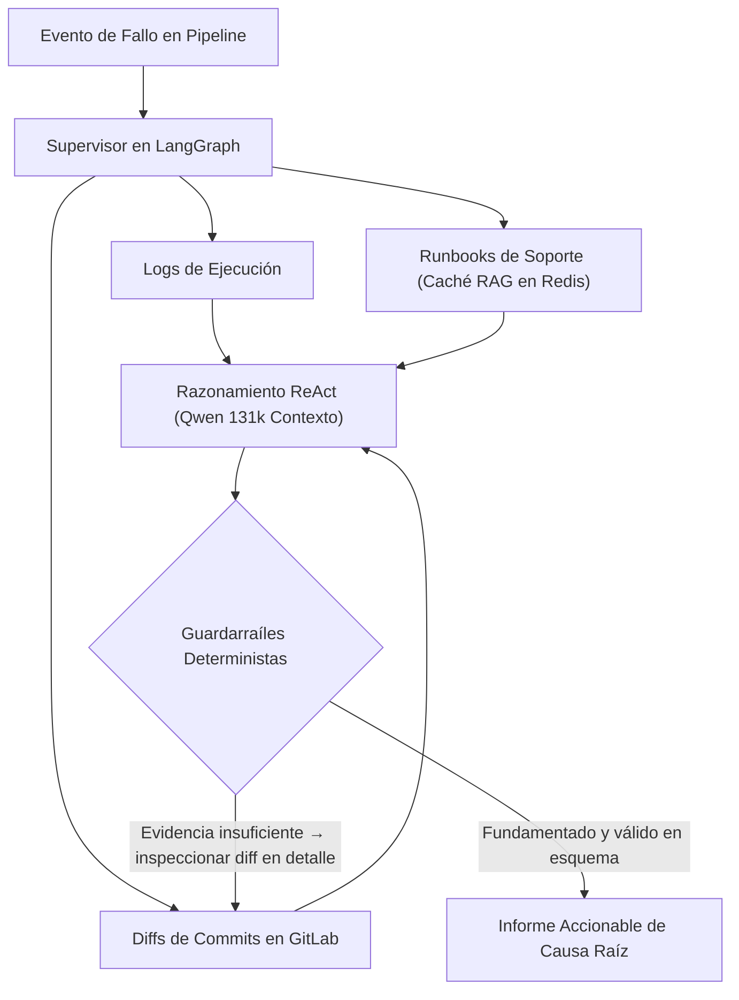

# La PoC Fue la Parte Fácil: Lecciones al Construir un Motor Agéntico de Diagnóstico CI/CD en Banca

La mayoría de los artículos técnicos sobre agentes de IA terminan en el instante en que el prototipo funciona sobre un conjunto de pruebas. En una gran empresa regulada, ahí es exactamente donde empieza la parte más difícil.

Cuando diseñamos y validamos la Prueba de Concepto (PoC) de **Orion AI** en BBVA — un sistema multi-agente construido con **LangGraph** y bucles **ReAct** para automatizar el análisis de causa raíz en fallos de CI/CD — el objetivo técnico era evidente: evitar que los ingenieros perdieran horas buceando entre logs interminables, manuales internos de soporte (*runbooks*) y diffs de commits en GitLab cada vez que fallaba un pipeline.

El prototipo cumplió su objetivo: redujo el triaje de horas de correlación manual a segundos. Sin embargo, su estado actual — **prototipo validado y preparado, a la espera de directrices de integración con la infraestructura central de IA** — me enseñó tanto sobre arquitectura de plataformas corporativas como el propio diseño de los nodos en LangGraph.

<!-- more -->

## 1. Por Qué las Cadenas Lineales de LLMs Fallan en el Triaje de Incidentes

Los primeros experimentos aplicando LLMs a operaciones suelen seguir una receta lineal ingenua: recortar las últimas líneas del log fallido, pegarlas en un prompt y preguntar al modelo qué ha fallado.

En pipelines reales de infraestructura, ese enfoque fracasa por dos motivos:

1. **La causa raíz casi nunca está en las últimas 50 líneas:** Un fallo en el minuto 18 suele ser consecuencia de una variable mal resuelta o un timeout de red ocurrido en el minuto 2.
2. **Los logs dicen *qué* se rompió, no *qué cambió*:** Un código de error en un despliegue resulta ambiguo hasta que se correlaciona con el diff del último commit en GitLab o con un runbook operativo conocido.

Por eso modelamos **Orion AI** como un **grafo cíclico con estado en LangGraph** en lugar de una cadena secuencial:

- **Recopilación concurrente de contexto:** El grafo extrae en paralelo las trazas de ejecución, los manuales y runbooks operativos (indexados en caché Redis para acelerar la recuperación RAG) y los metadatos del repositorio.
- **Correlación con contexto amplio (`Qwen` 131k):** Inyectar las evidencias consolidadas en un modelo de gran ventana de contexto preserva la cadena causal desde la inicialización hasta el error final.
- **Bucles ReAct acotados:** Cuando una traza apunta a un archivo de configuración modificado, el agente retrocede para inspeccionar el diff exacto del commit antes de emitir su conclusión.

## 2. Guardarraíles Deterministas: Tratar al LLM como un Componente No Confiable

En operaciones bancarias, sugerir un comando de remediación alucinado es peor que no emitir diagnóstico alguno. Para que la PoC fuera fiable para los equipos de ingeniería, aplicamos disciplina clásica de sistemas distribuidos a las entradas y salidas del modelo:

- **Esquemas estrictos de salida:** El agente no devuelve prosa libre; debe completar un contrato de diagnóstico tipado.
- **Evidencia explícita:** Cada causa raíz señalada debe apoyarse en evidencia concreta recuperada durante la ejecución (fragmentos de log, entradas de documentación o diffs de commits).
- **Fronteras de herramientas aisladas (MCP):** Los sistemas externos (Jenkins, caché de runbooks en Redis, GitLab) se consultan mediante herramientas tipadas de solo lectura en lugar de otorgar acceso arbitrario a consola.

## 3. Por Qué una PoC Validada Espera a los Cimientos Corporativos

Una vez validado el prototipo frente a escenarios reales de fallo, ¿por qué no lo conectamos a la mañana siguiente a todos los pipelines de producción del banco?

Porque en una entidad financiera de primer nivel, un agente de IA operativa vive en la intersección de dos dominios de plataforma distintos: **Operaciones de Infraestructura** (bajo nuestra responsabilidad) y la **Infraestructura Corporativa Central de IA** (gestionada por equipos transversales asociados).

Pasar de un prototipo validado a un despliegue masivo en producción requiere tres cimientos transversales:

1. **Capacidad de inferencia compartida y estándares de enrutamiento:** Ejecutar agentes con ventanas de 131k tokens ante cientos de fallos diarios exige asignación formal de cuota y directrices de consumo sobre los clusters centrales de inferencia del banco.
2. **Gobierno sobre datos operativos:** Los logs de CI/CD y los diffs de código contienen inevitablemente nombres de servidores internos, metadatos de configuración y estructura de repositorios. Formalizar cómo se anonimiza, transmite y retiene esa telemetría en los endpoints compartidos de IA es un requisito normativo ineludible.
3. **Propiedad clara del bucle de evaluación continua:** En producción, tanto los modelos como la infraestructura evolucionan. Definir quién mantiene el dataset de validación y los SLOs de precisión diagnóstica es tan importante como el código del grafo.

## Conclusión para Ingenieros de Plataforma

Si estás diseñando sistemas agénticos para operaciones reales, construye tu grafo de estado, tus contratos de herramientas y tus guardarraíles deterministas con calidad de producción desde el primer día — y mantén tu arquitectura desacoplada del proveedor de inferencia para que, cuando las directrices corporativas estén listas, el paso a producción sea un cambio de configuración y no una reescritura.

---

*Explora la arquitectura técnica en el [caso de estudio de Orion AI](../../projects/orion-ai.md).*
