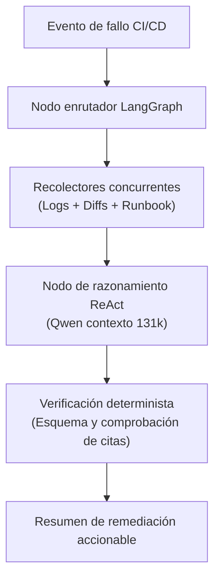

# Automatización del triaje de CI/CD con LangGraph y ReAct

Cuando una ejecución de CI/CD falla, la parte más lenta del ciclo de recuperación rara vez es la corrección en sí:
es el tiempo que un ingeniero pasa abriendo archivos de log de varios megabytes, buscando la primera traza de error,
cruzando referencias con diffs de commits y consultando documentación.

Aquí explicamos cómo diseñamos **Orion AI** utilizando **máquinas de estados en LangGraph** y **bucles ReAct**
para reducir el tiempo medio de resolución (MTTR) de horas a segundos.

<!-- more -->

## El desafío principal: Cero tolerancia a alucinaciones

En operaciones de infraestructura y banca, un agente de IA jamás puede inventar. Si un fallo de tubería se debe
a un token OIDC caducado, el agente no puede sugerir refactorizar tests unitarios.

Para lograr fiabilidad en producción, implementamos tres guardarraíles deterministas estrictos:

## ¿Por qué LangGraph frente a cadenas lineales?

Las cadenas secuenciales tradicionales de LLM fallan cuando los pasos de diagnóstico requieren retrocesos o ciclos de verificación:

1. **Bifurcación condicional:** si la traza bruta de error apunta a un archivo de configuración concreto (ej: `settings.py`), el grafo se bifurca para inspeccionar el diff de ese archivo específico en Git.
2. **Persistencia de estado:** LangGraph mantiene un diccionario de estado fuertemente tipado durante todo el ciclo de vida, permitiendo que nodos de verificación intermedios confirmen hechos antes de generar el veredicto final.
3. **Herramientas deterministas mediante MCP:** adoptamos el **Model Context Protocol (MCP)** para estandarizar las interacciones, asegurando que el modelo invoque APIs externas bajo contratos JSON tipados en lugar de scripts no estructurados.

## Resultados

Durante la fase de validación sobre cientos de ejecuciones de tuberías reales:
* El **MTTR** para el triaje inicial descendió de una media de ~45 minutos de indagación humana a **menos de 15 segundos**.
* Los desarrolladores recibieron un resumen directo en su flujo de trabajo (comentario en la Merge Request de GitLab o alerta en Slack) detallando la línea exacta del fallo, la clasificación de causa raíz y la acción correctiva recomendada.

---

*Puedes consultar la arquitectura detallada en el [caso de estudio de Orion AI](../../projects/orion-ai.md).*
