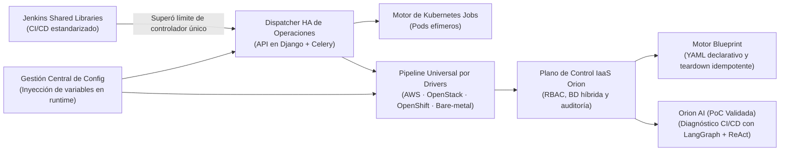

Senior Platform Engineer · Python · Madrid, España

# Oscar Redondo { .hero__title }

Diseño y construyo <strong>plataformas de despliegue y aprovisionamiento de infraestructura impulsadas por una filosofía propia de Infrastructure as Code</strong> — haciendo invisible la complejidad distribuida de AWS, OpenStack, OpenShift y bare-metal mediante APIs en autoservicio, motores declarativos de ciclo de vida y automatización determinista.

[:material-sitemap-outline: Explorar el ecosistema de plataforma](projects/index.md){ .md-button .md-button--primary }
[:material-file-account-outline: Ver mi CV](cv/index.md){ .md-button }
[:fontawesome-brands-github: GitHub (@oredondo)](https://github.com/oredondo){ .md-button }

  

    30.000+
    Máquinas gobernadas
  

  

    40.000+
    Operaciones diarias
  

  

    500+
    Ingenieros servidos
  

  

    10+ años
    Plataformas y Python
  

## Cómo se conecta todo: una plataforma construida capa por capa

Durante los últimos nueve años en **BBVA Technology**, mi trabajo no ha consistido en herramientas aisladas, sino en una **plataforma central de despliegue y gobierno de infraestructura** que ha evolucionado capa por capa bajo una filosofía propia de Infrastructure as Code a medida que resolvíamos cada cuello de botella de escala:

## Casos de Estudio de Arquitectura Corporativa

*Topología de sistemas, trade-offs de arquitectura y modos de fallo en entornos de producción multi-cloud:*

-   :material-cloud-cog-outline:{ .lg .middle } __[Orion — Plataforma IaaS Central y Pipeline por Drivers](projects/orion-iaas.md)__

    ---

    Arquitecto único de la plataforma IaaS central y despliegue para BBVA: una sola interfaz OpenAPI gobernando 30.000+ máquinas sobre AWS, OpenStack, OpenShift y bare-metal (40.000+ operaciones diarias), respaldada por PostgreSQL, MongoDB, Redis y auditorías automáticas.

    PythonDjango RESTCeleryPostgreSQLMongoDBRedis

    [:octicons-arrow-right-24: Leer caso de estudio](projects/orion-iaas.md)

-   :material-file-tree-outline:{ .lg .middle } __[Blueprint — Motor Declarativo de Ciclo de Vida](projects/blueprint.md)__

    ---

    Motor asíncrono en Python estilo Terraform guiado por planos YAML versionados. Orquesta olas DAG en paralelo contra Orion, emite trazas completas de auditoría y soporta desmontajes idempotentes — eliminando licencias comerciales.

    PythonAsyncIOPlanificación DAGYAML DeclarativoGitOps

    [:octicons-arrow-right-24: Leer caso de estudio](projects/blueprint.md)

-   :material-cached:{ .lg .middle } __[Dejar Jenkins Atrás — Dispatcher HA y Ejecución K8s](projects/dispatcher-migration.md)__

    ---

    Cómo evolucionamos desde Jenkins Shared Libraries en Groovy hacia un Dispatcher de Operaciones en Alta Disponibilidad (Django + Celery), inyección dinámica de configuración en runtime y ejecución efímera en Kubernetes Jobs.

    DjangoCeleryKubernetes JobsAnsibleOpenAPI

    [:octicons-arrow-right-24: Leer caso de estudio](projects/dispatcher-migration.md)

-   :material-radar:{ .lg .middle } __[Orion AI — Auto-Diagnóstico CI/CD (PoC Validada)](projects/orion-ai.md)__

    ---

    Prototipo multi-agente validado con LangGraph y bucles ReAct que correlaciona logs de ejecución, runbooks indexados en Redis y diffs de GitLab bajo guardarraíles deterministas — junto con un análisis honesto de las restricciones de despliegue bancario.

    LangGraphReActMCPQwen 131kGuardarraíles Deterministas

    [:octicons-arrow-right-24: Leer caso de estudio](projects/orion-ai.md)

## Sistemas Open-Source en GitHub

-   :material-waveform:{ .lg .middle } __[OmniLecture Studio — Suite IA Multimodal para Linux](projects/omni-lecture.md)__

    ---

    Suite nativa para Linux (Wayland/GNOME, GTK 3) con pipeline multimedia en FFmpeg (compresión H.264 a 10 FPS con `-tune stillimage` que ahorra hasta un 70% de espacio, sincronización PTS y filtros de audio `afftdn`), combinada con transcripción dual Whisper, OCR CLAHE en OpenCV y grafos en LangGraph.

    PythonFFmpegGTK 3 / WaylandLangGraphWhisper int8OpenCV / OCR

    [:octicons-arrow-right-24: Caso de estudio](projects/omni-lecture.md) · [:fontawesome-brands-github: Código en GitHub](https://github.com/oredondo/omnilecture-studio)

-   :material-wrench-outline:{ .lg .middle } __[WrenchBuddy — Plataforma IA de Vehículos y RAG con pgvector](projects/wrenchbuddy.md)__

    ---

    Plataforma full-stack construida con Django 6, DRF, PostgreSQL (`pgvector` RAG de 768 dim), Celery, Redis, S3/MinIO, OCR de facturas con LangChain Vision, informes PDF en ReportLab y frontend en TypeScript.

    Django 6 / DRFPostgreSQL pgvectorCelery &amp; RedisLangChain RAGTypeScript

    [:octicons-arrow-right-24: Caso de estudio](projects/wrenchbuddy.md) · [:fontawesome-brands-github: Backend](https://github.com/oredondo/WrenchBuddy) · [:fontawesome-brands-github: Frontend](https://github.com/oredondo/WrenchBuddy-frontend)

## Notas de Ingeniería y Ensayos de Arquitectura

-   __[Cuando las Shared Libraries Tocan Techo: Por Qué Sustituimos Jenkins por un Dispatcher HA Propio](blog/posts/2026-02-15-leaving-jenkins-at-scale-custom-dispatcher.md)__

    ---

    Por qué estandarizar el CI/CD con Jenkins Shared Libraries fue el primer paso indispensable — y cómo dejó al descubierto los límites que motivaron nuestro dispatcher HA en Django/Celery y Kubernetes Jobs efímeros.

-   __[Nueve Años de Plataformas Cloud Internas: Por Qué el YAML Declarativo Sustituyó a Nuestro Orquestador Comercial](blog/posts/2026-03-01-declarative-infrastructure-python.md)__

    ---

    Cómo ser propietarios del plano de control central cambia la decisión build-vs-buy, por qué evitamos archivos locales de estado y por qué el desmontaje idempotente es la prueba real de cualquier motor.

-   __[La PoC Fue la Parte Fácil: Lecciones al Construir un Motor Agéntico de Diagnóstico CI/CD en Banca](blog/posts/2026-03-10-agentic-cicd-diagnostics-langgraph.md)__

    ---

    Por qué los grafos cíclicos en LangGraph superan a las cadenas lineales en el triaje de logs, y qué bloquea realmente el paso de prototipos validados de IA a producción masiva en entornos regulados.

### Colaboración y Debate Técnico

Abierto a debatir sobre arquitectura de plataformas de despliegue, diseño de motores declarativos de IaC, sistemas distribuidos en Python y adopción de agentes de IA en producción.

[:material-linkedin: Conectar en LinkedIn](https://linkedin.com/in/oscarredondodjangopython){ .md-button .md-button--primary }
[:fontawesome-brands-github: GitHub (@oredondo)](https://github.com/oredondo){ .md-button }
[:material-email-outline: o.redondo91@gmail.com](mailto:o.redondo91@gmail.com){ .md-button }

