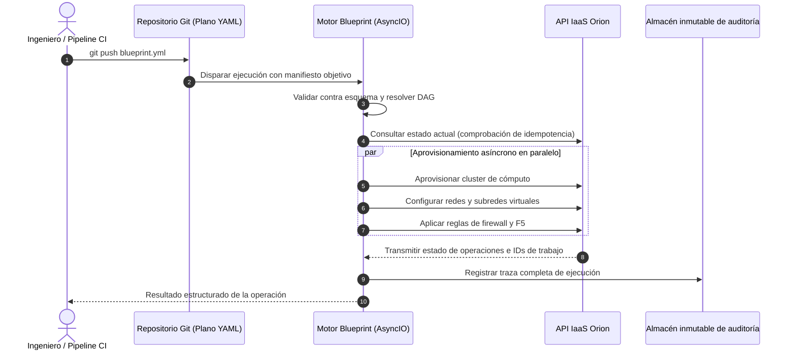

# Blueprint: Motor de Orquestación Declarativo y Asíncrono

| Dimensión | Detalles |
| :--- | :--- |
| **Rol** | Creador e Ingeniero Líder de Sistemas |
| **Organización** | BBVA Technology (Infraestructura Core Banking) |
| **Impacto** | Sustitución de plataforma de automatización comercial (Red Hat Ansible Automation Platform); aportó reproducibilidad GitOps a la infraestructura bancaria |
| **Stack** | Python, AsyncIO, PyYAML, JSON Schema, GitOps, API Orion |

!!! abstract "Resumen ejecutivo (TL;DR)"

    Los ingenieros declaran el **estado deseado** de su infraestructura en un archivo YAML
    versionado en Git. Blueprint lo valida, genera un grafo acíclico dirigido (DAG) de dependencias,
    ejecuta pasos independientes en paralelo mediante AsyncIO y reconcilia contra el estado en vivo
    de Orion para que cualquier ejecución —incluido un desmontaje interrumpido— sea **segura de repetir**.

## 1. Contexto y reto técnico

La automatización corporativa dependía de una suite comercial pesada. Conllevaba costes de licencia crecientes,
limitaciones de escalado y escasa alineación con los flujos internos de gobernanza bancaria; en particular,
reconstruir el estado exacto tras un fallo a mitad de ejecución era complejo para auditoría.

**Objetivo:** construir un motor declarativo interno en Python donde los equipos describieran entornos
completos en YAML bajo control de versiones, ejecutado en paralelo con plena trazabilidad y seguridad idempotente.

## 2. Flujo y arquitectura del motor



Un plano (*blueprint*) está diseñado para ser limpio y declarativo:

```yaml title="payments-stack.yml"
version: "2.0"
target_environment: aws-production

resources:
  - name: payment-network
    type: network.subnet
    cidr: 10.20.0.0/24

  - name: payment-worker-pool
    type: compute.instance_group
    count: 12
    flavor: m5.xlarge
    depends_on: [payment-network]

  - name: payment-redis-cache
    type: cache.cluster
    engine: redis
    depends_on: [payment-network]
```

## 3. Pilares técnicos fundamentales

### A. Resolvedor de dependencias DAG

La infraestructura tiene dependencias implícitas: una subred debe existir antes de vincular una instancia,
pero múltiples instancias pueden levantarse simultáneamente. Blueprint calcula **olas de ejecución** a partir
del grafo: todos los recursos de una misma ola se ejecutan en concurrencia; las olas avanzan secuencialmente.

### B. Idempotencia, auto-reconciliación y desmontajes resilientes

Los scripts tradicionales y playbooks procedimentales fallan bruscamente al reejecutarse si un recurso ya existe o ya ha sido eliminado. Blueprint aplica un **modelo de reconciliación en tres fases**:

1. **Consulta de estado observado:** Antes de ejecutar cualquier mutación, Blueprint consulta el estado en vivo a la API de Orion en lugar de confiar en archivos locales de estado (*statefiles*) propensos a desincronizaciones (*drift*).
2. **Evaluación del delta de intención:** Calcula una diferencia estricta (`NOOP`, `CREATE`, `UPDATE`, `DELETE`). Si el estado observado ya satisface la especificación deseada, la acción se marca como `NOOP` y concluye inmediatamente.
3. **Desmontaje reanudable con DAG invertido:** Los procesos de destrucción invierten el grafo de dependencias automáticamente (p. ej., las instancias se apagan antes de destruir subredes). Si un pipeline se interrumpe a mitad de una destrucción por timeout de red, relanzar el trabajo omite limpiamente los recursos ya destruidos y continúa exactamente donde se detuvo, sin intervención manual ni recursos huérfanos.

### C. Cero dependencia de licencias propietarias

La automatización pasa a ser código Python propio, adaptado a los estándares de cumplimiento bancario,
eliminando costes de licencia recurrente y otorgando total libertad evolutiva al equipo de plataforma.

### Análisis de trade-offs

| Decisión | Alternativa evaluada | Justificación técnica |
| :--- | :--- | :--- |
| Desarrollar motor propio | Mantener suite comercial / adoptar Terraform genérico | Integración nativa con la API de Orion, reintentos específicos y políticas de rollback a medida, propiedad total de auditoría y sin costes por nodo gestionado |
| AsyncIO nativo | Hilos (threads) o multiprocessing | Carga de trabajo 100% ligada a I/O (llamadas API y polling); miles de esperas concurrentes con consumo de recursos insignificante |
| Reconciliación contra estado en vivo | Archivo local de estado (*statefile*) | Orion ya es la fuente única de verdad; evita desincronizaciones de estado (*state drift*) y bloqueos concurrentes |

## 4. Aspectos destacados de la implementación en Python

### Planificador DAG por olas con reconciliación dinámica de estado

Núcleo ilustrativo del planificador combinando `graphlib.TopologicalSorter`, `asyncio.TaskGroup` y cálculo de diferencias idempotentes:

```python title="reconciliation.py (ilustrativo)"
import asyncio
from enum import Enum, auto
from graphlib import TopologicalSorter
from typing import NamedTuple


class DesiredState(NamedTuple):
    name: str
    resource_type: str
    spec: dict


class Action(Enum):
    NOOP = auto()
    CREATE = auto()
    UPDATE = auto()
    DESTROY = auto()


class BlueprintReconciler:
    def __init__(self, client: "OrionClient") -> None:
        self.client = client

    async def diff(self, desired: DesiredState, is_teardown: bool = False) -> Action:
        live = await self.client.get_resource(desired.name)
        if is_teardown:
            return Action.NOOP if live is None else Action.DESTROY

        if live is None:
            return Action.CREATE
        if live.spec == desired.spec:
            return Action.NOOP
        return Action.UPDATE

    async def reconcile_resource(self, desired: DesiredState, is_teardown: bool) -> None:
        action = await self.diff(desired, is_teardown=is_teardown)
        match action:
            case Action.NOOP:
                return  # La operación nula garantiza la idempotencia en reintentos
            case Action.CREATE:
                await self.client.create_resource(desired.spec)
            case Action.UPDATE:
                await self.client.update_resource(desired.name, desired.spec)
            case Action.DESTROY:
                await self.client.delete_resource(desired.name)

    async def run(
        self,
        manifest: dict[str, DesiredState],
        dependencies: dict[str, set[str]],
        teardown: bool = False,
    ) -> None:
        """Ejecuta dependencias en olas concurrentes.

        Si teardown=True, el grafo se invierte (se destruyen dependientes antes que dependencias).
        """
        graph_deps = dependencies if not teardown else self._invert_graph(dependencies)
        sorter = TopologicalSorter(graph_deps)
        sorter.prepare()  # (1)!

        while sorter.is_active():
            ready_wave = sorter.get_ready()
            async with asyncio.TaskGroup() as tg:  # (2)!
                for name in ready_wave:
                    tg.create_task(
                        self.reconcile_resource(manifest[name], is_teardown=teardown)
                    )
            sorter.done(*ready_wave)

    @staticmethod
    def _invert_graph(deps: dict[str, set[str]]) -> dict[str, set[str]]:
        inverted: dict[str, set[str]] = {k: set() for k in deps}
        for node, upstream in deps.items():
            for parent in upstream:
                inverted.setdefault(parent, set()).add(node)
        return inverted
```

1. `sorter.prepare()` valida el grafo al inicio; cualquier ciclo genera una excepción `CycleError` antes de mutar la infraestructura.
2. `asyncio.TaskGroup` ejecuta tareas independientes en paralelo por cada ola; si una falla, cancela de forma limpia las operaciones hermanas, preservando un estado determinista y reanudable.

## 5. Resultados

- :moneybag: **Ahorro recurrente de licencias:** sustitución completa de orquestación comercial por Python propio.
- :repeat: **Reproducibilidad GitOps:** cualquier modificación de entorno es un commit auditado y versionado.
- :mag: **Trazabilidad completa:** cada ejecución genera una traza inmutable para auditores.
- :zap: **Paralelismo por defecto:** los recursos independientes se aprovisionan en paralelo en lugar de secuencialmente.

[:octicons-arrow-right-24: Artículo relacionado: Por qué construimos nuestro propio motor YAML declarativo](../blog/posts/2026-03-01-declarative-infrastructure-python.md)
