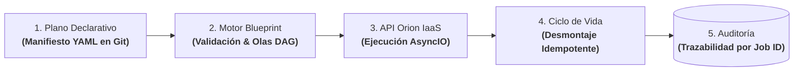

# Blueprint: Motor Asíncrono de Ciclo de Vida Declarativo

| Dimensión | Detalles |
| :--- | :--- |
| **Rol** | Arquitecto y Responsable de Plataforma |
| **Organización** | BBVA (Infraestructura Core Banking) |
| **Resultado** | Eliminación de licencias comerciales de orquestación (Red Hat Automation Platform); GitOps declarativo y desmontajes reanudables sobre Orion |
| **Stack** | Python, AsyncIO, DSL Declarativo en YAML, JSON Schema, GitOps, API REST de Orion |

!!! abstract "Resumen de arquitectura"

    Blueprint es un motor interno de orquestación asíncrona en Python — conceptualmente análogo a Terraform y diseñado específicamente sobre la plataforma **Orion** de BBVA. Los equipos declaran el estado deseado de sus entornos completos en planos YAML versionados en Git; el motor resuelve el grafo de dependencias en olas concurrentes, concilia contra el inventario en vivo de Orion, genera trazas de auditoría inmutables por Job ID y soporta **desmontajes idempotentes** que reanudan ejecuciones interrumpidas sin reprocesar pasos ya completados.

---

## 1. Contexto y Por Qué No Encajaban las Suites Comerciales

Una vez que **Orion** unificó las APIs de AWS, OpenStack, OpenShift y bare-metal, los equipos necesitaban desplegar o destruir entornos completos (redes, balanceadores, clusters, middleware) como una única unidad declarativa.

Depender de suites comerciales como **Red Hat Ansible Automation Platform / Tower** presentaba tres barreras insalvables:

1. **Coste y riesgo de concentración de terceros (DORA):** El licenciamiento por nodo penalizaba el crecimiento e incrementaba la dependencia cautiva (*vendor lock-in*) en componentes críticos de automatización.
2. **Opacidad ante fallos a mitad de ejecución:** Si un script procedimental de 40 pasos fallaba en el paso 27, reconstruir el estado o desmontar de forma segura el entorno parcial requería intervención manual.
3. **Desajuste con la arquitectura de Orion:** Orion ya era la fuente única de verdad. Se requería un motor que hablara de forma nativa su modelo de Job IDs, permisos RBAC y reportes de cumplimiento.

---

## 2. Topología Abstracta del Sistema: Ciclo de Vida de una Orquestación

Blueprint procesa planos declarativos mediante un pipeline asíncrono estricto:

### Pipeline de Ejecución Paso a Paso

| Fase | Componente Responsable | Qué se ejecuta exactamente | Garantía de Ingeniería |
| :--- | :--- | :--- | :--- |
| **1. Validación Pre-Flight** | Validador JSON Schema (Python) | Comprobación estricta de tipos, sintaxis y ciclos de dependencias en el YAML antes de tocar producción. | Rechazo inmediato de manifiestos erróneos sin llamadas a la API. |
| **2. Construcción del DAG** | Programador de Dependencias | Cálculo del grafo acíclico y partición en olas concurrentes (*waves*). En destrucciones, invierte el orden automáticamente. | Paralelismo máximo respetando la topología de red y servicios. |
| **3. Inspección en Vivo** | Conector REST con Orion | Consulta del estado real contra el inventario vivo de Orion para calcular el diferencial (*delta*). | Omisión limpia de pasos ya satisfechos (NO-OP), evitando re-trabajo. |
| **4. Ejecución Asíncrona** | Motor AsyncIO | Despacho de llamadas concurrentes contra Orion para los recursos de la ola activa, monitorizando cada Job ID devuelto. | Alta concurrencia sin bloqueo de hilos y huella mínima de memoria. |
| **5. Informe de Auditoría** | Generador de Trazas Forenses | Emisión de un informe estructurado que vincula cada recurso declarado con sus Job IDs exactos y marcas temporales. | Trazabilidad inmutable 100% auditable ante organismos reguladores. |

---

## 3. Decisiones Clave de Arquitectura

### A. Olas Concurrentes en DAG sobre Python AsyncIO
El aprovisionamiento de infraestructura está dominado por esperas de red (I/O-bound). Blueprint particiona el grafo de dependencias en olas: los recursos independientes se ejecutan de forma concurrente sobre el bucle `AsyncIO` de Python, mientras que los dependientes aguardan la finalización de su ola previa. Esto redujo el tiempo total de despliegue en más de un 60% frente a ejecuciones secuenciales.

### B. Desmontaje Idempotente y Reanudación sin Estado Huérfano
El punto crítico de la automatización tradicional es la destrucción de entornos complejos. Si una eliminación falla a mitad de camino, un script ingenuo se detiene al relanzarse porque la primera mitad ya no existe. Blueprint invierte el orden del DAG y verifica el estado en vivo en Orion antes de cada acción: los recursos ya eliminados se marcan como NO-OP y el desmantelamiento continúa limpiamente hasta el final.

### C. Trazabilidad por Job ID vs. Archivos Locales de Estado (`tfstate`)
En lugar de depender de ficheros de estado locales o remotos susceptibles de corrupción y bloqueos de concurrencia, Blueprint utiliza a la propia plataforma Orion como la fuente única de verdad en vivo. Cada acción queda vinculada a un Job ID inmutable en Orion, emitiendo una evidencia forense consumida directamente por los auditores del banco.

---

## 4. Modos de Fallo y Diseño de Resiliencia

| Escenario de Fallo | Enfoque Procedimental Tradicional | Comportamiento del Motor Blueprint |
| :--- | :--- | :--- |
| **Dependencia circular en el manifiesto** | Se descubre a mitad del despliegue tras mutar producción | Rechazado en la validación estática del DAG antes de invocar ninguna API |
| **Timeout a mitad de un desmontaje de 20 nodos** | Al relanzar falla con "recurso no encontrado" en los nodos 1–10 | Al relanzar consulta Orion, omite los nodos 1–10 y reanuda en el nodo 11 |
| **Auditoría solicita evidencia de un cambio fallido** | Correlación manual entre múltiples logs dispersos de consola | Informe estructurado vincula cada paso con su Job ID inmutable en Orion |

---

## 5. Trade-Offs de Arquitectura

| Decisión | Alternativa Evaluada | Justificación |
| :--- | :--- | :--- |
| **Motor propio en Python** | Red Hat Automation Platform / Terraform | Eliminó costes recurrentes de licencias comerciales, mitigó el riesgo de concentración de terceros (DORA) y se integró de forma nativa con el modelo de trabajos y auditoría de Orion. |
| **Orion como fuente única de verdad en vivo** | Archivos locales de estado (equivalente a `tfstate`) | Orion ya mantiene el inventario multi-cloud en tiempo real; consultar Orion evita deriva de estado (*drift*) y bloqueos concurrentes. |
| **Concurrencia con AsyncIO** | Ejecutores multi-hilo o multi-proceso | Alta concurrencia para cientos de esperas de API simultáneas con una huella de memoria mínima. |

---

## 6. Impacto Operativo y de Negocio

- **Eliminación de licencias comerciales:** Al diseñar un motor declarativo propio e integrado con Orion, se prescindió por completo de herramientas comerciales licenciadas por nodo (como Red Hat Ansible Automation Platform / Tower), contribuyendo decisivamente al ahorro acumulado superior a 6 millones de euros para la organización.
- **Desmontajes idempotentes y reanudables:** 100% de éxito en desmantelamientos parciales o reanudados tras incidencias, eliminando recursos huérfanos y mitigando cualquier riesgo de deriva manual.
- **Concurrencia asíncrona masiva:** Aceleró los tiempos de aprovisionamiento de entornos complejos en más de un 60% gracias a la resolución de dependencias por olas concurrentes sobre el bucle `AsyncIO` de Python.
- **Trazabilidad y auditoría por Job ID (Conformidad DORA):** Evidencia inmutable generada automáticamente para cada despliegue o desmantelamiento, vinculando manifiestos Git con identificadores de trabajo en Orion para auditorías regulatorias bancarias y control del riesgo de cambio.

---

[:octicons-arrow-left-24: Anterior: Plataforma IaaS Orion](orion-iaas.md) · [:octicons-arrow-right-24: Siguiente: Dejar Jenkins Atrás — Dispatcher HA y Ejecución K8s](dispatcher-migration.md)
