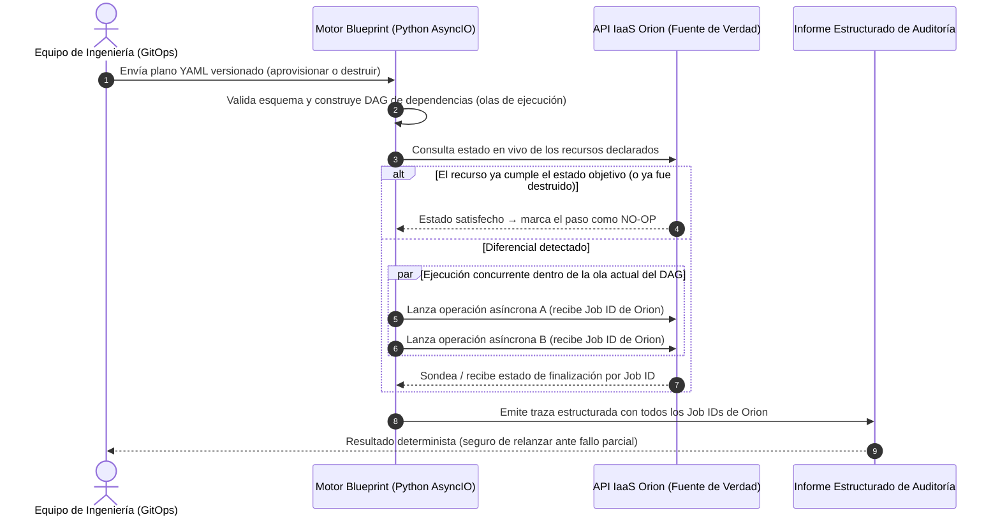
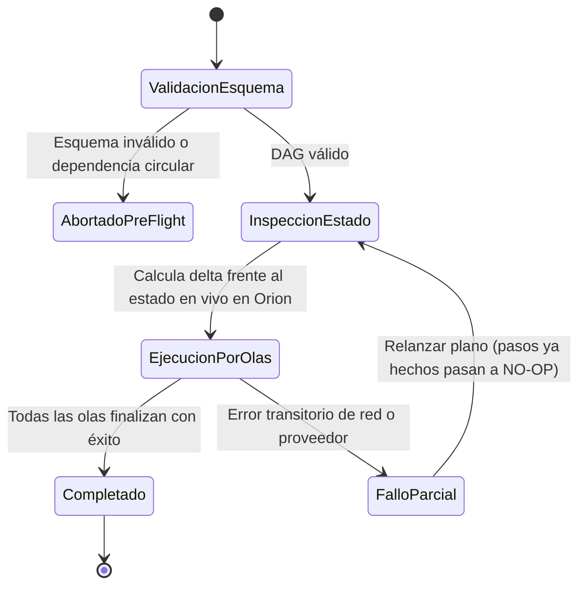

# Blueprint: Motor Asíncrono de Ciclo de Vida Declarativo

| Dimensión | Detalles |
| :--- | :--- |
| **Rol** | Creador y Arquitecto Principal de Sistemas |
| **Organización** | BBVA (Infraestructura Core Banking) |
| **Resultado** | Eliminación de licencias comerciales de orquestación (Red Hat Automation Platform); GitOps declarativo y desmontajes reanudables sobre Orion |
| **Stack** | Python, AsyncIO, DSL Declarativo en YAML, JSON Schema, GitOps, API REST de Orion |

!!! abstract "Resumen de arquitectura"

    Blueprint es un motor interno de orquestación asíncrona en Python — conceptualmente análogo a Terraform y diseñado específicamente sobre la plataforma **Orion** de BBVA. Los equipos de ingeniería declaran el estado deseado de sus entornos completos en planos YAML versionados; el motor resuelve el grafo de dependencias, ejecuta operaciones independientes en paralelo, genera un informe estructurado con trazabilidad completa de trabajos en Orion para auditoría y soporta **operaciones de destrucción idempotentes** que reanudan desmontajes parciales sin reprocesar pasos ya completados.

---

## 1. Contexto y Por Qué No Encajaban las Suites Comerciales

Una vez que **Orion** expuso una API REST unificada sobre AWS, OpenStack, OpenShift y bare-metal, los equipos necesitaban orquestar entornos completos (redes, balanceadores, grupos de cómputo, middleware) como una sola unidad en lugar de invocar endpoints aislados.

Depender de suites comerciales de orquestación como **Red Hat Automation Platform (Ansible Tower)** presentaba tres problemas estructurales:

1. **Coste de licenciamiento por nodo:** Las licencias comerciales escalan según el número de servidores gestionados, penalizando el crecimiento sobre decenas de miles de nodos.
2. **Opacidad ante fallos a mitad de ejecución:** Cuando una secuencia procedimental de 40 pasos falla en el paso 27 por un corte transitorio de red, reconstruir el estado exacto para auditoría o desmontar de forma segura el entorno parcial exigía intervención manual.
3. **Desajuste con la arquitectura de Orion:** Ya éramos propietarios de la fuente única de verdad (Orion). Necesitábamos un orquestador que hablara de forma nativa el modelo de identificadores de trabajo (Job IDs), sondeo asíncrono, permisos RBAC y reportes de cumplimiento de Orion.

---

## 2. Flujo Abstracto de Ejecución y Desmontaje

---

## 3. Pilares Técnicos Fundamentales

### A. Planos YAML Declarativos frente a Scripts Procedimentales
En lugar de mantener scripts imperativos que mezclan flujo de control con estado de infraestructura, los equipos versionan en Git un plano YAML declarativo que define **qué** topología debe existir y las dependencias entre componentes. La validación de esquema detecta errores estructurales y ciclos antes de realizar una sola llamada a Orion.

### B. Concurrencia Asíncrona por Olas (Waves)
El aprovisionamiento de infraestructura está limitado por I/O (esperas de red ante APIs cloud, hipervisores y balanceadores). Blueprint organiza el grafo de dependencias en **olas de ejecución**:

- Los recursos sin dependencias pendientes se ejecutan **de forma concurrente** sobre el bucle de eventos `AsyncIO` de Python.
- Los recursos dependientes esperan a que su ola predecesora finalice correctamente.
- Si un paso falla a mitad de una ola, el motor conserva el registro exacto de cada trabajo en vuelo dentro de Orion sin perder la trazabilidad de las operaciones hermanas.

### C. Destrucción Idempotente y Reanudación de Desmontajes Parciales
El desmantelamiento de entornos complejos es el punto donde suele romperse la automatización tradicional. Si una destrucción falla a mitad de camino, un script ingenuo aborta al relanzarse porque la primera mitad de los recursos ya no existe.

Blueprint gestiona el **ciclo de vida completo de la infraestructura**:

- En modo destrucción, el orden de dependencias se invierte para eliminar los servicios dependientes antes que las redes o el almacenamiento compartido.
- Antes de actuar sobre cualquier nodo, el motor verifica el estado en vivo en Orion. Los pasos ya completados en una ejecución previa interrumpida se omiten limpiamente, permitiendo relanzar el mismo plano hasta completar el desmontaje sin tocar la base de datos manualmente.

### D. Trazabilidad Extremo a Extremo por Job ID
En un entorno bancario regulado, que un pipeline termine en verde no basta como evidencia de auditoría. Cada ejecución de Blueprint genera un informe estructurado que vincula cada recurso del manifiesto YAML con los **Job IDs exactos de Orion**, marcas de tiempo y transiciones de estado ejecutadas — incluso cuando una ejecución se detiene a mitad de camino.

---

## 4. Modos de Fallo y Diseño de Resiliencia

| Escenario de Fallo | Playbook Procedimental Tradicional | Comportamiento del Motor Blueprint |
| :--- | :--- | :--- |
| **Dependencia circular en el manifiesto** | Se descubre a mitad del despliegue tras mutar producción | Rechazado en la validación previa del DAG antes de invocar ninguna API |
| **Timeout a mitad de un desmontaje de 20 nodos** | Al relanzar falla con "recurso no encontrado" en los nodos 1–10 | Al relanzar consulta Orion, omite los nodos 1–10 y reanuda en el nodo 11 |
| **Auditoría solicita evidencia de un cambio fallido** | Correlación manual entre múltiples logs de consola | Informe estructurado vincula cada paso con su Job ID inmutable en Orion |

---

## 5. Trade-Offs de Arquitectura

| Decisión | Alternativa Evaluada | Justificación |
| :--- | :--- | :--- |
| **Motor propio en Python** | Red Hat Automation Platform / Terraform | Eliminó costes recurrentes de licencias comerciales, se integró de forma nativa con el modelo de trabajos y auditoría de Orion y evitó bloqueos de archivos de estado externos. |
| **Orion como fuente única de verdad en vivo** | Archivos locales de estado (equivalente a `tfstate`) | Orion ya mantiene el inventario multi-cloud en tiempo real; consultar Orion evita deriva de estado (*drift*) y bloqueos concurrentes. |
| **Concurrencia con AsyncIO** | Ejecutores multi-hilo o multi-proceso | Alta concurrencia para cientos de esperas de API simultáneas con una huella de memoria mínima. |

---

[:octicons-arrow-left-24: Anterior: Plataforma IaaS Orion](orion-iaas.md) · [:octicons-arrow-right-24: Siguiente: Dejar Jenkins Atrás — Dispatcher HA y Ejecución K8s](dispatcher-migration.md)
