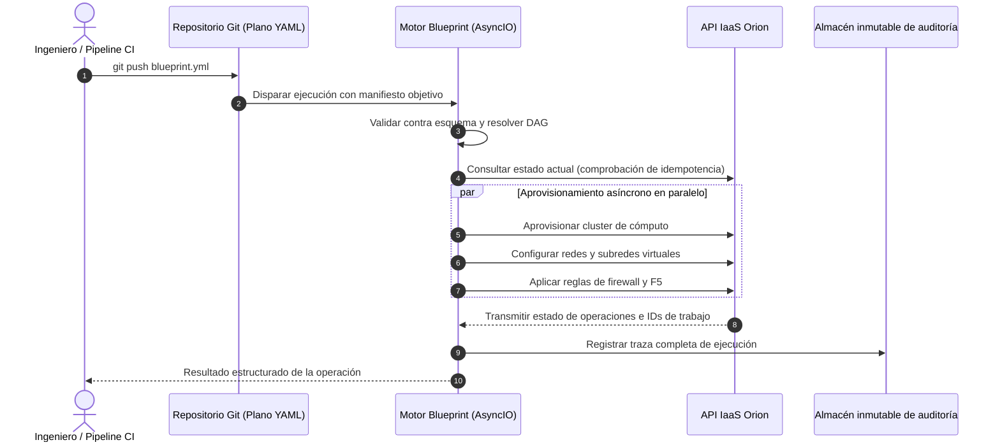

# Blueprint: Motor de Orquestación Declarativo y Asíncrono

| Dimensión | Detalles |
| :--- | :--- |
| **Rol** | Creador e Ingeniero Líder de Sistemas |
| **Organización** | BBVA Technology |
| **Impacto** | Sustitución de plataforma de automatización comercial (Red Hat Ansible Automation Platform); aportó reproducibilidad GitOps a la infraestructura bancaria |
| **Stack** | Python, AsyncIO, PyYAML, JSON Schema, GitOps, API Orion |

!!! abstract "Resumen ejecutivo (TL;DR)"

    Los ingenieros declaran el **estado deseado** de su infraestructura en un archivo YAML
    versionado en Git. Blueprint lo valida, genera un grafo acíclico dirigido (DAG) de dependencias,
    ejecuta pasos independientes en paralelo mediante AsyncIO y reconcilia contra el estado en vivo
    de Orion para que cualquier ejecución —incluido un desmontaje interrumpido— sea **segura de repetir**.

## 1. Contexto y reto técnico

La automatización corporativa dependía de una suite comercial pesada. Conllevaba costes de licencia crecientes,
limitaciones de escalado y escasa alineación con los flujos internos de gobernanza bancaria; en particular,
reconstruir el estado exacto tras un fallo a mitad de ejecución era complejo para auditoría.

**Objetivo:** construir un motor declarativo interno en Python donde los equipos describieran entornos
completos en YAML bajo control de versiones, ejecutado en paralelo con plena trazabilidad y seguridad idempotente.

## 2. Flujo y arquitectura del motor



Un plano (*blueprint*) está diseñado para ser limpio y declarativo:

```yaml title="payments-stack.yml"
version: "2.0"
target_environment: aws-production

resources:
  - name: payment-network
    type: network.subnet
    cidr: 10.20.0.0/24

  - name: payment-worker-pool
    type: compute.instance_group
    count: 12
    flavor: m5.xlarge
    depends_on: [payment-network]

  - name: payment-redis-cache
    type: cache.cluster
    engine: redis
    depends_on: [payment-network]
```

## 3. Pilares técnicos fundamentales

### A. Resolvedor de dependencias DAG

La infraestructura tiene dependencias implícitas: una subred debe existir antes de vincular una instancia,
pero múltiples instancias pueden levantarse simultáneamente. Blueprint calcula **olas de ejecución** a partir
del grafo: todos los recursos de una misma ola se ejecutan en concurrencia; las olas avanzan secuencialmente.

### B. Desmontaje idempotente y reanudación segura

Los scripts tradicionales fallan al reejecutarse si un recurso ya fue eliminado previamente. Blueprint
inspecciona primero el estado en vivo en Orion, omite los pasos ya satisfechos y solo actúa sobre el diferencial restante:
un proceso de destrucción interrumpido puede relanzarse de inmediato sin intervención manual sobre la base de datos.

### C. Cero dependencia de licencias propietarias

La automatización pasa a ser código Python propio, adaptado a los estándares de cumplimiento bancario,
eliminando costes de licencia recurrente y otorgando total libertad evolutiva al equipo de plataforma.

### Análisis de trade-offs

| Decisión | Alternativa evaluada | Justificación técnica |
| :--- | :--- | :--- |
| Desarrollar motor propio | Mantener suite comercial / adoptar Terraform genérico | Integración nativa con la API de Orion, reintentos específicos y políticas de rollback a medida, propiedad total de auditoría y sin costes por nodo gestionado |
| AsyncIO nativo | Hilos (threads) o multiprocessing | Carga de trabajo 100% ligada a I/O (llamadas API y polling); miles de esperas concurrentes con consumo de recursos insignificante |
| Reconciliación contra estado en vivo | Archivo local de estado (*statefile*) | Orion ya es la fuente única de verdad; evita desincronizaciones de estado (*state drift*) y bloqueos concurrentes |

## 4. Aspectos destacados de la implementación en Python

Núcleo simplificado e ilustrativo del planificador por olas, construido íntegramente con la librería estándar:

```python title="scheduler.py (ilustrativo)"
import asyncio
from graphlib import TopologicalSorter
from collections.abc import Awaitable, Callable

Step = Callable[[str], Awaitable[None]]


async def run_blueprint(dependencies: dict[str, set[str]], apply: Step) -> None:
    """Ejecuta cada recurso en cuanto todas sus dependencias han concluido."""
    graph = TopologicalSorter(dependencies)
    graph.prepare()  # (1)!

    while graph.is_active():
        wave = graph.get_ready()
        async with asyncio.TaskGroup() as tg:  # (2)!
            for resource in wave:
                tg.create_task(apply(resource))
        graph.done(*wave)


async def apply(resource: str) -> None:
    current = await orion.get_state(resource)
    if current.matches_desired():  # (3)!
        return
    await orion.reconcile(resource)
```

1. `prepare()` genera una excepción `CycleError` ante dependencias circulares, bloqueando planos erróneos antes de tocar infraestructura.
2. `TaskGroup` (Python 3.11+) cancela las tareas hermanas de la ola si una falla: el lote tiene éxito completo o se detiene limpiamente.
3. La comprobación de idempotencia: si el estado en vivo ya coincide con el deseado, la acción es una operación nula (*no-op*), lo que hace seguros los reintentos y desmontajes.

## 5. Resultados

- :moneybag: **Ahorro recurrente de licencias:** sustitución completa de orquestación comercial por Python propio.
- :repeat: **Reproducibilidad GitOps:** cualquier modificación de entorno es un commit auditado y versionado.
- :mag: **Trazabilidad completa:** cada ejecución genera una traza inmutable para auditores.
- :zap: **Paralelismo por defecto:** los recursos independientes se aprovisionan en paralelo en lugar de secuencialmente.

[:octicons-arrow-right-24: Artículo relacionado: Por qué construimos nuestro propio motor YAML declarativo](../blog/posts/2026-03-01-declarative-infrastructure-python.md)
