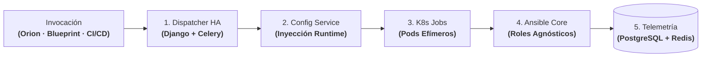

# Dejar Jenkins Atrás a Gran Escala: Dispatcher HA, Configuración en Runtime y Ejecución en K8s

| Dimensión | Detalles |
| :--- | :--- |
| **Rol** | Arquitecto y Responsable de Plataforma |
| **Organización** | BBVA (Infraestructura Core Banking) |
| **Alcance** | Sustitución de Jenkins como motor de ejecución de infraestructura; unificación de gestión de configuración y ejecución efímera en Kubernetes |
| **Stack** | Python, Django, DRF, Celery, Redis, PostgreSQL, Kubernetes Jobs, Ansible, Groovy |

!!! abstract "Resumen de arquitectura"

    Antes de que una plataforma interna pueda escalar a decenas de miles de operaciones diarias, su plano de ejecución debe ser fiable, gobernado por API y sin estado (*stateless*). Este caso de estudio aborda una evolución arquitectónica: estandarizar pipelines con **Jenkins Shared Libraries**, superar los cuellos de botella del monolito migrando a un **Dispatcher HA propio (Django + Celery)**, desacoplar variables mediante un **Sistema Centralizado de Configuración** y aislar la ejecución en **Kubernetes Jobs**.

---

## 1. El Cuello de Botella Operativo de Jenkins

Inicialmente estandarizamos la automatización corporativa mediante un framework modular de **Jenkins Shared Libraries en Groovy**. Aunque redujo la duplicación entre equipos, a escala bancaria destapó limitaciones insalvables en Jenkins:

1. **Fragilidad del controlador central (SPOF):** Las ejecuciones masivas concurrentes saturaban el proceso JVM maestro y la serialización CPS de Groovy, amenazando la disponibilidad de la plataforma.
2. **Control programático deficiente:** Gestionar miles de operaciones de infraestructura mediante la API web de Jenkins carecía de un modelo relacional de estados y de políticas avanzadas de contrapresión (*back-pressure*).
3. **Deriva en agentes estáticos:** Los workers de larga duración acumulaban estado residual, colisiones de librerías y contención de recursos.

---

## 2. Topología Abstracta del Sistema: Desacoplamiento de Ejecución y Estado

La arquitectura desacopla el flujo en cinco etapas bien definidas:

### Pipeline de Ejecución Paso a Paso

| Fase | Componente Responsable | Qué se ejecuta exactamente | Garantía de Ingeniería |
| :--- | :--- | :--- | :--- |
| **1. Despacho Asíncrono** | API OpenAPI & Workers Celery | Recepción de la orden desde Orion, Blueprint o CI/CD; persistencia del estado en PostgreSQL. | Ingesta no bloqueante en alta disponibilidad (cero SPOF). |
| **2. Inyección de Configuración** | Servicio Centralizado de Configuración | Detección del entorno (Dev/Staging/Prod) e inyección dinámica de variables y secretos en memoria. | Erradicación de la deriva de configuración (*zero drift*). |
| **3. Lanzamiento Efímero** | Controlador de Kubernetes Jobs | Creación de un pod efímero de corta duración con la imagen y dependencias exactas del trabajo. | Aislamiento estricto de recursos y dependencias limpias. |
| **4. Ejecución Agnóstica** | Ansible Runner en Contenedor | Ejecución de roles 100% reutilizables (GitLab, Artifactory, servicios base) sobre la infraestructura destino. | Idéntico código probado en todas las fases del ciclo de vida. |
| **5. Transmisión y Cierre** | Broker Redis & PostgreSQL | Envío continuo de logs, captura del código de salida, actualización del estado final y destrucción del pod. | Cero estado residual en workers e historial auditable. |

---

## 3. Decisiones Clave de Arquitectura

### A. Dispatcher Propio en Django/Celery vs. Escalar Controladores Jenkins
Escalar clústeres de Jenkins multiplicaba la sobrecarga de mantenimiento de plugins y no resolvía el acoplamiento de estado. Construir un dispatcher en Python con Celery y PostgreSQL aportó control nativo por API REST, colas asíncronas con priorización y un modelo relacional de transiciones de estado, permitiendo migrar las cargas de las Shared Libraries progresivamente y sin cortes de servicio.

### B. Inyección Dinámica de Variables vs. Repositorios Duplicados
Para erradicar la práctica de duplicar playbooks en ramas `dev`, `staging` y `prod`, diseñamos un servicio que desacopla la configuración de la automatización: los roles de Ansible son 100% agnósticos del entorno y las credenciales y variables se inyectan en runtime, garantizando que el mismo artefacto probado en staging llegue inalterado a producción.

### C. Kubernetes Jobs Efímeros vs. Agentes Estáticos de Larga Duración
Los agentes tradicionales compartidos acumulaban archivos residuales y dependencias cruzadas. Mover la ejecución a Kubernetes Jobs convirtió cada tarea en un contenedor efímero que nace, ejecuta su carga de forma aislada y se destruye al instante tras emitir su telemetría, eliminando cualquier mantenimiento de servidores trabajadores.

---

## 4. Trade-Offs de Arquitectura

| Decisión | Alternativa Evaluada | Justificación |
| :--- | :--- | :--- |
| **Dispatcher HA propio en Django/Celery** | Escalar múltiples controladores Jenkins | Eliminó el SPOF del controlador JVM, los cuellos de botella de serialización en Groovy y la fragilidad de plugins; aportó control nativo por API REST. |
| **Inyección de variables en runtime** | Ramas Git o inventarios por entorno | Evitó duplicar configuraciones entre repositorios y garantizó que exactamente el mismo rol probado se ejecute en dev, staging y producción. |
| **Kubernetes Jobs efímeros** | Máquinas virtuales trabajadoras estáticas | Eliminó la deriva de entorno, los conflictos de librerías y la contención de recursos entre ejecuciones concurrentes. |

---

## 5. Impacto Operativo y de Negocio

- **Alta Disponibilidad sin Puntos Únicos de Fallo (100% HA):** Eliminó la fragilidad del controlador monolítico de Jenkins para operaciones de infraestructura, garantizando continuidad de servicio y resiliencia ante caídas de nodos.
- **Cero Deriva de Configuración:** La inyección dinámica de variables en runtime desde un servicio centralizado sobre roles de Ansible agnósticos erradicó la dispersión y desincronización entre entornos de `dev`, `staging` y `prod`.
- **Aislamiento y Eficiencia de Cómputo:** Sustitución de agentes estáticos de larga duración por **Kubernetes Jobs efímeros**, que consumen recursos únicamente durante la ejecución y se destruyen inmediatamente al terminar con cero residuos.
- **Escala de Ejecución Masiva:** Capaz de despachar y supervisar **más de 40.000 operaciones diarias** con trazabilidad completa de estado en PostgreSQL y Redis.

---

[:octicons-arrow-left-24: Anterior: Motor Blueprint](blueprint.md) · [:octicons-arrow-right-24: Siguiente: Orion AI — Diagnóstico Agéntico CI/CD (PoC Validada)](orion-ai.md)
