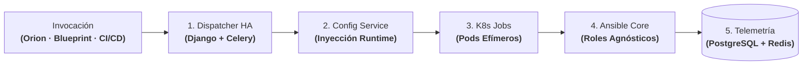

# Dejar Jenkins Atrás a Gran Escala: Dispatcher HA, Configuración en Runtime y Ejecución en K8s

| Dimensión | Detalles |
| :--- | :--- |
| **Rol** | Arquitecto y Responsable de Plataforma |
| **Organización** | BBVA (Infraestructura Core Banking) |
| **Alcance** | Sustitución de Jenkins como motor de ejecución de infraestructura; unificación de gestión de configuración y ejecución efímera en Kubernetes |
| **Stack** | Python, Django, DRF, Celery, Redis, PostgreSQL, Kubernetes Jobs, Ansible, Groovy |

!!! abstract "Resumen de arquitectura"

    Antes de que una plataforma interna pueda escalar a decenas de miles de operaciones diarias, su plano de ejecución debe ser fiable, gobernado por API y sin estado (*stateless*) en los nodos trabajadores. Este caso de estudio aborda una evolución arquitectónica en cuatro etapas: estandarizar pipelines con **Jenkins Shared Libraries**, superar los límites de Jenkins migrando a un **Dispatcher de Operaciones en Alta Disponibilidad (Django + Celery)**, desacoplar las variables de entorno mediante un **Sistema Centralizado de Gestión de Configuración** y aislar la ejecución en **Kubernetes Jobs**.

---

## 1. La Evolución: Por Qué Fueron Necesarias las Jenkins Shared Libraries — y Por Qué las Superamos

### Etapa 1: Estandarización con Jenkins Shared Libraries
Inicialmente, distintos equipos de infraestructura mantenían `Jenkinsfiles` duplicados y heterogéneos en múltiples repositorios. Diseñé un **framework modular de Jenkins Shared Libraries en Groovy** que se convirtió en el estándar CI/CD de varios equipos de infraestructura — reduciendo drásticamente la duplicación de código y el tiempo de incorporación de ingenieros.

Sin embargo, unificar la ejecución sobre un framework común también nos dio la visibilidad necesaria para detectar **dónde el propio Jenkins se convertía en el cuello de botella** al utilizarse como orquestador de operaciones de infraestructura a escala bancaria:

- **Fragilidad del controlador central:** Las ejecuciones masivas en paralelo saturaban el controlador central de Jenkins y la serialización de estado CPS en Groovy.
- **Control programático limitado:** Lanzar, reintentar y auditar miles de operaciones diarias a través de la API de Jenkins carecía de un modelo de estado relacional limpio y de mecanismos granulares de contrapresión (*back-pressure*).
- **Deriva en nodos estáticos:** Los agentes de ejecución permanentes acumulaban estado residual y conflictos de dependencias entre trabajos.

---

## 2. Topología Abstracta del Sistema: Desacoplamiento de Ejecución y Estado

Para eliminar a Jenkins como cuello de botella operativo, la arquitectura desacopla el flujo en cinco etapas bien definidas: recepción API, persistencia de estado, resolución de variables, ejecución efímera en Kubernetes y recolección de telemetría.

### Pipeline de Ejecución Paso a Paso

| Fase | Componente Responsable | Qué se ejecuta exactamente | Garantía de Ingeniería |
| :--- | :--- | :--- | :--- |
| **1. Despacho Asíncrono** | API OpenAPI & Workers Celery | Recepción de la orden de operación desde Orion, Blueprint o CI/CD; registro del estado inicial en PostgreSQL. | Ingesta no bloqueante en alta disponibilidad (cero SPOF). |
| **2. Inyección de Configuración** | Servicio Centralizado de Configuración | Detección del entorno destino (Dev/Staging/Prod) e inyección dinámica de credenciales y variables en memoria. | Erradicación de la deriva de configuración (*zero drift*). |
| **3. Lanzamiento Efímero** | Controlador de Kubernetes Jobs | Creación de un pod efímero de corta duración con la imagen y dependencias exactas del trabajo. | Aislamiento estricto de recursos y dependencias limpias. |
| **4. Ejecución Agnóstica** | Ansible Runner en Contenedor | Ejecución de roles 100% reutilizables (GitLab, Artifactory, servicios base) sobre la infraestructura destino. | Idéntico código probado en todas las fases del ciclo de vida. |
| **5. Transmisión y Cierre** | Broker Redis & PostgreSQL | Envío continuo de logs de ejecución, captura del código de salida, actualización del estado final y destrucción del pod. | Cero estado residual en workers e historial auditable. |

---

## 3. Decisiones Clave de Arquitectura

### A. Dispatcher de Operaciones en Alta Disponibilidad (Django + Celery)
Sustituimos por completo el modelo de ejecución basado en librerías de Jenkins por un **Dispatcher de Operaciones** propio desplegado en Alta Disponibilidad:

- **Diseño API-first (OpenAPI):** Cada operación se lanza, inspecciona y monitoriza mediante un contrato REST documentado con Swagger/OpenAPI en lugar de depender de trabajos orientados a interfaz web.
- **Control total del flujo y políticas de reintento:** Desacoplar la planificación de la ejecución permitió definir políticas de reintento a medida, priorización de colas y observabilidad granular paso a paso.
- **Migración sin cortes de servicio:** Al controlar ya la interfaz de las librerías compartidas que consumían los equipos, migramos las cargas progresivamente de Jenkins al dispatcher en Django/Celery sin interrumpir las operaciones del banco.

### B. Sistema Centralizado de Gestión de Configuración
Una fuente clásica de incidentes en infraestructura consiste en copiar playbooks entre ramas `dev`, `staging` y `prod` modificando variables manualmente.

- **Separación estricta entre lógica y configuración:** Construimos un Sistema Centralizado de Gestión de Configuración que desacopla por completo la administración de variables de la lógica de automatización.
- **Resolución dinámica en tiempo de despliegue:** Los ingenieros escriben **roles de Ansible 100% agnósticos del entorno** (incluyendo toda la automatización que gobierna los clusters internos de **GitLab, Artifactory y Jenkins** del banco). En el momento del despliegue, el sistema resuelve el entorno destino e inyecta automáticamente las variables correspondientes — eliminando repositorios duplicados y erradicando la deriva de configuración (*configuration drift*).

### C. Motor de Ejecución sobre Kubernetes Jobs
En lugar de ejecutar automatizaciones como procesos pesados sobre servidores estáticos compartidos, extendimos el pipeline de despliegue para ejecutar las operaciones mediante **Kubernetes Jobs**:

- **Aislamiento efímero:** Cada operación nace como un contenedor aislado de corta duración dentro del cluster con sus dependencias exactas y las variables de entorno inyectadas en runtime.
- **Ciclo de vida limpio:** En cuanto la operación concluye y envía su telemetría y traza de auditoría a la plataforma, el pod se destruye — garantizando cero estado residual entre ejecuciones.

---

## 4. Trade-Offs de Arquitectura

| Decisión | Alternativa Evaluada | Justificación |
| :--- | :--- | :--- |
| **Migrar de Jenkins a un Dispatcher HA propio en Django/Celery** | Escalar múltiples controladores de Jenkins | Eliminó los cuellos de botella del controlador JVM, los límites de serialización CPS en Groovy y la fragilidad de plugins; aportó control nativo por API en Python y estado relacional. |
| **Inyección de variables en runtime desde un servicio central** | Ramas Git o carpetas de inventario por entorno | Evitó duplicar configuraciones entre repositorios y garantizó que exactamente el mismo rol probado se ejecute en dev, staging y producción. |
| **Kubernetes Jobs efímeros por operación** | Máquinas virtuales trabajadoras estáticas | Eliminó la deriva de entorno, los conflictos de librerías y la contención de recursos entre ejecuciones concurrentes. |

---

## 5. Impacto Operativo y de Negocio

- **Alta Disponibilidad sin Puntos Únicos de Fallo (100% HA):** Eliminó la fragilidad del controlador monolítico de Jenkins para operaciones de infraestructura, garantizando continuidad de servicio y resiliencia ante caídas de nodos.
- **Cero Deriva de Configuración:** La inyección dinámica de variables en runtime desde un servicio centralizado sobre roles de Ansible agnósticos erradicó la dispersión y desincronización entre entornos de `dev`, `staging` y `prod`.
- **Aislamiento y Eficiencia de Cómputo:** Sustitución de agentes estáticos de larga duración por **Kubernetes Jobs efímeros**, que consumen recursos únicamente durante la ejecución y se destruyen inmediatamente al terminar con cero residuos.
- **Escala de Ejecución Masiva:** Capaz de despachar y supervisar **más de 40.000 operaciones diarias** con trazabilidad completa de estado en PostgreSQL y Redis.

---

[:octicons-arrow-left-24: Anterior: Motor Blueprint](blueprint.md) · [:octicons-arrow-right-24: Siguiente: Orion AI — Diagnóstico Agéntico CI/CD (PoC Validada)](orion-ai.md)
