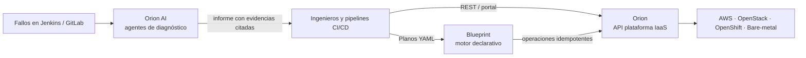

# Casos de Estudio

El código es solo una parte de una plataforma. Estos casos de estudio se centran en lo que
importa a escala: **el problema, la arquitectura, los trade-offs y los resultados medibles**,
además de analizar los patrones de diseño en Python detrás de cada sistema.

!!! note "Sobre confidencialidad"

    Los sistemas corporativos presentados fueron construidos en BBVA. La arquitectura se describe
    a un nivel que respeta estrictamente la confidencialidad; los fragmentos de código son
    **reimplementaciones ilustrativas y simplificadas** de los patrones empleados, nunca código fuente propietario.

## Sistemas de plataforma corporativa

-   :material-cloud-cog-outline:{ .lg .middle } __[Orion — Plataforma IaaS Corporativa](orion-iaas.md)__

    ---

    Una sola API en autoservicio sobre AWS, OpenStack, OpenShift y bare-metal.

    **Escala:** Decenas de miles de nodos · Operaciones de alto rendimiento · 500+ ingenieros 
    **Stack:** Python, Django, DRF, Celery, PostgreSQL, MongoDB, Redis

    [:octicons-arrow-right-24: Leer caso de estudio](orion-iaas.md)

-   :material-file-tree-outline:{ .lg .middle } __[Blueprint — Orquestador Declarativo](blueprint.md)__

    ---

    Motor AsyncIO al estilo Terraform guiado por planos YAML versionados.

    **Impacto:** Reemplazo de licencias de plataforma de automatización comercial 
    **Stack:** Python, AsyncIO, YAML + JSON Schema, GitOps

    [:octicons-arrow-right-24: Leer caso de estudio](blueprint.md)

## IA operativa aplicada

-   :material-stethoscope:{ .lg .middle } __[Orion AI — Autodiagnóstico de CI/CD](orion-ai.md)__

    ---

    Triaje multi-agente de causas raíz sobre logs, diffs de código y runbooks.

    **Impacto:** Triaje inicial de horas a menos de 15 segundos 
    **Stack:** LangGraph, ReAct, MCP, Qwen (contexto 131k), búsqueda vectorial

    [:octicons-arrow-right-24: Leer caso de estudio](orion-ai.md)

-   :material-school-outline:{ .lg .middle } __[OmniLecture — Suite IA Multimodal](omni-lecture.md)__

    ---

    Proyecto personal que convierte clases en notas estructuradas y flashcards.

    **Foco:** Tuberías multimodales e inferencia local en el edge 
    **Stack:** Python, LangGraph, Whisper (int8 + cloud), OpenCV, OCR

    [:octicons-arrow-right-24: Leer caso de estudio](omni-lecture.md)

## Cómo encajan los sistemas

