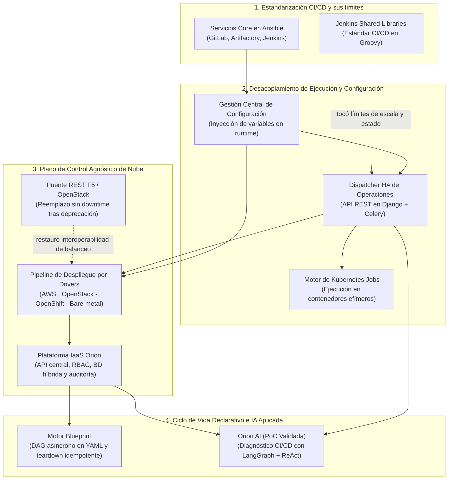

# Ecosistema de Plataforma y Casos de Estudio

Las grandes plataformas rara vez nacen en una pizarra en blanco en una sola tarde. Evolucionan **capa por capa** a medida que las herramientas existentes tocan su techo de escalabilidad, las integraciones de fabricantes quedan deprecadas y el gobierno manual deja de escalar.

Esta sección muestra cómo los sistemas que he diseñado durante la última década se conectan en una única trayectoria coherente de ingeniería — seguida de los casos de estudio en profundidad y mis proyectos open-source en GitHub.

---

## 1. Nueve Años de Evolución de una Plataforma Interna de Desarrollo

En **BBVA Technology** (2017 – Presente), lo que comenzó como la estandarización de pipelines CI/CD entre equipos de infraestructura evolucionó hasta convertirse en una plataforma cloud interna completa que gobierna **decenas de miles de nodos** en **AWS, OpenStack, OpenShift y servidores físicos** para **más de 500 ingenieros**:

1. **Primer cuello de botella — Multiplicación de pipelines y fragilidad de Jenkins:** Estandarizar mediante **Jenkins Shared Libraries** unificó a los equipos, pero dejó al descubierto a Jenkins como punto único de fallo bajo cargas masivas y concurrentes de infraestructura. Eso motivó sustituir Jenkins por un **Dispatcher de Operaciones en Alta Disponibilidad** construido en Django y Celery, y posteriormente ejecutar cargas aisladas en un **Motor de Ejecución sobre Kubernetes Jobs**.
2. **Segundo cuello de botella — Deriva de configuración (*drift*) entre entornos:** Los playbooks de Ansible duplicados entre desarrollo, preproducción y producción generaban errores humanos. Un **Sistema Centralizado de Gestión de Configuración** desacopló la resolución de variables de la lógica del playbook, inyectando los parámetros de cada entorno dinámicamente en tiempo de despliegue.
3. **Tercer cuello de botella — Fragmentación multi-cloud y auditoría:** Aprovisionar en AWS, OpenStack, OpenShift y servidores físicos exigía herramientas distintas y tickets manuales. Un **Pipeline Universal de Despliegue por Drivers** y **Orion** unificaron el gobierno, permisos RBAC, inventario y exportaciones automáticas de auditoría tras una única pasarela OpenAPI.
4. **Cuarto cuello de botella — Lock-in de orquestadores comerciales y triaje lento de fallos:** Con Orion consolidado como fuente única de verdad, **Blueprint** aportó orquestación declarativa en YAML (estilo Terraform) y destrucciones idempotentes sin licencias comerciales (evitando suites como Red Hat Automation Platform), mientras que **Orion AI (PoC)** exploró el diagnóstico multi-agente de causa raíz sobre nuestros propios logs y diffs operativos.

---

## 2. Casos de Estudio de Arquitectura Corporativa

-   :material-cloud-cog-outline:{ .lg .middle } __[Orion — Plataforma IaaS Central y Pipeline por Drivers](orion-iaas.md)__

    ---

    Arquitecto único del plano de control IaaS central: una sola interfaz OpenAPI sobre AWS, OpenStack, OpenShift y bare-metal, respaldada por una capa híbrida PostgreSQL + MongoDB + Redis y canalizaciones automáticas de auditoría.

    [:octicons-arrow-right-24: Arquitectura y trade-offs](orion-iaas.md)

-   :material-file-tree-outline:{ .lg .middle } __[Blueprint — Motor Declarativo de Ciclo de Vida](blueprint.md)__

    ---

    Motor de orquestación asíncrono en Python guiado por planos YAML versionados. Calcula grafos DAG de ejecución, reconcilia contra el estado en vivo de Orion y reanuda destrucciones interrumpidas de forma idempotente — eliminando licencias comerciales.

    [:octicons-arrow-right-24: Arquitectura y trade-offs](blueprint.md)

-   :material-cached:{ .lg .middle } __[Dejar Jenkins Atrás — Dispatcher HA y Ejecución K8s](dispatcher-migration.md)__

    ---

    Cómo migramos desde los cuellos de botella de Jenkins hacia un Dispatcher de Operaciones en Alta Disponibilidad (Django + Celery), inyección dinámica de configuración en runtime y ejecución efímera en Kubernetes Jobs.

    [:octicons-arrow-right-24: Arquitectura y trade-offs](dispatcher-migration.md)

-   :material-stethoscope:{ .lg .middle } __[Orion AI — Diagnóstico Agéntico CI/CD (PoC Validada)](orion-ai.md)__

    ---

    Prototipo multi-agente en LangGraph + ReAct que correlaciona logs de pipelines, runbooks indexados en Redis y diffs de GitLab bajo guardarraíles deterministas — junto con un análisis honesto de las barreras reales de paso a producción en banca.

    [:octicons-arrow-right-24: Arquitectura y lecciones de rollout](orion-ai.md)

---

## 3. Subsistemas de Plataforma y Proyectos Previos de Infraestructura

Además de los cuatro análisis en profundidad anteriores, estos subsistemas constituyeron piezas clave de la arquitectura:

-   :material-swap-horizontal-bold:{ .lg .middle } __Puente API REST F5 / OpenStack (BBVA)__

    ---

    **Problema:** La integración nativa de balanceadores F5 con OpenStack fue deprecada oficialmente, amenazando la automatización del balanceo de tráfico en entornos bancarios.
    
    **Solución:** Diseñé e implementé un puente API RESTful a medida en Python que restauró la interoperabilidad completa entre F5 y OpenStack. Desplegado con **cero tiempo de inactividad (zero downtime)**, evitando una migración disruptiva de plataforma.

-   :material-tune-variant:{ .lg .middle } __Sistema Centralizado de Gestión de Configuración (BBVA)__

    ---

    **Problema:** Las variables específicas de entorno acopladas dentro de los playbooks de Ansible provocaban repositorios duplicados y deriva de configuración entre desarrollo, staging y producción.
    
    **Solución:** Construí un servicio centralizado que desacopla la gestión de variables de la lógica de los playbooks, resolviendo e inyectando dinámicamente las variables del entorno destino en tiempo de despliegue.

-   :material-dharmachakra:{ .lg .middle } __Motor de Ejecución sobre Kubernetes Jobs (BBVA)__

    ---

    **Problema:** Ejecutar automatizaciones pesadas y campañas de validación sobre nodos estáticos de larga duración generaba contención de recursos y deriva de entorno.
    
    **Solución:** Extendí el pipeline de despliegue para ejecutar cualquier operación de infraestructura como un **Kubernetes Job** efímero y aislado, inyectando variables en tiempo de ejecución y enviando telemetría al sistema central.

-   :material-server-security:{ .lg .middle } __Gobierno de Servicios Core con Ansible (BBVA)__

    ---

    **Alcance:** Propietario y mantenedor de la base de código Ansible agnóstica de entorno que aprovisiona y configura las plataformas internas críticas de desarrollo de BBVA — incluyendo clusters de **GitLab, Artifactory y Jenkins** — consumiendo variables automáticamente del Sistema de Gestión de Configuración.

-   :material-source-branch:{ .lg .middle } __Framework de Jenkins Shared Libraries (BBVA)__

    ---

    **Alcance:** Desarrollé librerías compartidas modulares en Groovy y plantillas reutilizables de pipelines que se convirtieron en el estándar CI/CD de múltiples equipos de infraestructura, reduciendo la duplicación y sentando las bases operativas que motivaron después la migración al Dispatcher HA propio.

-   :material-harddisk:{ .lg .middle } __Plataforma de Almacenamiento en Nube Privada sobre OpenStack Swift (Oesia · 2015–2017)__

    ---

    **Alcance:** Administré una nube privada en producción basada en **OpenStack y almacenamiento distribuido Ceph**, y desarrollé una aplicación corporativa de almacenamiento y compartición de archivos (equivalente funcional a Dropbox) en Python sobre el almacenamiento de objetos **OpenStack Swift**.

---

## 4. Proyectos Open-Source e I+D Personal

Sistemas públicos construidos fuera de las restricciones bancarias — con código fuente completo disponible en GitHub:

-   :material-school-outline:{ .lg .middle } __[OmniLecture Studio — Suite Multimodal de IA para Linux](omni-lecture.md)__

    ---

    Grabador nativo de pantalla/audio para Linux (Wayland/GNOME, GTK 3) y pipeline de estudio con LangGraph. Combina Whisper de doble motor (`faster-whisper` CPU `int8` + API cloud), OCR de diapositivas y manuscritos con OpenCV CLAHE + Tesseract y guardarraíles anti-alucinación para generar apuntes Markdown, documentos `.docx` y mazos Anki.

    [:octicons-arrow-right-24: Caso de estudio](omni-lecture.md) · [:fontawesome-brands-github: Repositorio GitHub](https://github.com/oredondo/omnilecture-studio)

-   :material-wrench-outline:{ .lg .middle } __[WrenchBuddy — Plataforma IA de Mantenimiento y RAG con pgvector](wrenchbuddy.md)__

    ---

    Plataforma full-stack de ciclo de vida de vehículos construida con **Django 6, DRF, PostgreSQL (`pgvector`), Celery, Redis y LangChain** (más un frontend en TypeScript). Utiliza visión/OCR para extraer facturas de taller y RAG vectorial de 768 dimensiones sobre manuales técnicos para alimentar un asistente mecánico contextual.

    [:octicons-arrow-right-24: Caso de estudio](wrenchbuddy.md) · [:fontawesome-brands-github: Backend](https://github.com/oredondo/WrenchBuddy) · [:fontawesome-brands-github: Frontend](https://github.com/oredondo/WrenchBuddy-frontend)

