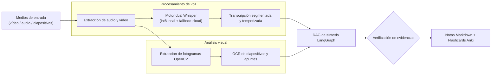

# OmniLecture Studio: Suite de IA Multimodal

| Dimensión | Detalles |
| :--- | :--- |
| **Rol** | Creador y Desarrollador (proyecto personal de ingeniería) |
| **Dominio** | IA agéntica multimodal e inferencia local en el edge |
| **Stack** | Python, LangGraph, Whisper (CPU int8 y cloud), OpenCV, OCR, embeddings vectoriales |

!!! abstract "Resumen ejecutivo (TL;DR)"

    Grabaciones en bruto, presentaciones de diapositivas y apuntes manuscritos entran en la tubería;
    notas en Markdown y flashcards para Anki salen de ella. Voz e imagen se procesan concurrentemente,
    se sintetizan en un grafo LangGraph y cada tarjeta generada debe estar respaldada por una marca temporal o extracto visual.

## 1. Visión general

OmniLecture Studio convierte material formativo no estructurado en conocimiento indexable y estructurado.
Se ejecuta localmente en Linux para preservar privacidad y permitir uso sin conexión, escalando a endpoints cloud
cuando se requiere procesar lotes masivos.



## 2. Decisiones técnicas clave

- **Motor dual de reconocimiento de voz:** inferencia en CPU local cuantizada en `int8` para entornos privados y sin red, con fallback automático a cloud para lotes de alta concurrencia.
- **Inyección de vocabulario técnico:** diccionarios con jerga técnica especializada en los prompts de transcripción para evitar confusiones fonéticas en términos clave.
- **Generación fundamentada de flashcards:** cada par pregunta-respuesta debe referenciar una marca temporal o extracto de diapositiva explícito; las tarjetas sin evidencia verificada se descartan algorítmicamente.

## 3. Aspectos destacados de la implementación en Python

El motor dual implementa un patrón Strategy desacoplado mediante protocolos tipados:

```python title="transcription.py (ilustrativo)"
from pathlib import Path
from typing import Protocol


class Transcriber(Protocol):
    def transcribe(self, audio: Path, *, prompt: str) -> list["Segment"]: ...


class DualTranscriber:
    """Prioriza inferencia local privada; recurre a la nube si la carga lo exige."""

    def __init__(self, local: Transcriber, cloud: Transcriber, max_local_minutes: float = 90) -> None:
        self.local, self.cloud, self.max_local_minutes = local, cloud, max_local_minutes

    def transcribe(self, audio: Path, *, prompt: str) -> list["Segment"]:
        if duration_minutes(audio) <= self.max_local_minutes:
            try:
                return self.local.transcribe(audio, prompt=prompt)
            except MemoryError:
                pass  # degradación elegante hacia el motor en la nube
        return self.cloud.transcribe(audio, prompt=prompt)
```

Al cumplir ambos motores el mismo `Protocol`, el resto de la tubería —y su suite de pruebas—
opera de forma agnóstica sin acoplamiento a la infraestructura de ejecución.

[:octicons-arrow-left-24: Volver a todos los casos de estudio](index.md)
