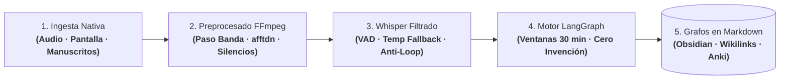

# OmniLecture Studio: Suite Multimodal de IA Nativa para Linux

| Dimensión | Detalles |
| :--- | :--- |
| **Rol** | Creador y Mantenedor (Open Source) |
| **Repositorio** | [:fontawesome-brands-github: `github.com/oredondo/omnilecture-studio`](https://github.com/oredondo/omnilecture-studio) (Licencia MIT) |
| **Dominio** | Ingeniería de escritorio en Linux (Wayland / GNOME / GTK 3) y pipelines multimodales en LangGraph |
| **Stack** | Python 3.10+, GTK 3, D-Bus Screencast, GStreamer, FFmpeg, LangGraph, `faster-whisper` (`int8`), Whisper API, OpenCV (CLAHE), Tesseract OCR |

!!! abstract "Resumen de arquitectura"

    **OmniLecture Studio** es una suite open-source de productividad técnica y académica construida de forma nativa para escritorios Linux (GNOME / Wayland y X11). Integra captura de pantalla y audio mediante APIs del sistema, un pipeline avanzado de **acondicionamiento acústico en FFmpeg para dictados por voz**, **transcripción con filtros anti-alucinación en Whisper** y un motor multi-nodo en **LangGraph** que sintetiza el contenido en **grafos de conocimiento interconectados en Markdown (`.md`)** (compatibles con Obsidian y herramientas PKM) y mazos de tarjetas **Anki**, bajo guardarraíles estrictos de cero invención.

---

## 1. Contexto y Desafíos de Ingeniería

El procesamiento automatizado de clases técnicas, conferencias y dictados por voz sobre Linux presentaba tres barreras críticas:

1. **Ruido acústico y alucinaciones en transcripción:** El audio en bruto (respiración, chasquidos de teclado, silencios muertos o eco) induce al motor Whisper a generar bucles infinitos de repetición o alucinar frases ficticias.
2. **Sobrecarga de cómputo y almacenamiento:** Las herramientas estándar graban vídeo a 30/60 FPS, generando ficheros masivos e ineficientes para contenidos donde la mayor parte de la pantalla (diapositivas o código) permanece estática.
3. **Pérdida de relaciones conceptuales:** Volcar notas en bloques de texto lineales desaprovecha la riqueza semántica de una sesión técnica, dificultando la conexión entre conceptos interdependientes.

---

## 2. Topología Abstracta del Sistema: Pipeline Multimodal y de Dictado

OmniLecture Studio desacopla la captura, el preprocesado de señal, la transcripción filtrada y la síntesis conceptual en un flujo lineal determinista:

### Pipeline de Procesamiento Paso a Paso

| Fase | Componente Responsable | Qué se ejecuta exactamente | Garantía de Ingeniería |
| :--- | :--- | :--- | :--- |
| **1. Ingesta Nativa** | GTK 3, D-Bus Screencast & GStreamer | Captura de vídeo de escritorio vía Portal de GNOME y mezcla de audio de sistema y micrófono (PipeWire/PulseAudio). | Acceso nativo y seguro sin privilegios de root ni capas web intermedias. |
| **2. Acondicionamiento FFmpeg** | Tubería Multimedia (`processor.py`) | Filtrado espectral FFT (`afftdn`), paso banda vocal (100 Hz–4000 Hz), supresión de silencios muertos (`silenceremove`) y codificación H.264 a 10 FPS (`-tune stillimage`). | Reducción de hasta un 70% en peso de vídeo y señal de audio pura optimizada para inferencia. |
| **3. Whisper Filtrado** | Motor Dual de Transcripción | Detección de actividad de voz (VAD), penalización por ratio de compresión, caída de temperatura (*temperature fallback*) y motor dual (`faster-whisper int8` local o API remota en bloques de 10 min). | **Cero bucles infinitos:** erradicación de alucinaciones en pausas y bajo consumo (< 1 GB RAM en CPU). |
| **4. Orquestación LangGraph** | Grafo Cíclico con Estado | Particionado de sesiones en ventanas de 30 minutos, correlación multimodal con OCR de diapositivas (CLAHE + Tesseract) y evaluación reflexiva. | Coherencia temporal y trazabilidad sin pérdida de contexto en grabaciones largas. |
| **5. Síntesis en Grafos Markdown** | Generador de Redes Conceptuales | Emisión de notas estructuradas en Markdown (`.md`) con *wikilinks* bidireccionales (`[[concepto]]`), metadatos YAML frontmatter y mazos de tarjetas Anki. | Integración nativa con Obsidian y herramientas PKM para navegación semántica. |

---

## 3. Decisiones Clave de Arquitectura

### A. Acondicionamiento Acústico en FFmpeg para Dictados y Voz
El preprocesado de audio en FFmpeg constituye la primera línea de defensa para garantizar transcripciones precisas en dictados técnicos:
- **Reducción espectral FFT (`afftdn`):** Elimina ruidos continuos de fondo (ventiladores del equipo, zumbidos eléctricos) antes de que la forma de onda toque el modelo de lenguaje.
- **Paso banda vocal estricto (100 Hz–4000 Hz):** Filtra ruidos mecánicos de baja frecuencia (golpes en la mesa, resonancias) y armónicos agudos ajenos a las formantes del habla humana.
- **Supresión inteligente de silencios (`silenceremove`):** Elimina pausas prolongadas y fragmentos muertos que suelen desencadenar alucinaciones en motores de inferencia fonética.
- **Compresión visual optimizada:** El perfil H.264 a 10 FPS con `-tune stillimage` y CRF 24 preserva bordes ultra nítidos en código fuente y tipografía, ahorrando hasta un 70% de espacio en disco.

### B. Filtros Avanzados y Control Anti-Alucinación en Whisper
Para neutralizar la propensión de Whisper a alucinar texto cuando el audio decae, el pipeline implementa guardarraíles fonéticos estrictos:
- **Voice Activity Detection (VAD):** Descarta segmentos mudos o con energía insuficiente antes de invocar la red neuronal.
- **Temperature Fallback:** Inicia la inferencia a temperatura `0.0` (máximo determinismo) y solo eleva escalonadamente la temperatura si el ratio de compresión excede `compression_ratio_threshold` (2.4), evitando bucles de frases repetidas.
- **Doble motor de ejecución:** Permite alternar entre un motor local desacoplado `faster-whisper` cuantizado en `int8` (que opera en CPU consumiendo menos de 1 GB de RAM sin enviar datos a la red) y la API remota de Whisper con particionado automático en bloques de 10 minutos.

### C. Grafos de Conocimiento en Markdown (`.md`) y Orquestación LangGraph
OmniLecture descarta los formatos ofimáticos cerrados para centrarse exclusivamente en la generación de **grafos de conocimiento interconectados en Markdown**:
- **Máquina de estados en LangGraph:** Orquesta la sesión en ventanas consecutivas de 30 minutos (`Segmentación → Extracción de Entidades → Refinamiento`), evitando la degradación de contexto en grabaciones extensas.
- **Interconexión semántica (Obsidian Knowledge Graphs):** Cada concepto, fórmula o definición clave se vincula mediante *wikilinks* bidireccionales (`[[Concepto Clave]]`) y taxonomías jerárquicas en Markdown (`.md`), permitiendo visualizar la sesión como un grafo semántico explícito en Obsidian o cualquier gestor de conocimiento personal (PKM).
- **Repaso espaciado:** Generación automática de mazos de tarjetas para Anki vinculados a los conceptos del grafo, asegurando la retención técnica a largo plazo.

---

## 4. Trade-Offs de Arquitectura

| Decisión | Alternativa Evaluada | Justificación |
| :--- | :--- | :--- |
| **Acondicionamiento FFmpeg previo** | Enviar audio en bruto directamente a Whisper | Elimina ruido de fondo y silencios que provocan bucles infinitos y alucinaciones en el modelo de lenguaje. |
| **Filtros VAD y Temperature Fallback** | Inferencia estándar a temperatura fija | Previene la generación repetitiva de fragmentos de texto y garantiza salidas deterministas. |
| **Grafos de conocimiento en Markdown (`.md`)** | Documentos ofimáticos propietarios | Permite modelar redes conceptuales enlazadas mediante *wikilinks* compatibles con Obsidian y controlables por Git. |
| **Whisper dual (`int8` local + Cloud)** | Solo modelo cloud o solo modelo local pesado | Ofrece privacidad total y bajo consumo (< 1 GB RAM en CPU) en local, manteniendo acceso a la nube para sesiones masivas. |
| **LangGraph en ventanas de 30 minutos** | Prompt único con el texto completo | Evita la saturación del contexto y preserva la precisión técnica en grabaciones de varias horas. |

---

## 5. Código Fuente y Repositorio Open Source

Todo el código fuente en Python, las tuberías de filtrado FFmpeg, la interfaz nativa en GTK 3 y los grafos de LangGraph están publicados bajo licencia MIT:

- :fontawesome-brands-github: **Repositorio oficial en GitHub:** [`github.com/oredondo/omnilecture-studio`](https://github.com/oredondo/omnilecture-studio)

---

[:octicons-arrow-left-24: Anterior: Orion AI (PoC)](orion-ai.md) · [:octicons-arrow-right-24: Siguiente: WrenchBuddy — Plataforma IA de Mantenimiento y RAG (Open Source)](wrenchbuddy.md)
