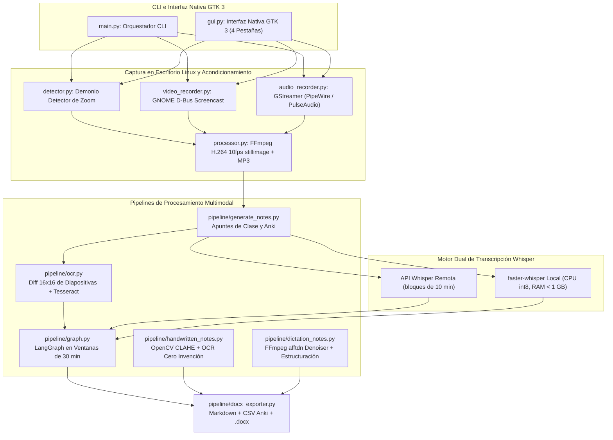

# OmniLecture Studio: Suite Multimodal de IA Nativa para Linux

| Dimensión | Detalles |
| :--- | :--- |
| **Rol** | Creador y Mantenedor (Open Source) |
| **Repositorio** | [:fontawesome-brands-github: `github.com/oredondo/omnilecture-studio`](https://github.com/oredondo/omnilecture-studio) (Licencia MIT) |
| **Dominio** | Ingeniería de escritorio en Linux (Wayland / GNOME / GTK 3) y pipelines multimodales en LangGraph |
| **Stack** | Python 3.10+, GTK 3, D-Bus Screencast, GStreamer (PipeWire/PulseAudio), FFmpeg, LangGraph, `faster-whisper` (`int8`) + API Whisper, OpenCV (CLAHE), Tesseract OCR |

!!! abstract "Resumen"

    **OmniLecture Studio** es una suite open-source de productividad académica y técnica construida de forma nativa para escritorios Linux con GNOME (Wayland y X11). Captura clases online, diapositivas, fotografías de apuntes manuscritos y dictados por voz, procesándolos mediante un flujo multi-nodo en **LangGraph** para generar apuntes estructurados en Markdown, documentos Microsoft Word (`.docx`) y mazos de tarjetas **Anki** bajo una política estricta de cero invención.

---

## 1. Arquitectura Real del Sistema

A diferencia de los envoltorios web, OmniLecture Studio se integra directamente con la pila nativa de escritorio Linux (`GNOME Shell D-Bus Screencast`, `GStreamer`, `FFmpeg`) y orquesta modelos de IA locales y en la nube a través de pipelines modulares:

---

## 2. Decisiones Técnicas Destacadas

### A. Pipeline Multimedia Avanzado en FFmpeg y Captura Nativa
- **Compresión sintonizada para texto y código en FFmpeg:** El procesador (`processor.py`) implementa una codificación H.264 optimizada a 10 FPS con `-tune stillimage` y CRF 24. A diferencia de los grabadores estándar a 30/60 FPS, este perfil prioriza la nitidez de bordes en tipografías y bloques de código, reduciendo el tamaño del archivo final hasta un 70% sin artefactos de compresión.
- **Acondicionamiento y filtrado de audio para inferencia (`dictation_notes.py`):** Antes de enviar el audio a los modelos Whisper, el pipeline aplica un filtro espectral de reducción de ruido FFT en FFmpeg (`afftdn`), seguido de un paso banda para voz humana (100 Hz–4000 Hz) y normalización AAC a 48 kHz, eliminando ruidos de fondo y silencios muertos para mitigar alucinaciones en el LLM y prevenir errores de memoria.
- **Sincronización multi-pista por hardware (PTS):** Sincroniza pistas de pantalla y micrófonos mediante marcas de tiempo de reloj de host (*Presentation Time Stamp*), generando simultáneamente una pista MP3 complementaria optimizada para repaso rápido.
- **Recuperación ante caídas (`recover.py`):** Un demonio de inspección detecta grabaciones interrumpidas por fallos de alimentación y reconstruye los contenedores MP4/AAC a partir de los segmentos temporales en `.temp/`.

### B. OCR de Bajo Consumo en CPU y Whisper de Doble Motor
- **Detección perceptual de cambio de diapositiva 16×16 (`pipeline/ocr.py`):** Reduce cada fotograma a una miniatura de 16×16 para detectar cambios reales de diapositiva antes de invocar Tesseract OCR, ignorando fotogramas estáticos y recortando el 25% derecho de la imagen para excluir paneles laterales de chat.
- **Transcripción dual con Whisper (`pipeline/transcription.py`):** Combina endpoints remotos compatibles con OpenAI (en bloques automáticos de 10 minutos) con un motor local `faster-whisper` cuantizado en `int8` sobre CPU diseñado para mantener el uso de RAM por debajo de 1 GB.

### C. Síntesis con LangGraph en Ventanas de 30 Minutos y Cero Invención
- **DAG en LangGraph por ventanas (`pipeline/graph.py`):** Procesa clases largas en ventanas secuenciales de 30 minutos (`Consolidación → Segmentación por STUDY_TARGET → Generación de Apuntes y CSV Anki → Pase Editorial de Refinamiento`), evitando la pérdida de detalle en grabaciones de varias horas.
- **Digitalización de manuscritos (`pipeline/handwritten_notes.py`):** Aplica ecualización adaptativa de histograma **CLAHE** con OpenCV antes del OCR, convirtiendo esquemas a mano en bloques Mermaid y fórmulas en LaTeX bajo prompts que prohíben inventar datos ausentes en el papel.
- **Acondicionamiento acústico para dictado (`pipeline/dictation_notes.py`):** Ejecuta un reductor espectral de ruido FFmpeg (`afftdn`), un filtro paso banda de voz humana (100 Hz–4000 Hz) y eliminación automática de silencios antes de transcribir.

---

## 3. Estructura del Repositorio y Código Fuente

Todo el código Python, los componentes GTK 3, las tuberías FFmpeg y los grafos en LangGraph están publicados en GitHub:

- :fontawesome-brands-github: **Repositorio oficial:** [`github.com/oredondo/omnilecture-studio`](https://github.com/oredondo/omnilecture-studio)

---

[:octicons-arrow-left-24: Anterior: Orion AI (PoC)](orion-ai.md) · [:octicons-arrow-right-24: Siguiente: WrenchBuddy — Plataforma IA de Mantenimiento y RAG (Open Source)](wrenchbuddy.md)
