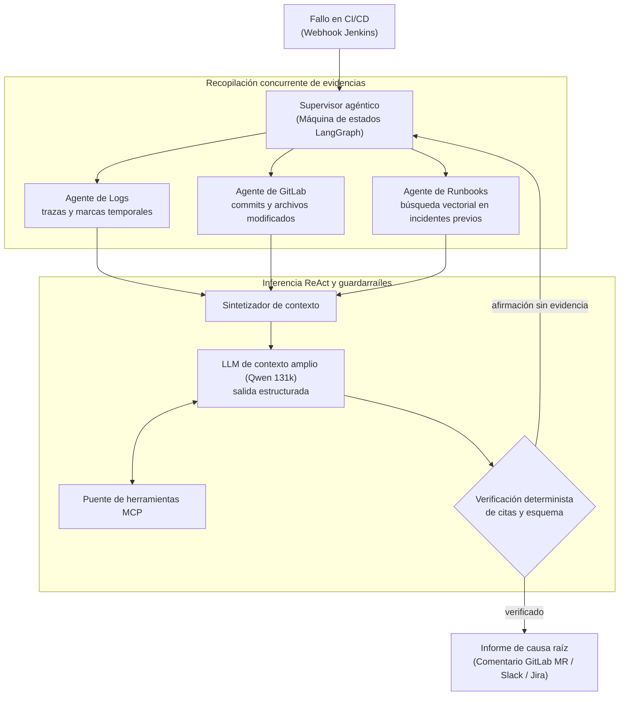

# Orion AI: Motor de Autodiagnóstico Agéntico para CI/CD

| Dimensión | Detalles |
| :--- | :--- |
| **Rol** | Arquitecto e Ingeniero Líder de IA |
| **Organización** | BBVA — PoC validada para FONIL |
| **Impacto** | Reducción del triaje inicial de horas a menos de 15 segundos; eliminación de inspección manual de logs |
| **Stack** | Python, LangGraph, ReAct, Qwen LLM (131k contexto), MCP, búsqueda vectorial en Redis, APIs de GitLab y Jenkins |

!!! abstract "Resumen ejecutivo (TL;DR)"

    Cuando una tubería de CI/CD falla, Orion AI recopila evidencias en paralelo (logs, diferencias de código,
    incidentes previos), razona sobre ellas mediante un LLM de contexto extendido y únicamente publica un diagnóstico
    cuando **cada conclusión está respaldada por una línea de log o un commit SHA verificado**. Si no se puede probar, no se emite.

## 1. El desafío de ingeniería

A escala corporativa, las canalizaciones de CI/CD fallan a diario por múltiples factores: problemas
transitorios de infraestructura, desvío de configuraciones (*drift*), dependencias rotas o errores de código.

- Los ingenieros invertían horas revisando logs gigantescos en Jenkins, localizando la traza real del fallo,
  comparando diffs en GitLab y consultando runbooks dispersos.
- El **tiempo medio de resolución (MTTR)** estaba dominado por el triaje manual humano, no por la aplicación de la solución.

## 2. Arquitectura multi-agente

Orion AI fue diseñado como un sistema agéntico concurrente y con memoria de estado basado en grafos **LangGraph**
y bucles **ReAct (Reason + Act)**.



## 3. Decisiones de diseño clave

### A. Grafos con estado frente a cadenas lineales

LangGraph mantiene un estado tipado a lo largo del proceso. Si el análisis de logs arroja una traza ambigua,
el grafo retrocede de forma cíclica hacia el nodo de inspección de código para verificar dependencias recién modificadas,
algo inviable en canalizaciones secuenciales tradicionales.

### B. Adopción de Model Context Protocol (MCP)

El razonamiento del modelo se desacopló de las integraciones externas mediante **MCP**: los artefactos de Jenkins,
la base de datos Redis y los endpoints de GitLab se exponen como herramientas formalmente tipadas, permitiendo que
los servicios evolucionen sin alterar los prompts ni la lógica de los agentes.

### C. Guardarraíles deterministas de tolerancia cero a alucinaciones

En operaciones bancarias un agente jamás puede especular. El modelo está restringido a un esquema estricto de salida,
y un validador algorítmico comprueba que **cada afirmación del diagnóstico cite una línea real del log o un SHA de commit existente** antes de publicar el informe.

### Análisis de trade-offs

| Decisión | Alternativa evaluada | Justificación técnica |
| :--- | :--- | :--- |
| Máquina de estados con LangGraph | Prompt único o cadena lineal | Permite bifurcaciones condicionales, ciclos de corrección y verificación de estados intermedios |
| Validador determinista post-LLM | Confiar en la auto-crítica del modelo | La verificación debe ser reproducible, estricta y matemática, no probabilística |
| Modelo de contexto largo (131k) | Fragmentación agresiva de logs (*chunking*) | Los fallos suelen estar relacionados con eventos iniciales de inicialización; el contexto amplio preserva la causalidad |

## 4. Aspectos destacados de la implementación en Python

Extracto ilustrativo y simplificado del bucle de verificación de evidencias:

```python title="graph.py (ilustrativo)"
from typing import TypedDict

from langgraph.graph import END, StateGraph
from pydantic import BaseModel, Field


class Finding(BaseModel):
    claim: str
    evidence_log_line: int | None = None
    evidence_commit: str | None = Field(default=None, pattern=r"^[0-9a-f]{7,40}$")


class Diagnosis(BaseModel):
    category: str  # ej: "infrastructure", "dependency", "code", "config"
    findings: list[Finding]
    recommended_action: str


class TriageState(TypedDict):
    log: list[str]
    commits: set[str]
    diagnosis: Diagnosis | None
    attempts: int


def verify(state: TriageState) -> str:
    """Puerta determinista: cada hallazgo debe apuntar a una evidencia real verificada."""
    diagnosis = state["diagnosis"]
    for f in diagnosis.findings:
        line_ok = f.evidence_log_line is not None and 0 <= f.evidence_log_line < len(state["log"])
        commit_ok = f.evidence_commit in state["commits"]
        if not (line_ok or commit_ok):
            return "retry" if state["attempts"] < 3 else "escalate"
    return "publish"


graph = StateGraph(TriageState)
graph.add_node("gather", gather_evidence)      # agentes paralelos de logs / diffs / runbooks
graph.add_node("reason", reason_with_llm)      # bucle ReAct, salida estructurada -> Diagnosis
graph.add_node("publish", publish_report)
graph.add_node("escalate", hand_off_to_human)
graph.set_entry_point("gather")
graph.add_edge("gather", "reason")
graph.add_conditional_edges("reason", verify, {"retry": "gather", "publish": "publish", "escalate": "escalate"})
graph.add_edge("publish", END)
graph.add_edge("escalate", END)
app = graph.compile()
```

## 5. Resultados

<div class="kpi-grid">
  <div class="kpi-card"><span class="kpi-value">&lt; 15 s</span><span class="kpi-label">Tiempo de diagnóstico</span></div>
  <div class="kpi-card"><span class="kpi-value">94%+</span><span class="kpi-label">Precisión en validación</span></div>
  <div class="kpi-card"><span class="kpi-value">~45 min</span><span class="kpi-label">Triaje manual sustituido</span></div>
</div>

- :zap: **Diagnóstico inmediato:** el análisis se completa en menos de 15 segundos tras finalizar la tubería fallida.
- :mag: **Precisión diagnóstica:** identificó causas sutiles (ej: timeout de DNS al descargar de un registro de contenedores frente a fallo de tests unitarios) con más del 94% de acierto.
- :building_construction: **Arquitectura para producción:** PoC validada diseñada para conectarse a clusters de inferencia corporativos.

[:octicons-arrow-right-24: Artículo relacionado: Automatización del triaje de CI/CD con LangGraph](../blog/posts/2026-03-10-agentic-cicd-diagnostics-langgraph.md)
