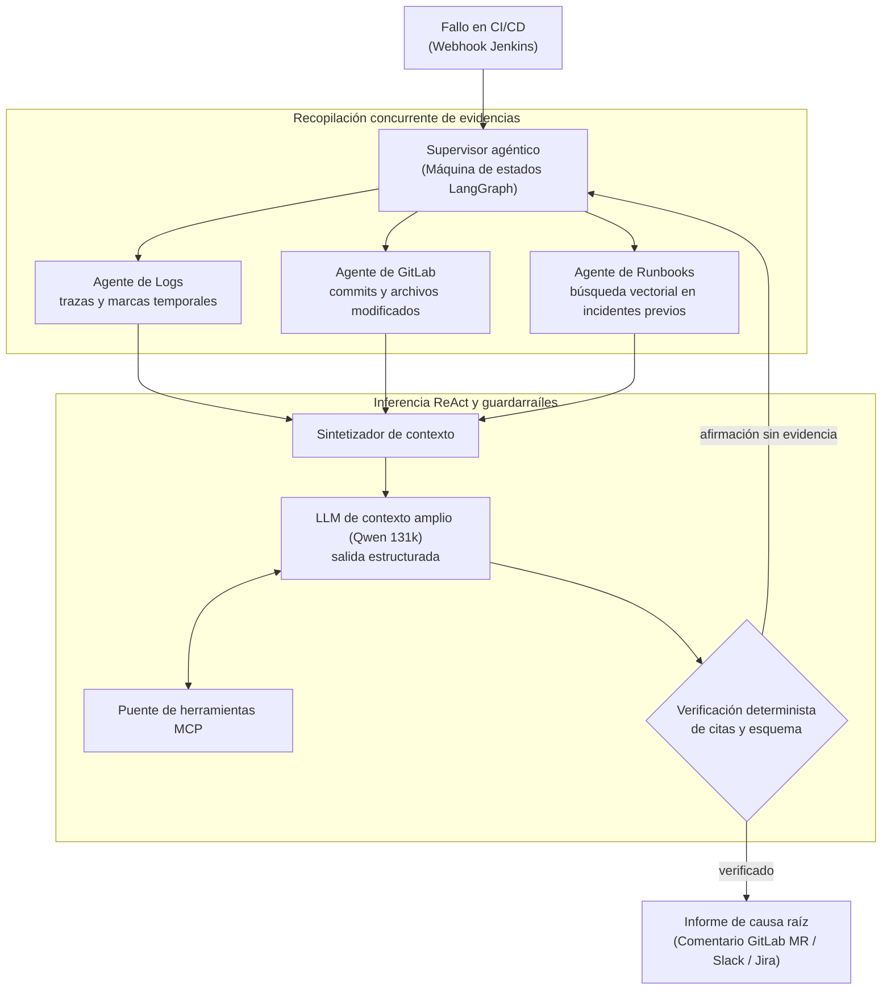

# Orion AI: Motor de Autodiagnóstico Agéntico para CI/CD

| Dimensión | Detalles |
| :--- | :--- |
| **Rol** | Arquitecto e Ingeniero Líder de IA |
| **Organización / Alcance** | Infraestructura Core Banking de BBVA (AI Ops autónomo) |
| **Impacto** | Reducción del triaje inicial de horas a menos de 15 segundos; eliminación de inspección manual de logs |
| **Stack** | Python, LangGraph, ReAct, Qwen LLM (131k contexto), MCP, búsqueda vectorial en Redis, APIs de GitLab y Jenkins |

!!! abstract "Resumen ejecutivo (TL;DR)"

    Cuando una tubería de CI/CD falla, Orion AI recopila evidencias en paralelo (logs, diferencias de código,
    incidentes previos), razona sobre ellas mediante un LLM de contexto extendido y únicamente publica un diagnóstico
    cuando **cada conclusión está respaldada por una línea de log o un commit SHA verificado**. Si no se puede probar, no se emite.

## 1. El desafío de ingeniería

A escala corporativa, las canalizaciones de CI/CD fallan a diario por múltiples factores: problemas
transitorios de infraestructura, desvío de configuraciones (*drift*), dependencias rotas o errores de código.

- Los ingenieros invertían horas revisando logs gigantescos en Jenkins, localizando la traza real del fallo,
  comparando diffs en GitLab y consultando runbooks dispersos.
- El **tiempo medio de resolución (MTTR)** estaba dominado por el triaje manual humano, no por la aplicación de la solución.

## 2. Arquitectura multi-agente

Orion AI fue diseñado como un sistema agéntico concurrente y con memoria de estado basado en grafos **LangGraph**
y bucles **ReAct (Reason + Act)**.



## 3. Decisiones de diseño clave

### A. Orquestación cíclica y adaptativa (LangGraph + ReAct)

Las cadenas lineales (DAGs estrictamente acíclicos) son frágiles ante el diagnóstico de incidentes: si el análisis inicial de trazas arroja señales ambiguas, un pipeline secuencial se ve forzado a especular o abortar.

Orion AI recurre a **LangGraph** para modelar la investigación de incidentes como una máquina de estados cíclica gobernada por un agente Supervisor:

1. **Extracción inicial de señales:** El nodo `parse_logs` aísla trazas de excepción, códigos de salida y marcas de tiempo.
2. **Detección de ambigüedad y bucle adaptativo:** Si un fallo carece de trazas explícitas (p. ej., un código 137 OOM opaco en un contenedor o un error silencioso en resolución de dependencias), el supervisor evalúa el estado y bifurca dinámicamente hacia `inspect_git_diff` para auditar los últimos commits, manifiestos de dependencias (`pyproject.toml`, `requirements.txt`) y modificaciones en Dockerfiles.
3. **Re-evaluación causal:** Con los diffs de git integrados en el estado, el grafo retrocede al agente de razonamiento ReAct con contexto enriquecido, permitiendo al LLM correlacionar un error críptico con un cambio de código específico antes de emitir la causa raíz.

### B. Adopción de Model Context Protocol (MCP)

El razonamiento del modelo se desacopló de las integraciones externas mediante **MCP**: los artefactos de Jenkins,
la base de datos Redis y los endpoints de GitLab se exponen como herramientas formalmente tipadas, permitiendo que
los servicios evolucionen sin alterar los prompts ni la lógica de los agentes.

### C. Guardarraíles deterministas de tolerancia cero a alucinaciones

En operaciones bancarias un agente jamás puede especular. El modelo está restringido a un esquema estricto de salida,
y un validador algorítmico comprueba que **cada afirmación del diagnóstico cite una línea real del log o un SHA de commit existente** antes de publicar el informe.

### Análisis de trade-offs

| Decisión | Alternativa evaluada | Justificación técnica |
| :--- | :--- | :--- |
| Máquina de estados con LangGraph | Prompt único o cadena lineal | Permite bifurcaciones condicionales, ciclos de corrección y verificación de estados intermedios |
| Validador determinista post-LLM | Confiar en la auto-crítica del modelo | La verificación debe ser reproducible, estricta y matemática, no probabilística |
| Modelo de contexto largo (131k) | Fragmentación agresiva de logs (*chunking*) | Los fallos suelen estar relacionados con eventos iniciales de inicialización; el contexto amplio preserva la causalidad |

## 4. Aspectos destacados de la implementación en Python

### Máquina de estados cíclica con enrutamiento adaptativo

Implementación ilustrativa de la máquina de estados en LangGraph con re-enrutamiento cíclico entre triaje de logs e inspección de diferencias de git:

```python title="graph.py (ilustrativo)"
from typing import Annotated, Literal
from operator import add
from typing_extensions import TypedDict
from langgraph.graph import END, StateGraph
from pydantic import BaseModel, Field


class Finding(BaseModel):
    claim: str
    evidence_log_line: int | None = None
    evidence_commit: str | None = Field(default=None, pattern=r"^[0-9a-f]{7,40}$")


class Diagnosis(BaseModel):
    category: Literal["infrastructure", "dependency", "code", "configuration"]
    findings: list[Finding]
    root_cause: str
    confidence_score: float = Field(ge=0.0, le=1.0)


class TriageState(TypedDict):
    job_id: str
    raw_logs: list[str]
    diff_patches: Annotated[list[str], add]  # Concatena evidencias a lo largo de los ciclos
    diagnosis: Diagnosis | None
    investigation_depth: int
    is_ambiguous: bool


def supervisor_router(
    state: TriageState,
) -> Literal["inspect_git_diff", "reason_with_llm", "escalate"]:
    """Evalúa la ambigüedad de la evidencia y enruta cíclicamente o prosigue."""
    if state["investigation_depth"] > 3:
        return "escalate"  # Disyuntor (circuit breaker) contra bucles infinitos de investigación

    if state["is_ambiguous"] and not state["diff_patches"]:
        return "inspect_git_diff"  # Bucle de retroalimentación: recupera diffs de código y manifiestos

    return "reason_with_llm"


def verify_guardrails(state: TriageState) -> Literal["publish", "retry_deeper", "escalate"]:
    """Puerta determinista: cada afirmación debe citar líneas de log reales o commits SHAs válidos."""
    diagnosis = state.get("diagnosis")
    if not diagnosis or diagnosis.confidence_score < 0.85:
        return "retry_deeper" if state["investigation_depth"] < 3 else "escalate"

    for finding in diagnosis.findings:
        valid_line = (
            finding.evidence_log_line is not None
            and 0 <= finding.evidence_log_line < len(state["raw_logs"])
        )
        valid_commit = bool(finding.evidence_commit and finding.evidence_commit in state.get("diff_patches", ""))
        if not (valid_line or valid_commit):
            return "escalate"

    return "publish"


# Construcción del grafo cíclico con estado
graph = StateGraph(TriageState)

graph.add_node("parse_logs", parse_logs_node)
graph.add_node("inspect_git_diff", fetch_gitlab_diff_node)
graph.add_node("reason_with_llm", llm_react_reasoning_node)
graph.add_node("publish", publish_to_mr_and_slack_node)
graph.add_node("escalate", notify_oncall_engineer_node)

graph.set_entry_point("parse_logs")

# Bifurcación condicional cíclica del supervisor
graph.add_conditional_edges(
    "parse_logs",
    supervisor_router,
    {
        "inspect_git_diff": "inspect_git_diff",
        "reason_with_llm": "reason_with_llm",
        "escalate": "escalate",
    },
)

# Tras obtener los diffs, vuelve a ciclar hacia el razonamiento
graph.add_edge("inspect_git_diff", "reason_with_llm")

# Puerta de verificación determinista posterior al LLM
graph.add_conditional_edges(
    "reason_with_llm",
    verify_guardrails,
    {
        "publish": "publish",
        "retry_deeper": "inspect_git_diff",  # Bucle de realimentación adaptativo
        "escalate": "escalate",
    },
)

graph.add_edge("publish", END)
graph.add_edge("escalate", END)

app = graph.compile()
```

## 5. Resultados

<div class="kpi-grid">
  <div class="kpi-card"><span class="kpi-value">&lt; 15 s</span><span class="kpi-label">Tiempo de diagnóstico</span></div>
  <div class="kpi-card"><span class="kpi-value">94%+</span><span class="kpi-label">Precisión en validación</span></div>
  <div class="kpi-card"><span class="kpi-value">~45 min</span><span class="kpi-label">Triaje manual sustituido</span></div>
</div>

- :zap: **Diagnóstico inmediato:** el análisis se completa en menos de 15 segundos tras finalizar la tubería fallida.
- :mag: **Precisión diagnóstica:** identificó causas sutiles (ej: timeout de DNS al descargar de un registro de contenedores frente a fallo de tests unitarios) con más del 94% de acierto.
- :building_construction: **Arquitectura para producción:** PoC validada diseñada para conectarse a clusters de inferencia corporativos.

[:octicons-arrow-right-24: Artículo relacionado: Automatización del triaje de CI/CD con LangGraph](../blog/posts/2026-03-10-agentic-cicd-diagnostics-langgraph.md)
