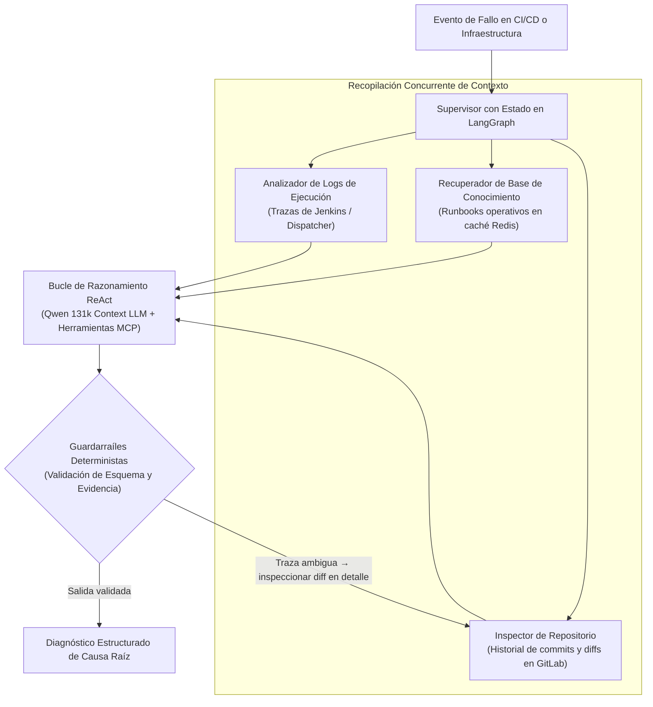

# Orion AI: IA Operativa y Motor de Auto-Diagnóstico para CI/CD (PoC Validada)

| Dimensión | Detalles |
| :--- | :--- |
| **Rol** | Arquitecto y Desarrollador |
| **Organización / Fase** | BBVA Technology · **Prueba de Concepto Validada (PoC)** |
| **Resultado** | Prototipo validado que reduce el triaje de logs de horas a segundos; preparado y a la espera de directrices de integración con la infraestructura central de IA |
| **Stack** | Python, LangGraph, Agentes ReAct, Qwen LLM (131k de contexto), Model Context Protocol (MCP), Redis, APIs de Jenkins y GitLab |

!!! abstract "Resumen de arquitectura"

    Orion AI es una **Prueba de Concepto (PoC) funcional y validada** diseñada para evaluar un pipeline multi-agente paralelo de análisis de causa raíz sobre fallos en CI/CD e infraestructura. Mediante máquinas de estado en **LangGraph** y bucles de razonamiento **ReAct**, el sistema agrega concurrentemente logs de ejecución, runbooks operativos (indexados en caché Redis para acelerar la recuperación RAG) y diffs de commits en GitLab utilizando modelos de contexto amplio (`Qwen` 131k) bajo guardarraíles deterministas estrictos — reduciendo el triaje manual de horas a segundos durante las pruebas de validación.

---

## 1. Planteamiento del Problema Operativo

Cuando los pipelines de CI/CD o los despliegues de infraestructura fallan a escala corporativa, la corrección en sí rara vez es lo que consume más tiempo de ingeniería. El **Tiempo Medio de Resolución (MTTR)** está dominado por la recopilación manual de contexto:

1. Abrir logs masivos de ejecución en Jenkins o en el dispatcher para localizar la primera traza real del error.
2. Buscar en la documentación interna de soporte e incidencias previas errores conocidos de infraestructura.
3. Inspeccionar los commits y diffs recientes en GitLab para comprobar si un cambio de código o configuración provocó el fallo.

**Objetivo de la PoC:** Demostrar que un flujo multi-agente autónomo podía reunir esas tres fuentes de evidencia en paralelo y sintetizar un diagnóstico preciso y sin alucinaciones en cuestión de segundos tras un fallo.

---

## 2. Topología Abstracta Multi-Agente

---

## 3. Decisiones Clave de Diseño

### A. Orquestación Cíclica en Grafo (LangGraph) frente a Prompts Lineales
Los fallos en pipelines rara vez pueden diagnosticarse en una única pasada secuencial. Cuando un log solo muestra un código de salida genérico, el agente necesita retroceder e inspeccionar los diffs recientes del repositorio o cambios de configuración antes de emitir una conclusión. **LangGraph** mantiene un estado tipado entre nodos, permitiendo bifurcaciones condicionales y bucles ReAct acotados en lugar de prompts frágiles de un solo paso.

### B. Agregación Concurrente de Evidencias con Contexto Amplio
En lugar de consultar fuentes secuencialmente, el grafo recupera en paralelo las trazas de ejecución, los manuales y runbooks operativos en caché Redis y los metadatos de GitLab, inyectando el contexto consolidado en un **LLM de 131k tokens de contexto (Qwen)** para preservar la causalidad desde la inicialización del entorno hasta el error final.

### C. Guardarraíles Deterministas Estrictos
En un entorno bancario regulado, una herramienta de diagnóstico operativo no puede especular ni inventar comandos:

- **Contratos de salida tipados:** Las respuestas se restringen a esquemas estructurados en lugar de texto libre.
- **Evidencia fundamentada:** Cada hallazgo debe correlacionarse directamente con fragmentos reales del log, entradas existentes en la base de conocimiento o diffs de commits verificados.
- **Fronteras de herramientas estandarizadas (MCP):** Las integraciones externas (logs, caché de runbooks en Redis, APIs de GitLab) se exponen tras contratos de herramientas limpios para que el modelo no ejecute acciones arbitrarias.

---

## 4. Por Qué Es una PoC Validada — y Qué Bloqueó su Despliegue Masivo

> [!IMPORTANT]
> Explicar con transparencia las restricciones organizativas reales detrás de una PoC es fundamental en cualquier análisis de arquitectura serio.

El prototipo técnico fue construido íntegramente, probado sobre escenarios reales de fallo y validado — demostrando que el triaje multi-agente reduce el tiempo de diagnóstico de horas de búsqueda manual a segundos.

Sin embargo, llevar un sistema basado en LLMs desde una **PoC validada** hasta un **despliegue generalizado en producción** dentro de un gran banco depende de fronteras de plataforma que exceden a un único equipo:

1. **Dependencia de la infraestructura central de IA:** El despliegue en producción a gran escala requiere directrices estandarizadas y asignación de capacidad sobre la infraestructura corporativa compartida de inferencia de IA (gestionada por equipos transversales del banco).
2. **Gobierno y conformidad sobre datos operativos:** Incluso utilizando modelos internos, enviar logs de CI/CD y diffs de repositorios a un servicio compartido de inferencia exige definiciones corporativas formales sobre retención, anonimización y aislamiento multi-inquilino.
3. **Lección principal de ingeniería:** Construir un agente fiable en LangGraph + ReAct con guardarraíles deterministas es la parte técnica resoluble; alinear las plataformas corporativas compartidas de inferencia y las normativas de gobierno es lo que marca los tiempos reales de adopción en sectores regulados.

---

[:octicons-arrow-left-24: Anterior: Dejar Jenkins Atrás — Dispatcher HA](dispatcher-migration.md) · [:octicons-arrow-right-24: Siguiente: OmniLecture Studio (Open Source)](omni-lecture.md)
