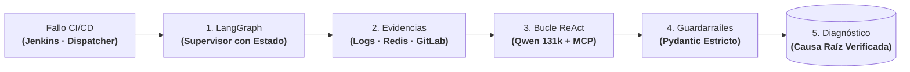

# Orion AI: IA Operativa y Motor de Auto-Diagnóstico para CI/CD (PoC Validada)

| Dimensión | Detalles |
| :--- | :--- |
| **Rol** | Arquitecto y Responsable Técnico |
| **Organización / Fase** | BBVA · **Prueba de Concepto Validada (PoC)** |
| **Resultado** | Prototipo validado que reduce el triaje de logs de horas a segundos; preparado y a la espera de directrices de infraestructura central de IA |
| **Stack** | Python, LangGraph, Agentes ReAct, Qwen LLM (131k de contexto), Model Context Protocol (MCP), Redis, APIs de Jenkins y GitLab |

!!! abstract "Resumen de arquitectura"

    Orion AI es una **Prueba de Concepto (PoC) funcional y validada** diseñada para evaluar un pipeline multi-agente paralelo de análisis de causa raíz sobre fallos en CI/CD e infraestructura. Mediante máquinas de estado en **LangGraph** y bucles de razonamiento **ReAct**, el sistema agrega concurrentemente logs de ejecución, runbooks operativos en caché Redis y diffs de commits en GitLab utilizando modelos de contexto amplio (`Qwen` 131k) bajo guardarraíles deterministas estrictos — reduciendo el triaje manual de horas a segundos durante las pruebas de validación.

---

## 1. Planteamiento del Problema Operativo

Cuando los pipelines o despliegues de infraestructura fallan a escala corporativa, el **Tiempo Medio de Resolución (MTTR)** está dominado por la recopilación manual de contexto. En un entorno bancario sujeto a normativas como **DORA**, la rápida detección y mitigación de incidencias TIC operativas es un requerimiento esencial:
1. Rastrear logs de ejecución interminables en Jenkins o el dispatcher para aislar el error raíz.
2. Buscar manualmente en wikis y tickets históricos patrones de fallo conocidos.
3. Inspeccionar diffs recientes en GitLab para correlacionar cambios de código o configuración.

**Objetivo de la PoC:** Demostrar que un flujo multi-agente autónomo puede consolidar esas tres fuentes en paralelo y emitir un diagnóstico preciso sin alucinaciones en cuestión de segundos.

---

## 2. Topología Abstracta del Sistema: Pipeline Multi-Agente de Diagnóstico

Orion AI estructura el análisis de causa raíz como un flujo secuencial con bucles reflexivos:

### Pipeline de Diagnóstico Paso a Paso

| Fase | Componente Responsable | Qué se ejecuta exactamente | Garantía de Ingeniería |
| :--- | :--- | :--- | :--- |
| **1. Ingesta de Fallo** | Webhook / API Listener | Recepción del evento de error desde Jenkins o el Dispatcher con el Job ID y código de salida inicial. | Inicio inmediato del triaje sin intervención humana. |
| **2. Recopilación Concurrente** | Nodos Paralelos de LangGraph | Recuperación en paralelo de trazas de log completas, manuales de soporte en caché Redis y últimos diffs de GitLab. | Consolidación de contexto en milisegundos sin bloqueos en serie. |
| **3. Razonamiento Multimodal** | Bucle ReAct (Qwen 131k) | Procesamiento conjunto del contexto dentro de la ventana de 131k tokens para rastrear la causa raíz del fallo. | Capacidad para detectar dependencias rotas o cambios sutiles en Git. |
| **4. Validación Determinista** | Guardarraíles Pydantic & Esquema | Verificación estricta de que cada afirmación del diagnóstico está respaldada por un log real o diff existente. | **Cero alucinaciones:** rechazo de hipótesis no verificables. |
| **5. Emisión de Diagnóstico** | Generador de Informes de Incidencia | Publicación de un resumen estructurado con la línea exacta del fallo, commit causante y acción de remediación sugerida. | Reducción del MTTR de horas a segundos para los equipos de operaciones. |

---

## 3. Decisiones Clave de Arquitectura

### A. Grafos Cíclicos con Estado (LangGraph) vs. Cadenas Lineales
Los fallos en pipelines rara vez se diagnostican en una pasada única. Cuando un log solo arroja un código de salida genérico, el agente necesita retroceder e inspeccionar los diffs del repositorio antes de emitir un veredicto. LangGraph mantiene un estado tipado entre nodos, permitiendo bifurcaciones condicionales y bucles ReAct acotados imposibles en cadenas lineales tradicionales.

### B. Ventana de Contexto Amplia (131k) vs. Fragmentación por Chunks
En lugar de fragmentar los logs de compilación mediante técnicas RAG tradicionales que pierden la causalidad entre pasos distantes, el sistema alimenta el contexto consolidado en un modelo de 131k tokens (Qwen), preservando la cronología completa desde la inicialización del entorno hasta el error terminal.

### C. Guardarraíles Deterministas Tipados vs. Texto Libre
En un entorno bancario regulado, un agente operativo no puede especular. Las respuestas se restringen a contratos tipados de Pydantic y las integraciones con logs y GitLab se aíslan tras interfaces del Model Context Protocol (MCP), erradicando alucinaciones y garantizando que cada diagnóstico esté respaldado por evidencias reales verificables.

---

## 4. Trade-Offs de Arquitectura

| Decisión | Alternativa Evaluada | Justificación |
| :--- | :--- | :--- |
| **Grafos cíclicos con estado (LangGraph)** | Cadenas secuenciales lineales o prompts aislados | Permite reintentos reflexivos condicionales y retroceso al análisis de diffs cuando los logs son ambiguos. |
| **Modelo local de contexto amplio (Qwen 131k)** | APIs de modelos cerrados en nube pública | Mantiene la soberanía de datos bancarios confidenciales y preserva la traza completa de ejecución en una sola ventana. |
| **Guardarraíles deterministas tipados (Pydantic)** | Generación en texto libre desestructurado | Erradica alucinaciones de comandos o hipótesis inventadas, garantizando salidas verificables contra fuentes reales. |

---

## 5. Por Qué Es una PoC Validada — y Restricciones de Rollout Bancario

> [!IMPORTANT]
> Explicar con transparencia las restricciones organizativas reales detrás de una PoC es fundamental en cualquier análisis de arquitectura serio.

El prototipo técnico fue construido íntegramente, probado sobre escenarios reales de fallo y validado con éxito. Sin embargo, llevar un sistema basado en LLMs a **producción masiva** dentro de un gran banco depende de factores corporativos transversales:

1. **Infraestructura central de inferencia:** Requiere directrices unificadas y asignación de capacidad sobre plataformas GPU compartidas gestionadas por equipos corporativos de IA.
2. **Gobierno y privacidad de datos operativos:** El enrutamiento de trazas de CI/CD y código fuente exige políticas formales de retención, anonimización y aislamiento multi-inquilino.
3. **Lección de ingeniería:** Diseñar el agente técnico en LangGraph con guardarraíles es la parte resoluble; coordinar plataformas corporativas compartidas de GPU y normativas de cumplimiento es lo que marca los tiempos de adopción en sectores regulados.

---

## 6. Impacto y Validación Operativa

- **Reducción radical de MTTR (Alineado con DORA):** Redujo el tiempo necesario para aislar la causa raíz de un fallo complejo de CI/CD de más de 2 horas de rastreo manual a menos de 15 segundos, respaldando los umbrales de respuesta ante incidentes TIC exigidos por la directiva DORA.
- **Correlación multi-fuente sin alucinaciones:** Demostró la viabilidad de cruzar logs de ejecución, manuales en caché Redis y diffs de GitLab bajo esquemas estrictos de evidencia verificable.
- **Pionero de arquitectura agéntica:** Estableció los patrones de referencia de orquestación en grafos con estado, contratos de herramientas MCP y guardarraíles tipados para futuras iniciativas de IA operativa en la organización.

---

[:octicons-arrow-left-24: Anterior: Dejar Jenkins Atrás — Dispatcher HA](dispatcher-migration.md) · [:octicons-arrow-right-24: Siguiente: OmniLecture Studio (Open Source)](omni-lecture.md)
